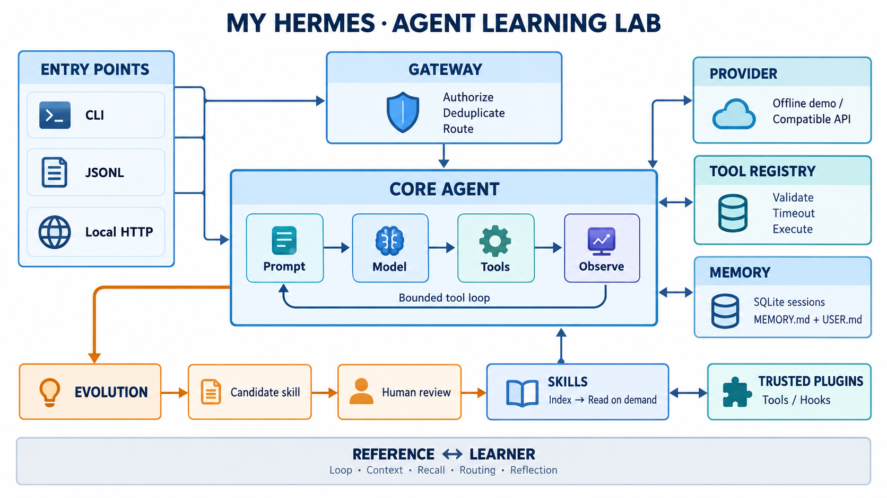

# my-hermes

一个以 [Hermes Agent](https://github.com/NousResearch/hermes-agent) 为主要参考的 TypeScript Agent 学习项目：外围框架可运行，核心算法留给学习者，完整参考实现可随时观察和对照。

包含 **Core、Gateway、连接器、短长期记忆、Skills、Plugin、自进化候选与审核**。需要 **Node.js 24+**；运行时仅用 Node 内置模块，默认离线，不需要模型密钥。



## 先跑起来

```bash
npm install
npm run build
npm run typecheck
npm test
npm run dev -- init
npm run check -- --all --mode reference
npm run dev -- chat --message '/calc (2+3)*4' --trace
npm run dev -- chat
```

计算示例会经过 Provider 协议、工具注册/校验、执行与 SQLite 持久化，结果为 `20`。默认 `DemoProvider` 是确定性离线模拟器，不是语言模型；支持 `/calc`、`/remember`、`/memory`、`/recall` 和 `/skill`。交互中 `/new` 开始新会话，`/quit` 退出。Node 的 `node:sqlite` 可能输出实验性 API 警告，这与应用错误不同。

开发入口通过 `tsx` 运行 TypeScript。构建后也可用 `node dist/cli.js init` 和 `node dist/cli.js chat`；`typescript`、`tsx` 等只属于开发依赖，运行构建产物不需要第三方运行时包。

## 自己实现核心

- `reference`：完整参考实现，先看系统如何运行。
- `learner`：调用 [exercises.ts](src/learning/exercises.ts) 中的练习；未完成会报出 `L1`～`L5` 并失败，不会自动回退到答案。

基础设施、参考算法与阶段验收均已提供。**有意留空的代码只有学习练习**。每个阶段可以独立调试，不要求先完成整个 Agent。

| 阶段 | 学习内容 | 自己实现 | 独立验收 |
| --- | --- | --- | --- |
| 1 | Core：模型、工具、观察、终止 | L1 `runLoop` | `npm run dev -- check --stage 1 --mode learner` |
| 2 | 短期上下文、长期记忆、历史召回 | L2 `compactHistory`、L3 `selectMemories` | `npm run dev -- check --stage 2 --mode learner` |
| 3 | Gateway：授权、隔离、幂等 | L4 `sessionKey` | `npm run dev -- check --stage 3 --mode learner` |
| 4 | Skills 与可信 Plugin | 添加自己的 Skill / Tool Plugin | `npm run dev -- check --stage 4 --mode learner` |
| 5 | 自进化：成功轨迹到技能候选 | L5 `reflect` | `npm run dev -- check --stage 5 --mode learner` |

`demo --stage N` 运行同一离线场景。完整 `learner` 聊天先需要 L1/L2/L4；历史召回使用 L3，自动反思使用 L5。详细契约、断点和失败案例见 [学习路径](docs/03-learning-path.md)。[reference.ts](src/learning/reference.ts) 是可选阅读的参考答案。

调试 TypeScript：

```bash
node --inspect-brk --import tsx src/cli.ts check --stage 1 --mode learner
```

随后用浏览器的 Node 调试器或 VS Code 附加调试器，在 `src/learning/exercises.ts` 设置断点。

## 记忆与扩展

```bash
npm run dev -- chat --message '/remember 我在学习 TypeScript Agent'
npm run dev -- chat --message '/memory'
npm run dev -- chat --session another --message '/recall TypeScript'
npm run dev -- skills list
npm run dev -- chat --message '/skill study-notes'
npm run dev -- chat --plugin ./examples/plugins/word-count.ts
```

长期记忆是按用户隔离的 `MEMORY.md` / `USER.md`，每文件默认 4000 字符，超限报错。`/remember` 是整篇替换演示；已有会话的系统提示保持快照，新会话读取更新后的记忆。短期上下文保留最近完整轮次；SQLite 保存成功轮次的完整消息与工具调用。本版采用子串召回与整轮裁剪，Hermes 的全文检索和模型摘要见 [参考映射](docs/02-hermes-reference.md)。

Skill 只提前注入名称/描述，正文通过工具按需读取。Plugin 是显式信任的 TypeScript / JavaScript 模块，导出 `register(context)` 注册工具与 Hook。离线 Demo 不自动选择任意插件工具；阶段 4 直接验收插件调用，真实模型可根据 schema 选择。插件不是沙箱，源文件修改后需重启进程。

## Gateway 与连接器

```bash
npm run dev -- gateway --connector jsonl --allow-user learner < examples/messages.jsonl
```

JSONL 每行一个事件，重复已完成事件返回 `cached: true`。本机 HTTP 连接器要求 Bearer Token 和用户白名单：

```bash
export MY_HERMES_GATEWAY_TOKEN='replace-with-a-local-token'
npm run dev -- gateway --connector http --allow-user learner --port 8765
```

消息协议、curl、授权和重试边界见 [Gateway 文档](docs/05-gateway.md)。目前提供 JSONL 与本机 HTTP；飞书、Telegram 等生产 IM 平台可按协议扩展，仓库未包含这些 SDK。

## 自进化闭环

```bash
npm run dev -- chat --mode reference --message '/calc 6*7' --auto-reflect
npm run dev -- evolve list
npm run dev -- evolve show PROPOSAL_ID
npm run dev -- evolve approve PROPOSAL_ID --name checked-calculation --description '经人工核对的计算流程'
npm run dev -- skills list
```

将 `PROPOSAL_ID` 替换为实际 ID。成功工具轨迹可生成流程候选，批准后才进入 Skill 索引。模型没有批准工具；基线反思是供人工改进的草稿，不修改源码或模型权重。

## 接入真实模型

```bash
npm run dev -- chat --provider compatible --base-url http://127.0.0.1:11434/v1 --model YOUR_MODEL
```

模型服务须支持 OpenAI-compatible Chat Completions 和 tool calling。远程服务凭证放在 `MY_HERMES_API_KEY` 或 `OPENAI_API_KEY` 环境变量中；URL 和模型名替换为实际值。示例不会自动启动模型服务。仓库验证使用离线与本机协议测试，在线模型和真实 IM 尚未联调。

## 目录与文档

```text
src/
  core/         Agent、模型协议、Provider、工具运行时
  memory/       node:sqlite 会话、Markdown 长期记忆
  gateway/      事件授权、会话隔离与去重
  connectors/   JSONL、本机 HTTP
  skills/       元数据索引、正文按需读取
  plugins/      显式工具与 Hook 扩展
  evolution/    候选存储、审核与 Skill 提升
  learning/     学习者练习与完整参考算法
  data/skills/  内置 Skill，构建时复制到 dist/data/
  cli.ts        运行、检查、调试和查看状态
  lab.ts        五个离线阶段验收场景
```

[文档导航](docs/README.md) · [架构](docs/01-architecture.md) · [Hermes 参考](docs/02-hermes-reference.md) · [学习路径](docs/03-learning-path.md) · [记忆与扩展](docs/04-memory-and-extensions.md) · [Gateway](docs/05-gateway.md) · [调试](docs/06-debugging.md)

运行数据默认存入 `.hermes-lab/`。用子命令的 `--home PATH` 或 `MY_HERMES_HOME` 隔离 profile；`config.json` 使用 `mode/provider/model/baseUrl/maxSteps/contextChars/turnTimeoutMs/autoReflect/plugins` 等配置，命令行优先。`check/demo` 也读取所选 profile 的 mode，但始终用临时数据和离线 Provider，不加载其插件。

`chat/gateway` 用 `.runtime.lock/` 目录锁独占 profile。正常退出释放锁；崩溃后需先确认旧进程已停止，再手动移除锁目录，详见 [恢复步骤](docs/05-gateway.md)。`sessions`、`history SESSION_ID`、`doctor` 可查看本地状态。

架构 PNG 由内置 imagegen 生成，位于 `docs/images/architecture.png`；[生成提示词](docs/images/architecture-prompt.txt) 一并保留。精确依赖与接口以可维护的 Mermaid 和源码为准。
