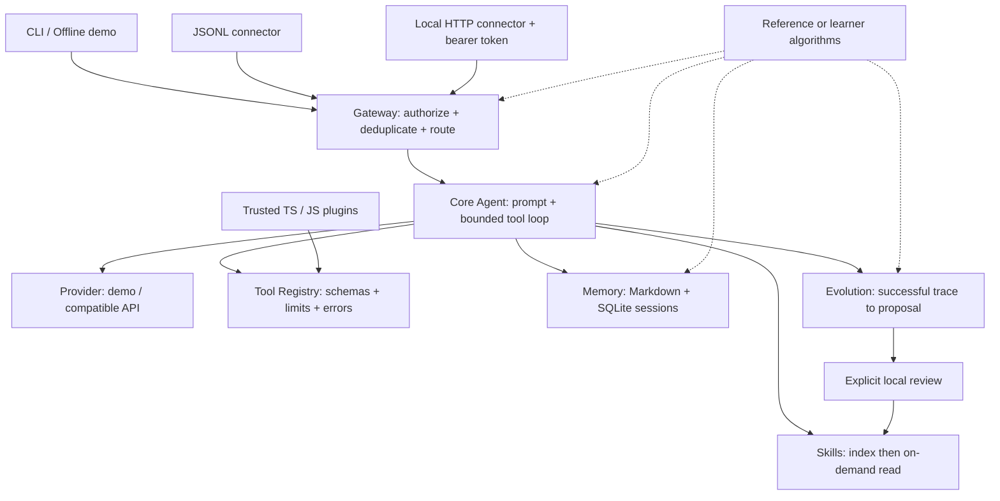

# 架构设计与稳定边界

这是以 Hermes 为主要参考的 TypeScript 教学重构，不复制上游实现，也不承诺功能或插件兼容。目标是让学习者能运行、单步调试并替换核心算法。需要 Node.js 24+；运行时只使用内置模块，包括 `node:sqlite`、`fetch`、`node:http` 和 `node:fs`。开发依赖负责 TypeScript 编译、类型检查与直接运行源码。

## 模块与依赖方向

入口依赖 Gateway，Gateway 依赖 Core，Core 使用协议、工具与记忆；Core 不依赖具体连接器。Skill 是知识文档，Plugin 是运行在当前进程中的可信代码。自进化产出候选 Skill，经本地显式批准后生效，不自动修改源码或权重。

## 关键决策

- `reference` 可直接运行；`learner` 调用 `src/learning/exercises.ts`，未完成抛出带 L1～L5 的异常，绝不暗中回退。
- 同一会话串行，不同会话可并发；路由包含 channel、conversation、user。稳定 event ID 用于已完成消息去重。
- SQLite 保存成功轮次的完整消息和工具配对；裁剪只改变下一次模型上下文，不覆盖历史。数据库通过 Node 内置 `node:sqlite` 访问，未引入外部数据库包。
- 按用户 scope 隔离有界 `MEMORY.md` 与 `USER.md`；新会话构建冻结快照，写入后通过工具可读到即时值，新会话才更新系统提示。
- Skills 只提前加载名称/描述，正文按需读。新会话刷新索引，使长驻 Gateway 能发现刚批准的 Skill；已有会话保留原快照。
- Plugin 只加载显式指定入口，统一注册工具和观察 Hook，拒绝覆盖已有工具。Node 动态 import 缓存模块，修改插件后需重启。
- 模型请求、工具执行、回合与步数均有预算。用户输入与单次模型文本最多 16,000 字符；单响应最多 8 个工具调用，每个参数对象序列化后最多 16,000 字符。拒绝 NaN/Infinity，避免非 JSON 数值进入历史。
- 工具结果默认最多 12,000 个序列化 JSON 字符，最小预算 200；超限保留合法成功/错误结构并标记 `truncated: true`。请求预算包含消息与工具 schema；长度按 JavaScript 的 `string.length` 计算，是教学近似，未实现模型专用 tokenizer。
- 默认 DemoProvider 用于断点与测试；真实模型通过 `fetch` 调用兼容 Chat Completions 的接口，不依赖特定厂商 SDK。
- `AbortSignal` 贯穿 Provider、工具和连接器。异步实现应响应取消；同步阻塞代码会阻塞事件循环，取消不能回滚已经完成的外部副作用。可信 Plugin 不属于安全沙箱。

本版不包含流式模型输出、分布式队列、向量数据库、生产 IM 平台 SDK、MCP 或操作系统隔离；这些可在稳定接口上继续扩展。

## TypeScript 接口

内部 `Message` 使用 camelCase：`role/content/toolCalls/toolCallId`，`ToolCall` 为 `id/name/arguments`，`ModelResponse` 为 `content/toolCalls`。`src/core/models.ts` 的 `toWireMessage/fromWireMessage` 负责转换 Chat Completions 的 `tool_calls/tool_call_id` 等字段，连接器不直接拼模型消息。

| 接口 | 契约 |
| --- | --- |
| `Provider.complete(messages, tools, signal?)` | 返回 `Promise<ModelResponse>`；支持取消与统一响应校验 |
| `ToolRegistry.schemas()` / `execute(call, signal?)` | 返回工具 schema / `Promise<Message>`；验参、限时、结构化错误 |
| `SessionStore(path)` | `getOrCreate`、`setSystemPrompt`、`loadMessages`、`appendMessages`、`search`、`listSessions`、`close` |
| `LongTermMemory(root, maxChars = 4000)` | `snapshot(scope)`、`read(scope, target)`、`write(scope, target, content)`；target 只允许两个记忆文件 |
| `SkillCatalog(roots)` | `discover()`、`index()`、`read(name)` |
| `PluginManager(registry)` | `await load(paths)`；context 提供 `registerTool` 和 `on`；`emit` 观察事件 |
| `EvolutionManager(root, skillsRoot)` | `propose`、`listProposals`、`approve`；提升只由本地 CLI 显式调用 |
| `Gateway.handle(message, signal?)` | 归一化事件 → 授权 → 会话串行 → Agent → 缓存回复 |

学习接口在 `src/learning/exercises.ts`：`runLoop`、`compactHistory`、`selectMemories`、`sessionKey`、`reflect`。消息大小与响应检查辅助函数位于 `core/models.ts`，共享异常位于 `core/errors.ts`。

## 数据流与故障

1. 连接器检查并归一化输入，Gateway 检查用户、event ID 与会话路由。
2. Agent 恢复完整历史和系统提示，读取记忆、技能索引，按预算选择上下文。
3. Provider 返回文本或工具调用；Registry 校验、执行、包装结果，循环直到最终文本或预算耗尽。
4. 成功轮次一次性追加到 SQLite；可选反思只生成待审核候选，其失败不撤销已保存答复。
5. Gateway 写入已完成回复，重复事件返回同一文本；冲突或失败以错误返回。

每个 profile 同时只由一个 chat/gateway 运行实例拥有。`.runtime.lock/owner.json` 记录 PID 和随机 token；正常退出核对所有权后释放目录，异常退出留下目录，由用户确认旧进程已停止后手动恢复。锁不自动回收陈旧 PID，也不提供分布式租约。

取消、超时或崩溃可能发生在工具副作用之后、成功缓存之前；重试仍可能重复外部操作。SQLite 和本地文件保证教学框架的可检查状态，不能据此宣称外部副作用 exactly-once。
