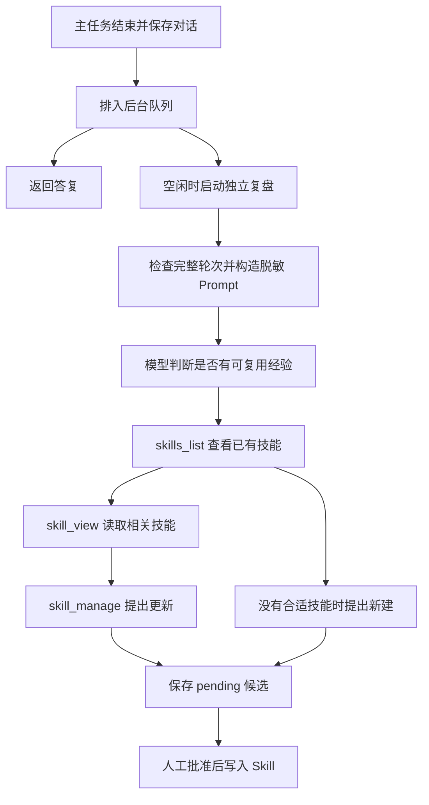
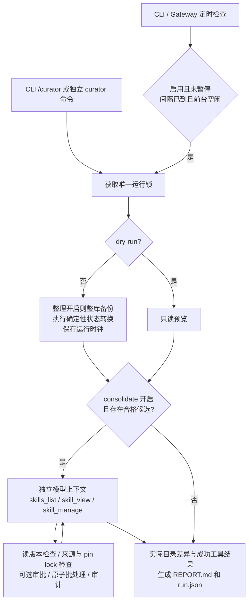
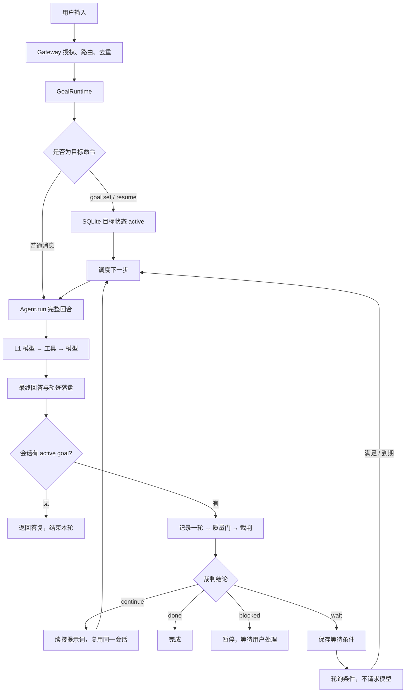

# 记忆、Skills、Plugin 与自进化

本篇介绍本项目接口。需要系统理解 Hermes 与本项目的对应关系时，先读 [记忆系统图解](09-memory-system-guide.md)；数据库表、索引和迁移清单见 [记忆存储参考](10-memory-storage-reference.md)。L3 的逐步调试、搜索与读取示例见 [历史检索教程](11-l3-history-retrieval.md)。

## 记忆的三个层次

- 短期上下文默认由选定的 L2 `compactHistory` 异步清理并摘要，`ContextCompressor` 提供运行环境，工作上下文和冷却状态单独持久化；关闭后使用辅助函数 `trimHistory` 整轮裁剪。两种方式都不删改原始记录，详见 [上下文压缩](08-context-compression.md)。
- 会话历史由 `node:sqlite` 存在 profile 的 `sessions.db` 中；成功轮次完整保留 assistant/tool 调用关系。按 scope 过滤后，使用 FTS5 默认 `unicode61` 词索引、`trigram` 子串索引或字面 LIKE 回退召回原文；`%`、`_` 按普通字符处理。FTS 是关键词倒排索引，没有 embedding 或向量检索。
- 长期记忆位于 `memory/<sha256(scope)>/MEMORY.md` 和 `USER.md`；每文件默认 4000 字符，临时文件写入后原子替换。超限报错，不静默截断，人工编辑同样受读取预算检查。

scope 由入口生成，模型不能替换。Gateway 使用 `[channel,userId]` 的规范 JSON，同渠道同用户跨会话共享长期记忆，不同渠道或用户隔离。`SessionStore.getOrCreate` 拒绝把已有 session key 迁移到另一个 scope。

`SessionStore` 提供 `getOrCreate`、`setSystemPrompt`、`loadMessages`、`appendMessages`、`search`、`searchCapabilities`、`readHistory`、`listSessions`、`close`。系统提示在新会话第一次运行时固定；记忆写入后，工具读取可见实时值，新会话才读取新快照。Node 24 的 `node:sqlite` 可能发出实验性 API 警告。

## 磁盘存储与历史召回

默认 profile 为项目目录下的 `.hermes-lab/`；`--home` 或 `MY_HERMES_HOME` 可指定其他位置。记忆不统一存成 JSONL：

| 文件 | 内容 |
| --- | --- |
| `sessions.db` | SQLite：`sessions` 保存会话与固定系统提示；`messages` 保存成功轮次原文与稳定 ID；两张 FTS 虚拟表按运行时能力建立关键词/子串索引，`history_search_meta` 记录索引版本和重建状态；`context_checkpoints` 保存默认链路的工作上下文与冷却状态；`summary_checkpoints` 保存可选检查点引擎的摘要、覆盖数与代际 |
| `memory/<sha256(scope)>/MEMORY.md`、`USER.md` | 精选事实、偏好及用户资料，独立于对话摘要 |
| `skills/<name>/SKILL.md` | 经审核的可复用流程；待审候选另存于 `proposals/*.json` |
| `traces.jsonl` | 启用 chat/gateway 的 `--trace` 后追加的诊断事件，不是完整会话或记忆数据库 |

JSONL 连接器则是按行传递输入事件和输出回复的协议，不承担记忆持久化。

L3 `selectMemories` 已在 learner 实现，运行链路是 `history_search → SessionStore.search → 所选模式的 selectMemories → 工具结果 → 下一次模型请求`。需要上下文时，模型再调用 `history_read`：

1. 入口绑定 scope，工具只接受 query，不能指定另一个用户或渠道。查询覆盖该 profile 中同 scope 的所有 session，包含当前会话。
2. SQLite 从完整 `messages` 表召回最多 20 条候选，不查询压缩摘要。英文等词项优先走 `messages_fts` 的词索引；足够长的中文片段走 `messages_fts_trigram`，短中文、路径、符号等走字面 LIKE。多词先要求全部命中，零命中后才放宽为任一词命中。索引不可用时保留字面回退，数据库锁、损坏等真实错误继续上报。用户输入不会作为 SQL 或 MATCH 操作符执行。
3. 工具另外合并当前轮已执行工具的原文，排除 `history_search` 与 `history_read` 自身结果，避免递归扩张。临时候选按完整 query 的字面子串匹配，较新的在前；它们可以补回本轮已经清理或摘要、尚未入库的输出，`source` 为 `live`，暂时没有持久 `messageId`。
4. L3 按去重后的查询词项覆盖数排序，忽略大小写；重复词不额外加分。词项同分时 live 优先；同一 FTS 来源内使用 BM25 `rank` 升序，数值越小越相关，负值也一样。不同来源的 rank 不直接比较，其余保持原序，不把兼容字段 `score` 当作统一相关度。用 `sessionId + messageId` 去重后最多返回 5 条，不按相同正文合并不同经历，不修改候选或原始分数。
5. 已持久命中包含 `sessionId`、`messageId`、`role`、`createdAt`、`source` 和原文；FTS 来源另带 `rank`。工具预算不足时只缩短正文预览，保留结构化字段，使用 `contentTruncated/originalContentChars` 标出省略。模型可拿锚点继续调用 `history_read`，不用从截断的字符串里猜 ID。
6. 空查询或无匹配返回空数组，数据库错误由工具框架包装成 `ok: false`，不会伪装成没有记录。FTS 与 trigram 都不自动把整句自然语言改写为语义检索；模型应挑选关键词，并通过原文窗口核对结果。

`history_read` 要求 `session_id`，最多选择一种锚点：`around_message_id` 读取周边窗口、`before_message_id` 读取更早页、`after_message_id` 读取更晚页。`limit` 默认 10，范围 1～50；返回消息始终按 ID 升序，并提供 `hasBefore/hasAfter`、`beforeCursor/afterCursor`。这是按稳定 ID 的 keyset 分页，不按数组下标或 SQL OFFSET 翻页；同一会话的消息 ID 可以不连续。

长正文可用 `around_message_id + limit: 1 + content_offset` 续读，`content_chars` 默认 2000、范围 1～6000。按响应中的 `nextContentOffset` 请求下一段；offset 按 JavaScript UTF-16 字符单位计数，不能切开代理对。窗口只返回历史数据，旧工具参数与 reasoning 不会作为新指令重放给模型；完整协议字段仍保留在数据库及 `readHistory` 库 API 中。目标会话必须属于当前 scope，锚点还必须属于该会话。

历史原文在模型主动调用工具后进入下一次请求。离线 Demo 的 `/recall 关键词` 演示搜索；`npm run learn:recall` 演示搜索、窗口与翻页，[L3 教程](11-l3-history-retrieval.md) 讲解具体断点。`npm run dev -- check --stage 2 --mode learner` 运行 26 项 L2/L3 验收；L4 路由已完成，可以直接使用 learner CLI 聊天。`tests/recall.test.ts` 保留原有压缩、重启与隔离回归，新增 `tests/history-search.test.ts`、`tests/l3-ranking.test.ts` 和 `tests/recall-upgrade.test.ts` 覆盖候选索引、排序和搜索后读取的链路。

## 长期记忆条目与整理

`memory` 工具用 `target: "memory"` 或 `"user"` 选择环境事实或用户偏好；文件路径仍由 scope 决定。`operations` 是同一目标的一批操作：`add(content)` 新增条目，`patch(old_text, content)` 替换唯一片段，`remove(old_text)` 删除唯一匹配的整条记录。条目以单独一行 `§` 分隔，精确重复的新增不会挤占容量。

存储层先在内存中演算整批操作，最后检查总容量，再原子写入一次。定位歧义、缺少条目或最终超容量时，整个批次不写入；错误提供当前条目、容量和需要腾出的空间，让模型把合并旧事实与新增事实放到同一批重试。它不自动丢弃仍有效的事实，也不声称通过文本匹配解决事实冲突。

压缩前的可选记忆整理只开放 `memory` 工具，最多两次模型请求；保存稳定偏好、项目约定和环境事实，跳过凭证、原始日志、临时状态与整段推理。摘要用于接续当前任务，不能整篇灌入长期记忆。记忆工具写入是已经发生的副作用，后续主任务失败或取消不保证撤销；SQLite 成功轮次与压缩工作上下文则仍按事务规则提交。详见 [上下文压缩](08-context-compression.md#压缩前整理长期记忆)。

`memory_read` / `memory_write` 保留兼容；Demo 的 `/remember` 仍演示整篇替换。工具读取能立即看到新值，当前会话的 system 快照保持冻结，新会话才注入新值。

## Skill 渐进加载

`SkillCatalog(roots)` 扫描下一层 `*/SKILL.md`，支持单行 frontmatter；`discover()` 刷新、`index()` 返回名称/描述、`read(name)` 按需读正文。单文件上限 32000 字节，重复名称、软链目录和越界路径会被拒绝。

```markdown
---
name: my-study-notes
description: 将学习材料整理为概念、例子和自测题。
---

# 学习流程

1. 说明适用场景。
2. 按步骤处理材料。
3. 用一个案例验证结果。
```

内置技能在 `src/data/skills/`，构建时复制到 `dist/data/`；个人技能放 profile 的 `skills/`。新会话刷新目录，发现刚批准的内容；已有会话保留原系统提示。Skill 是知识输入，阅读它不会自动执行其中脚本，也不会安装 Plugin。

## Plugin 显式加载

插件是可信 TypeScript / JavaScript 模块。`await new PluginManager(registry).load(paths)` 只加载显式入口；模块导出 `register(context)`，可同步完成或返回 Promise。context 提供 `registerTool(tool)` 和 `on(event, handler)`。

工具使用统一 Registry：`name/description/parameters/handler`，handler 接收 `(args, { signal })`。schema 使用本版支持的 JSON Schema 子集，参数先校验再执行；异步操作应使用 signal。观察 Hook 必须同步，收到独立 payload；错误被隔离，不能改变已保存答复。事件适合观察与统计，不承担必须成功的业务写入。

```sh
npm run dev -- chat --plugin ./examples/plugins/word-count.ts
```

配置文件的 `plugins` 数组以 profile 目录为相对基准；命令行 `--plugin` 相对当前目录。tsx 开发入口可加载 `.ts` 示例；运行构建产物时使用编译后的 `.js` 插件。

Node 使用稳定文件 URL 缓存 ESM 模块，同一路径不会每轮重新执行顶层代码。每个新 Registry 仍调用 register，获得独立注册上下文；注册失败不提交半套工具和 Hook。修改插件源码或修复顶层 import 失败后需重启进程，不通过不断变更 URL 来绕过缓存。

Plugin 拥有当前 Node 进程权限，这些注册接口不是沙箱。同步阻塞会阻塞事件循环，AbortSignal 不能中断任意同步代码；不要把不可信下载模块直接放入 plugins。

## 自进化闭环

开启 `--auto-reflect` 后，learner 会在答复持久化后排入后台复盘队列。`Agent.run()` 不再等待模型复盘；下一轮事件循环才启动后台请求，Gateway 的答复缓存先完成。reference 保留旧的规则模板作教学对照，但也使用这套后台调度。默认不开启自动复盘。



### 从什么内容学习

`reviewableTurn` 只检查结构完整性：user 开始、assistant 最终答复结束，工具调用 ID 唯一且结果完整配对，工具结果是带布尔 `ok` 的合法 JSON。失败结果不再被一律丢弃，无工具的用户纠正也能进入模型复盘。

模型看到当前轮次和可选的上一轮用户/助手摘录，因此可以理解“以后先给代码”等反馈针对什么回答。普通闲聊、没有新经验、只有失败而没有依据支持修复时可以返回 null。Prompt 要求区分失败尝试和已验证修复，不把失败路径当作最佳实践；判断质量仍取决于模型和人工审核。

原始工具参数、成功结果正文、原对话的思考内容不直接发送；调用 ID 改为序号，失败结果保留脱敏的错误摘录。用户/助手文本会做常见凭证脱敏与长度限制，但可能复述私人数据，因此不是完整匿名化。复盘模型自身产生的 `reasoningContent` 只用于后续请求的协议接续，不进入候选或原始会话。

### 优先改进已有 Skill

复盘使用独立注册表，只包含三个工具：

| 工具 | 作用 |
| --- | --- |
| `skills_list` | 列出当前 profile 的技能；新建前必须先查询 |
| `skill_view` | 重新读取某个技能的完整内容，内部记住 SHA-256 版本 |
| `skill_manage` | `create` 返回新候选正文；`update` 返回目标名、整合后的正文和读取版本 |

模型优先检查当前任务使用过的技能，其次查找同类技能，再考虑新建。更新必须在前一次模型请求中已经读取目标；同一响应同时声明读取和更新会被拒绝，因为模型尚未观察读取结果。过大的技能不能把截断正文当作完整读取。复盘不开放终端、长期记忆写入或批准工具。

`reflect` 返回 `string | SkillUpdate | null`：字符串表示新建候选，`SkillUpdate` 表示更新，null 表示跳过。工具执行期间只在内存中暂存建议；只有完整复盘完成且未取消，Agent 才调用 `EvolutionManager.propose()` 落盘。

新建与更新都写到 `proposals/<id>.json`，先处于 pending 状态。更新候选另外保存 `skillName`、`baseHash` 和 `previousContent`，可用 `evolve show ID` 对照旧内容和建议正文。创建候选时与批准时都会重读目标校验版本，检测到人工修改或其他更新就报冲突，保留 pending，要求重新复盘。批准更新保留原 frontmatter，并更新来源信息；只操作当前 profile 下的技能，不修改内置或外部目录。

```sh
# 首次运行产生新建候选，答复先打印，正常退出前等待后台候选落盘。
npm run dev -- chat --provider demo --mode learner --message '/calc 6*7' --auto-reflect
npm run dev -- evolve list
npm run dev -- evolve show NEW_ID
npm run dev -- evolve approve NEW_ID --name verified-calculation --description '核验计算流程'

# 再运行同类任务，离线模型会读取已有技能并提出更新。
npm run dev -- chat --provider demo --mode learner --message '/calc 7*8' --auto-reflect
npm run dev -- evolve list
npm run dev -- evolve show UPDATE_ID
npm run dev -- evolve approve UPDATE_ID
```

替换示例中的 ID 后执行。新建仍需指定名称和描述，重名时不会覆盖；更新直接使用候选绑定的名称，不能改名。新会话会刷新技能索引，已有会话的 system 保持冻结。

### 调度、预算与退出

每个 Agent 最多同时复盘一个会话，待执行队列最多 32 个会话；同会话的新任务替换未开始的旧复盘，容量不足时丢弃最旧的待执行任务。任何新的前台任务开始时都会取消正在执行的复盘，优先服务用户。后台失败不回滚已保存答复；队列为尽力执行，不跨进程持久化。

默认整个复盘最多 5 次模型请求、总超时 10 秒，每次请求最多 12000 字符（包括工具 schema），候选最多 6000 字符。输入摘录可缩短，调用链和 JSON 结构保持完整；技能读取后的累计上下文若超限，就停止复盘。工具错误可以在剩余步数内纠正；Provider 错误或超时不自动重试。`AgentOptions.reflection` 可调整 `timeoutMs`、`maxInputChars`、`maxSteps`，CLI 当前使用默认预算。

后台使用独立取消信号；新前台任务或 `Agent.close()` 会取消它，迟到响应不能写候选。库调用方可用 `await agent.waitForReflections()` 等待已有后台任务结束，在关闭 SQLite 前调用 `agent.close()`。CLI 单次聊天和 JSONL 正常结束时，会先输出答复再等待剩余复盘；中断或 HTTP 服务关闭时取消后台任务。`--trace` 可观察 `evolution.started/proposed/skipped/cancelled/error`，错误事件只记录类型。

### 与 Hermes 的对应和差距

本机 Hermes 的 `agent/background_review.py` 和 `agent/turn_finalizer.py` 同样支持任务后的后台复盘、用户纠正、失败修复经验、优先更新已有技能和更新前读取。本项目独立实现这些机制，没有引用上游代码。

L5 仍然先生成待审候选。下面的 Curator 是独立的整库维护链路：包含统计、自动状态转换、完整技能包操作、模型整理、可选审批、备份和审计撤销。两者可以共同使用同一个技能库，但触发条件和写入策略不同。Skill 是程序性知识，不修改模型权重或项目源码，也不代表已经通过效果评测。

## 调试建议

1. 在 `SessionStore.appendMessages` 检查调用 ID 与结果配对。
2. 修改 USER.md，对比旧会话和新会话的系统提示。
3. 在 `SkillCatalog.read` 确认正文按需载入。
4. 让插件重复注册工具，观察初始化直接报错。
5. 对比待审和批准后的索引，确认模型没有批准接口。

运行 `npm test` 验证持久化、隔离、路径边界、扩展注册和审核；`npm run dev -- check --stage 4` / `--stage 5 --mode learner` 可单独检查扩展与自进化闭环。`tests/learner-reflection.test.ts` 覆盖输入预算与异常边界；`tests/evolution-review.test.ts` 覆盖后台优先级、纠正学习、读取后更新和过期版本冲突；CLI 与集成测试验证新建、更新和批准后的新会话。

构建时还会将示例插件编译到 `dist/examples/plugins/word-count.js`，可直接供编译后的 CLI 加载。使用已安装 npm 包时，选择这个 JavaScript 入口；Node 不会对 `node_modules` 内的 TypeScript 文件执行内置类型擦除。仓库开发流程仍使用 `examples/plugins/word-count.ts`。

## Curator：整库维护

对照版本是本机 `/Users/bill/code/hermes-agent` 的提交 `29a61cb7ab509cda0c376bf3860edb87210b0755`。实现与 prompt 用 TypeScript 独立编写；对应上游 `agent/curator.py`、`agent/curator_backup.py`、`tools/skill_usage.py`、`tools/skill_ledger.py`、`tools/skill_manager_tool.py`、`tools/skill_manager_batch.py` 和 `tools/skill_manager_guards.py`。

L5 研究“这一轮任务有什么经验值得留下”；Curator 研究“整个技能库有没有长期闲置的技能，许多零碎技能能不能整理成更容易找到的领域指南”。它没有调用 L5 的 `reflect()`，也不会在自己执行结束后递归触发复盘。



### 先从这几个入口读

1. [`curator.ts`](../src/curator/curator.ts)：`due()` → `run()` → `transitions()` → `modelReview()`，看“什么时候维护”和“两阶段执行”。
2. [`prompt.ts`](../src/curator/prompt.ts)：模型整理指令及 dry-run 附加约束。不是只让模型判断相似度，而是要求建立领域级 umbrella、提炼规则、保留有价值的细节、检查整个技能包并重写相对引用。
3. [`tools.ts`](../src/curator/tools.ts)：读取记录、先读后写、审批和批量工具。读结果必须在更早的模型步骤中得到；同一条模型回复里先 read 再 patch 不算已经观察到结果。
4. [`repository.ts`](../src/curator/repository.ts)：技能来源、usage、pin/lock、完整包读写、归档恢复和批处理事务。
5. [`backup.ts`](../src/curator/backup.ts)、[`ledger.ts`](../src/curator/ledger.ts)：整库回滚与单次操作撤销分别解决什么问题。
6. [`tests/curator.test.ts`](../tests/curator.test.ts)：先看模型真正合并两个技能的测试，再看失败和恢复测试。所有测试都用临时 profile 和离线 provider。

### 调度与状态转换

默认配置和本机 Hermes 对齐：

```json
{
  "curator": {
    "enabled": true,
    "interval_hours": 168,
    "min_idle_hours": 2,
    "stale_after_days": 14,
    "archive_after_days": 30,
    "consolidate": false,
    "prune_builtins": false,
    "archive_ttl_days": 0,
    "backup": { "enabled": true, "keep": 2 }
  },
  "skills": {
    "ledger": true,
    "ledger_max_bytes": 5242880,
    "write_approval": false,
    "disabled": [],
    "external_dirs": []
  },
  "auxiliary": {
    "curator": { "provider": "kimi", "model": "your-curator-model", "baseUrl": "https://api.moonshot.cn/v1" }
  }
}
```

`auxiliary.curator` 是可选的；省略时沿用主 provider。这里只展示路由形状，模型名称与地址应填自己的实际配置。Curator 默认启用的是确定性维护，`consolidate` 默认关闭，所以不会仅因启用 Curator 就自动付费调用模型。

交互式 CLI 启动时像 Hermes 一样额外做一次后台检查，并把启动阶段视作空闲；Gateway 的首次定时检查在 90 秒后，之后每小时检查一次。自动维护用独立工作进程执行，整库扫描和备份不会占住聊天进程的事件循环。前台正在处理请求时不启动；最后一个请求结束后重新计算空闲时间。首次没有 `last_run_at` 时只记录当前时间，等待完整的 168 小时间隔。程序退出后计时器停止；状态留在磁盘，下次启动继续判断。`curator run` 是手动立即执行，绕过自动间隔和暂停门槛。

生命周期按最近的 `last_used_at`、`last_viewed_at`、`last_patched_at` 三者最大值计算；没有活动则看 `created_at`。超过 14 天标记 stale，超过 30 天将整个目录移动到 `.archive`；恢复活动的 stale 技能重新变 active。最近创建、从未使用的技能不会被当成过期。首次看到内置技能时先锚定时间，不能把缺少统计当作“从 epoch 起就没用”。

### 管理资格和保护

| 条件 | 自动状态转换 | 模型合并/改写 |
| --- | --- | --- |
| 本地 `created_by: agent` | 允许 | 允许 |
| 本地 `learn` 或无管理标记 | 不处理；可 `adopt` | 不处理 |
| bundled 内置 | 仅 `prune_builtins: true` 可归档 | 不改写 |
| hub installed / external_dirs | 不处理 | 不改写 |
| pinned | 跳过 | 跳过；普通前台修改仍可进行 |
| locked | 跳过 | 拒绝所有 agent 修改；L5 批准也检查 |
| cron 引用，包括暂停任务 | 不按闲置归档 | 只能吸收到仍存在的目标，并迁移引用 |
| disabled | 仍按维护资格判断确定性生命周期 | 不作为整理候选，不允许读取或改写 |

`created_by: agent` 表示用户同意交给 Curator 管理，不是可靠的作者身份证明；`adopt` 会写这个标记。已有旧技能不会凭空获得管理资格。L5 新批准的自动经验技能会记录管理标记；旧技能可先列出来再采用 `adopt`。

内置技能首次使用时镜像到 profile，归档只作用于镜像。`.curator_suppressed.json` 防止已经归档的内置技能在下次启动时重新出现。不会移动源码里的 `src/data/skills`。支持嵌套分类目录；归档和恢复以 frontmatter 中的技能名识别，恢复到平铺目录。

### 模型循环和异常

模型只拿到三个技能工具，使用独立消息数组；没有 terminal、memory 工具，也不注入主会话历史。最大迭代 9999 次，支持上下文压缩，保留 provider 要求的 `reasoningContent`。每次模型请求单独有超时，可以由进程关闭信号终止。

`skill_manage` 接受 `operations` 数组，兼容单操作的 `action/name` 写法。最多 20 项；创建、patch、写支持文件、删支持文件可以跨多个技能原子执行。一项失败，涉及的技能文件和 usage 恢复；不留下声称成功的批次审计。同一文件不允许前面改了后面又全量覆盖；连续的局部 patch 可以组合。`delete` 必须独占一批，并提供已存在且已读取的 `absorbed_into`；此处实际执行归档，彻底删除只在显式 `purge` 中发生。

既有文件必须先完整读取，且写入时哈希仍一致。支持 `references/`、`templates/`、`scripts/`、`assets/` 等包内文件，保留二进制和执行权限。`write_file` 的正文键为 `file_content`，`patch` 使用 `old_string/new_string` 或完整 `content`。每种操作的失败都作为工具错误返给模型，让模型修正。相同参数失败 2 次警告、5 次后拒绝重放；同一工具连续失败累计 8 次终止；重复只读结果也检测无进展，避免烧完迭代预算。

运行时钟在模型阶段之前落盘。模型超时、网络失败、循环保护触发或取消时，已完成的变更保留并记录到报告，报告带 `error`，CLI 返回失败；不会声称整轮成功，也不会立刻因未记录运行时间而重跑。报告的合并关系来自实际归档结果和 `absorbed_into`，不凭模型最后一段文字认定成功。

`skills.write_approval: true` 会把完整操作和读版本写进 `.pending`。批准时重新检查 pin/lock、来源和文件版本，过期审批不能覆盖新内容。待审操作未修改线上技能，模型也被明确告知不能假设它已经生效。L5 自己的 proposal 审核流程保持独立。

### 数据落在哪里

```text
<home>/
  skills/
    <skill>/SKILL.md + references/ + scripts/ + templates/ + assets/
    .usage.json                    # 每个技能的活动统计、管理标记、pin、lock、状态
    .curator_state                 # 调度时钟、暂停、运行次数、最后摘要与报告路径
    .bundled_manifest              # 本项目的内置镜像清单
    .curator_suppressed.json       # 被归档内置技能的抑制清单
    .archive/<skill-or-version>/   # 整包归档
    .curator_backups/<id>/
      skills.tar.gz + manifest.json
    .curator_ledger.jsonl          # 每次实际修改的 actor、前后文件哈希、关联关系
    .pending/<id>.json            # 可选写入审批
    .locks/                       # 所有权 token / PID 的进程间操作锁
  .curator_backups/blobs/<sha256>  # 审计引用的原始字节
  logs/curator/<id>/run.json + REPORT.md
  cron/jobs.json                  # 若存在，读取和迁移任务的 skill/skills 引用
```

这里没有新增 SQLite 表；Curator 管理的是技能文件资产。对话历史仍在 `sessions.db`，长期事实仍在 memory 文件中。

整库备份默认保留 2 份。只有启用模型整理的正式运行才做前置整库备份；单纯归档本身已经可恢复。备份失败与上游一样会记警告，不能悄悄禁用整个 Curator。归档、hub、审计、锁、缓存及 Git 数据不进入整库快照；回滚也保留这些被排除的数据。整库回滚先验证压缩包与路径，再创建安全快照，失败会恢复回滚前内容。cron 只恢复仍存在任务的技能引用，不复活已删除的任务，不覆盖 prompt、调度等其他字段。

审计记录使用 SHA-256 blob 保存前后文件字节；一般审计写入失败只记录警告，正常修改继续。单条撤销要求安全记录成功，缺失 blob 或关闭 ledger 时拒绝执行。大小默认 5 MiB；压缩相同文件条目、裁去最老记录，保留最新记录，并清理超过一小时且无人引用的 blob。`ledger_max_bytes: 0` 表示不限大小。配套文件已经迁走时，归档/清除审计会从最近整库备份补齐缺项，避免单条撤销恢复出不完整的包。

### 可以直接运行的命令

```bash
# 查看状态、所有来源的统计、尚未交给 Curator 的旧技能
npm run dev -- curator status
npm run dev -- curator usage --sort recent
npm run dev -- curator list-unmanaged
npm run dev -- curator adopt my-skill

# 确定性维护、模型预览、正式模型整理、独立后台进程
npm run dev -- curator run
npm run dev -- curator run --dry-run --consolidate
npm run dev -- curator run --consolidate
npm run dev -- curator run --consolidate --background

# 保护、暂停与恢复
npm run dev -- curator pin my-skill
npm run dev -- curator lock my-skill
npm run dev -- curator unlock my-skill
npm run dev -- curator pause
npm run dev -- curator resume

# 归档与显式清除（默认 TTL=0，永不自动删除）
npm run dev -- curator prune --days 30 --dry-run
npm run dev -- curator prune --days 30 --yes
npm run dev -- curator list-archived
npm run dev -- curator restore my-skill
npm run dev -- curator purge --days 90 --dry-run

# 两种恢复：整库快照 / 单条变更
npm run dev -- curator backup
npm run dev -- curator backups
npm run dev -- curator rollback SNAPSHOT_ID
npm run dev -- curator ledger --limit 20
npm run dev -- curator undo LEDGER_ID

# 可选审批
npm run dev -- curator pending
npm run dev -- curator approve PENDING_ID
npm run dev -- curator reject PENDING_ID
```

所有命令可加 `--home PATH`。聊天 CLI 支持 `/curator status`、`/curator run --dry-run --consolidate` 等相同命令；`--background` 使用独立 CLI。demo provider 会验证链路并说明未做语义合并，真实语义整理需要配置 Kimi 或 compatible provider。离线测试使用脚本化 provider 验证实际合并和失败恢复，没有调用付费接口。

### 明确的适配边界

这版保留上述核心维护机制，但不是 Python Hermes 的二进制或平台兼容移植：

- 原项目目前只有 CLI、JSONL 和 HTTP 入口；空闲维护接入它们的运行进程。没有移植 Telegram/Discord/Web UI 或 Hermes 的完整 cron 执行器。`cron/jobs.json` 引用保护和迁移是真实文件操作，可独立验证，不会伪造定时任务已经在执行。
- JSON 配置、内置 manifest、报告和锁格式属于本项目，不能把两套 profile 直接互换。模型路由覆盖现有 demo/Kimi/compatible 能力；没有移植 Hermes 的 credential pool、ACP 或专用 provider 家族。
- dry-run 在工具层禁止写入，也禁止读取产生 usage 计数，保证预览不改变维护时钟；本机上游的通用 `skill_view` wrapper 会更新 view/use，这里把预览隔离做得更严格。
- PID 锁只回收确认死亡的进程，避免上游按一小时陈旧时间抢占仍在执行的长整理。后台 CLI 用独立进程，退出原终端命令后仍可完成；运行中断后保存的状态和审计可查看，但不会从半轮模型上下文继续执行。
- 工具沿用项目的有界消息协议、技能 frontmatter 格式和文件预算。备份总大小上限 256 MiB；超限会明确报错，不截断文件。本次没有迁移上游完整 YAML frontmatter、市场安装系统和任意 shell 执行。

这些边界不影响学习 Curator 的核心链路。下面的 Persistent Goals 是“跨多个主任务回合推进目标”的外层控制器，已独立接入，不属于 Curator。

## Persistent Goals：跨回合推进目标

这是对本机 Hermes `hermes_cli/goals.py` 以及 `cli_loops_mixin.py` 调度逻辑的独立 TypeScript 实现，prompt 也重新编写。核心结构相同：显式设定会话目标，完成一个主任务回合后先验收，再决定是否继续。它不会给所有聊天默认开启目标模式。

### 两层循环和触发点



`Agent.run` 是一次完整的用户回合，内部 L1 可以连续调用多次模型、工具。`maxSteps` 限制这层内部步数；`max_turns` 限制 Goals 自动推进的完整回合数，默认 20。有活动目标时，真实用户回合和自动续接回合都会计数；命令、状态查询和等待轮询不计数。在 WAIT 条件仍成立时，插入的普通聊天也不消耗目标轮数。

答案先持久化并返回，后台再开始判定。自动续接复用会话键、scope 和原有 `Agent.run`，因此历史、记忆、压缩和工具注册仍走现有链路。它没有伪造一个 Gateway 入站事件。真实用户输入优先于下一次自动续接；同会话主任务串行执行，用户输入可以打断正在等待结果的裁判。

### 先跑起来，再读代码

```bash
# 离线例子：真实走 calculator 工具，然后裁判判 done。
npm run dev -- goal set '/calc (2+3)*4' --max-turns 3 --provider demo --mode reference --home /tmp/my-hermes-goals-study
npm run dev -- goal status --home /tmp/my-hermes-goals-study

# 交互模式：可随时输入下表中的 /goal 和 /subgoal 命令。
npm run dev -- chat --provider demo --mode reference --home /tmp/my-hermes-goals-study
```

Demo 只用固定规则验证计算目标；其他通用目标会明确暂停。实际任务要配置 Kimi/compatible 模型，并确保 Agent 已注册完成任务需要的工具。Goals 不会自动增加文件、终端或外部服务能力。

| 交互命令 | 行为 |
| --- | --- |
| `/goal set 目标` 或 `/goal 目标` | 设置并立即推进当前会话的目标 |
| `/goal set --turns 8 目标` | 设置本次目标预算；独立 CLI 用 `goal set TEXT --max-turns 8` |
| `/goal status`、`/goal show`、`/goal` | 只读状态，不启动、取消或重置目标 |
| `/goal history` | 读取当前会话已持久化的消息，包括自动续接回合 |
| `/goal pause`、`/goal resume` | 暂停；恢复会重新给予 `max_turns` 轮预算，并清零裁判连续故障计数 |
| `/goal clear` | 标记 cleared，保留历史，不再自动推进 |
| `/goal budget 10` | 修改目标最大轮数；不会自动恢复已暂停目标 |
| `/goal draft 目标` | 辅助模型生成完成合同，然后设置并开始目标；草拟失败则带提示使用原始目标 |
| `/subgoal 一个验收点`、`/subgoal remove 1`、`/subgoal clear` | 维护子目标列表；`/subgoal` 只读 |
| `/goal wait 60`、`/goal wait pid 12345`、`/goal unwait` | 时间等待、观察进程退出、解除等待 |
| `/goal gate add npm test`、`/goal gate list`、`/goal gate remove 1` | 配置本地 shell 质量门，`/goal gate clear` 清空 |

目标以命令关键字开头时，用 `/goal -- 原始目标` 避免被解析成控制命令。独立 CLI 的 `goal` 子命令对应 `/goal`；子目标可在聊天内输入，也可用 `chat --message '/subgoal ...'`。

### 裁判、prompt 和失败处理

续接 prompt 放在 [prompts.ts](../src/goals/prompts.ts)：包含目标、完成合同、子目标，以及要求下一步采取具体行动、提供证据、遇到阻塞明确说明的指令。它是同一会话中的下一条工作输入，先前对话仍可见。

完成合同字段为 `outcome`（交付物）、`verification`（验证方法）、`constraints`（限制）、`boundaries`（范围）、`stop_when`（停止条件）。可以在目标后用独立的 `字段: 内容` 行填写，也可通过 draft 生成。CLI 参数可携带实际换行，例如：

```bash
npm run dev -- goal set $'整理说明\nverify: 列出运行命令\nboundaries: 只使用已有信息'
```

子目标补充验收清单，不是另开多个 Agent。

裁判使用独立、无工具的请求，输入包含目标前 2000 字符、最新回答前 4000 字符，以及合同、子目标、可观测的后台任务和委派数量。输出 JSON `verdict/reason`，WAIT 另带等待对象。它只基于所给证据判断；硬性验证应使用质量门。默认请求超时 30 秒、输出预算 4096 token，可独立配置 `auxiliary.goal_judge`。

| 结果 | 后续动作 |
| --- | --- |
| `continue` | 未达预算则生成续接输入，否则暂停 |
| `done` | 标记完成；最后一个预算回合也可以判完成 |
| `blocked` | 暂停并记录原因，不冒充完成 |
| `wait` | 保存可观测的 PID/session 或明确时间条件，保持 active |
| 无效 JSON | 本轮按 continue 处理；连续 3 次暂停 |
| 请求失败或超时 | 本轮按 continue 处理；连续 5 次暂停；只保存错误类别 |
| 用户取消 | 停止等待，不计成裁判故障，也不发布迟到结果 |

两个故障计数分别维护，不同结果会重置不对应的连续计数。WAIT 每 5 秒检查一次条件，不反复请求裁判。PID/session 等待最多 30 分钟；时间等待使用指定截止时间，委派数量下降也可提前唤醒。唤醒后先查剩余轮数，预算耗尽会暂停。

质量门先于裁判运行，全部通过才判断是否完成。失败时跳过模型裁判，把命令、退出码和最多 3000 字符输出尾部带给下一轮修复；默认每条命令超时 300 秒、允许 3 次修复重试（第 4 次失败暂停），预算耗尽也暂停。命令固定使用注册时的工作目录，超时/取消会终止进程组。只有本地用户显式添加的命令可执行，模型不能添加；HTTP/JSONL 不接受 shell 质量门注册，也不执行从本地带来的门。

配置片段（合入已有 `config.json`，不含凭证）：

```json
{
  "goals": { "max_turns": 20, "judge_timeout_ms": 30000, "poll_interval_ms": 5000 },
  "auxiliary": { "goal_judge": { "provider": "kimi", "max_tokens": 4096 } }
}
```

省略辅助路由时沿用主 provider/model；可以指定 `model`、`baseUrl`。管理命令延迟初始化模型，因此查看状态不要求 API key。

### SQLite 状态与重启

一会话一个当前目标，保存在 `sessions.db` 的 `state_meta`，键为 `goal:<sessionId>`，值是 JSON；成功任务轨迹仍在 `messages`。没有另写 Goals JSONL。`status` 表达 active/paused/done/cleared；本项目另加 `phase` 作为恢复游标：

| phase | 含义与恢复行为 |
| --- | --- |
| `run` | 下一次可以调用主 Agent |
| `running` | 已记录调用前消息水位，主回合可能正在执行 |
| `judge` | 完整回答已落盘并计数，等待验收 |
| `waiting` | 等待外部条件，暂不执行主 Agent |
| `idle` | 目标已暂停、完成或清除 |

写入用 revision + SQLite 条件更新（CAS）。裁判 await 期间如果用户暂停、替换目标或修改验收条件，旧结果无法覆盖新状态。消息 ID 水位保证同一完整回合只计一次；execution_id 区分暂停/恢复前后的执行。SQL 与索引见 [存储参考](10-memory-storage-reference.md#66-目标状态的键值表与条件更新)。

交互 CLI 只恢复当前选定会话；Gateway 只恢复当前授权范围内的非 CLI 会话。若退出发生在回答提交之后，恢复时只补验收；若半轮没有提交，暂停并要求检查已有工具副作用后显式恢复，不自动重放。`goal status` 等独立管理命令不会偷偷启动旧目标。

持久化保留的是状态，进程退出后没有独立守护进程继续工作。单次 CLI 和 JSONL EOF 会等待当前可执行工作，遇到 WAIT 就落盘退出；要持续观察等待条件，使用交互 CLI 或长驻 Gateway。JSONL 自动答复以 `goal.answer/goal.decision/goal.error` 事件输出，附带会话身份；HTTP 当前通过同会话 `/goal status`、`/goal history` 查询进度，没有主动推送协议。

### 学习入口与适配边界

按这个顺序读，相关衔接处有中文注释：

1. [commands.ts](../src/goals/commands.ts)：用户什么时候开启目标模式。
2. [types.ts](../src/goals/types.ts)、[manager.ts](../src/goals/manager.ts)：状态、预算、门、裁判、错误处理和 CAS。
3. [runtime.ts](../src/goals/runtime.ts)：完整回合外层调度、用户优先、取消和恢复。
4. [prompts.ts](../src/goals/prompts.ts)、[provider.ts](../src/goals/provider.ts)：续接 prompt、裁判输入和模型路由。
5. [cli.ts](../src/cli.ts)、[Agent](../src/core/agent.ts)：入口接线、落盘边界及 L5 独立触发。
6. [状态机测试](../tests/goals.test.ts)、[CLI/JSONL 测试](../tests/goals-cli.test.ts)：继续→完成、异常、暂停、WAIT、抢占、重启、真实工具回合。

与 Hermes 对齐的是上述目标控制机制，不是全部平台基础设施。本项目目前没有 Hermes 的后台终端 session 注册表及委派调度器：时间等待和 PID 等待可直接使用；session 等待、后台任务列表和委派唤醒由 `GoalEnvironment` 注入真实观测能力，默认拒绝未知 session，不伪造任务已经存在。现有 CLI、JSONL、HTTP 已接入；平台消息推送仍需对应连接器。
