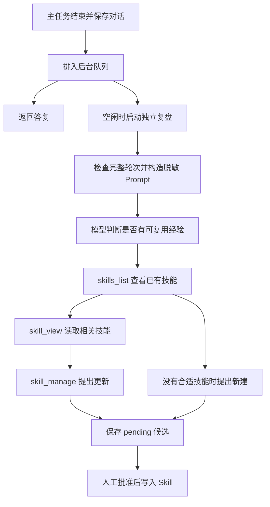

# 记忆、Skills、Plugin 与自进化

本篇介绍本项目接口。需要系统理解 Hermes 与本项目的对应关系时，先读 [记忆系统图解](09-memory-system-guide.md)；数据库表、索引和迁移清单见 [记忆存储参考](10-memory-storage-reference.md)。L3 的逐步调试、搜索与读取示例见 [历史检索教程](11-l3-history-retrieval.md)。

## 记忆的三个层次

- 短期上下文默认由选定的 L2 `compactHistory` 异步清理并摘要，`ContextCompressor` 提供运行环境，工作上下文和冷却状态单独持久化；关闭后使用辅助函数 `trimHistory` 整轮裁剪。两种方式都不删改原始记录，详见 [上下文压缩](08-context-compression.md)。
- 会话历史由 `node:sqlite` 存在 profile 的 `sessions.db` 中；成功轮次完整保留 assistant/tool 调用关系。按 scope 过滤后，使用 FTS5 默认 `unicode61` 词索引、`trigram` 子串索引或字面 LIKE 回退召回原文；`%`、`_` 按普通字符处理。FTS 是关键词倒排索引，没有 embedding 或向量检索。
- 长期记忆位于 `memory/<sha256(scope)>/MEMORY.md` 和 `USER.md`；每文件默认 4000 字符，临时文件写入后原子替换。超限报错，不静默截断，人工编辑同样受读取预算检查。

scope 由入口生成，模型不能替换。Gateway 使用 `[channel,userId]` 的规范 JSON，同渠道同用户跨会话共享长期记忆，不同渠道或用户隔离。`SessionStore.getOrCreate` 拒绝把已有 session key 迁移到另一个 scope。

`SessionStore` 提供 `getOrCreate`、`setSystemPrompt`、`loadMessages`、`appendMessages`、`search`、`searchCapabilities`、`readHistory`、`listSessions`、`close`。系统提示在新会话第一次运行时固定；记忆写入后，工具读取可见实时值，新会话才读取新快照。Node 24 的 `node:sqlite` 可能发出实验性 API 警告。

## 磁盘存储与历史召回

默认 profile 为项目目录下的 `.hermes-lab/`；`--home` 或 `MY_HERMES_HOME` 可指定其他位置。记忆不统一存成 JSONL：

| 文件 | 内容 |
| --- | --- |
| `sessions.db` | SQLite：`sessions` 保存会话与固定系统提示；`messages` 保存成功轮次原文与稳定 ID；两张 FTS 虚拟表按运行时能力建立关键词/子串索引，`history_search_meta` 记录索引版本和重建状态；`context_checkpoints` 保存默认链路的工作上下文与冷却状态；`summary_checkpoints` 保存可选检查点引擎的摘要、覆盖数与代际 |
| `memory/<sha256(scope)>/MEMORY.md`、`USER.md` | 精选事实、偏好及用户资料，独立于对话摘要 |
| `skills/<name>/SKILL.md` | 经审核的可复用流程；待审候选另存于 `proposals/*.json` |
| `traces.jsonl` | 启用 chat/gateway 的 `--trace` 后追加的诊断事件，不是完整会话或记忆数据库 |

JSONL 连接器则是按行传递输入事件和输出回复的协议，不承担记忆持久化。

L3 `selectMemories` 已在 learner 实现，运行链路是 `history_search → SessionStore.search → 所选模式的 selectMemories → 工具结果 → 下一次模型请求`。需要上下文时，模型再调用 `history_read`：

1. 入口绑定 scope，工具只接受 query，不能指定另一个用户或渠道。查询覆盖该 profile 中同 scope 的所有 session，包含当前会话。
2. SQLite 从完整 `messages` 表召回最多 20 条候选，不查询压缩摘要。英文等词项优先走 `messages_fts` 的词索引；足够长的中文片段走 `messages_fts_trigram`，短中文、路径、符号等走字面 LIKE。多词先要求全部命中，零命中后才放宽为任一词命中。索引不可用时保留字面回退，数据库锁、损坏等真实错误继续上报。用户输入不会作为 SQL 或 MATCH 操作符执行。
3. 工具另外合并当前轮已执行工具的原文，排除 `history_search` 与 `history_read` 自身结果，避免递归扩张。临时候选按完整 query 的字面子串匹配，较新的在前；它们可以补回本轮已经清理或摘要、尚未入库的输出，`source` 为 `live`，暂时没有持久 `messageId`。
4. L3 按去重后的查询词项覆盖数排序，忽略大小写；重复词不额外加分。词项同分时 live 优先；同一 FTS 来源内使用 BM25 `rank` 升序，数值越小越相关，负值也一样。不同来源的 rank 不直接比较，其余保持原序，不把兼容字段 `score` 当作统一相关度。用 `sessionId + messageId` 去重后最多返回 5 条，不按相同正文合并不同经历，不修改候选或原始分数。
5. 已持久命中包含 `sessionId`、`messageId`、`role`、`createdAt`、`source` 和原文；FTS 来源另带 `rank`。工具预算不足时只缩短正文预览，保留结构化字段，使用 `contentTruncated/originalContentChars` 标出省略。模型可拿锚点继续调用 `history_read`，不用从截断的字符串里猜 ID。
6. 空查询或无匹配返回空数组，数据库错误由工具框架包装成 `ok: false`，不会伪装成没有记录。FTS 与 trigram 都不自动把整句自然语言改写为语义检索；模型应挑选关键词，并通过原文窗口核对结果。

`history_read` 要求 `session_id`，最多选择一种锚点：`around_message_id` 读取周边窗口、`before_message_id` 读取更早页、`after_message_id` 读取更晚页。`limit` 默认 10，范围 1～50；返回消息始终按 ID 升序，并提供 `hasBefore/hasAfter`、`beforeCursor/afterCursor`。这是按稳定 ID 的 keyset 分页，不按数组下标或 SQL OFFSET 翻页；同一会话的消息 ID 可以不连续。

长正文可用 `around_message_id + limit: 1 + content_offset` 续读，`content_chars` 默认 2000、范围 1～6000。按响应中的 `nextContentOffset` 请求下一段；offset 按 JavaScript UTF-16 字符单位计数，不能切开代理对。窗口只返回历史数据，旧工具参数与 reasoning 不会作为新指令重放给模型；完整协议字段仍保留在数据库及 `readHistory` 库 API 中。目标会话必须属于当前 scope，锚点还必须属于该会话。

历史原文在模型主动调用工具后进入下一次请求。离线 Demo 的 `/recall 关键词` 演示搜索；`npm run learn:recall` 演示搜索、窗口与翻页，[L3 教程](11-l3-history-retrieval.md) 讲解具体断点。`npm run dev -- check --stage 2 --mode learner` 运行 26 项 L2/L3 验收；L4 路由已完成，可以直接使用 learner CLI 聊天。`tests/recall.test.ts` 保留原有压缩、重启与隔离回归，新增 `tests/history-search.test.ts`、`tests/l3-ranking.test.ts` 和 `tests/recall-upgrade.test.ts` 覆盖候选索引、排序和搜索后读取的链路。

## 长期记忆条目与整理

`memory` 工具用 `target: "memory"` 或 `"user"` 选择环境事实或用户偏好；文件路径仍由 scope 决定。`operations` 是同一目标的一批操作：`add(content)` 新增条目，`patch(old_text, content)` 替换唯一片段，`remove(old_text)` 删除唯一匹配的整条记录。条目以单独一行 `§` 分隔，精确重复的新增不会挤占容量。

存储层先在内存中演算整批操作，最后检查总容量，再原子写入一次。定位歧义、缺少条目或最终超容量时，整个批次不写入；错误提供当前条目、容量和需要腾出的空间，让模型把合并旧事实与新增事实放到同一批重试。它不自动丢弃仍有效的事实，也不声称通过文本匹配解决事实冲突。

压缩前的可选记忆整理只开放 `memory` 工具，最多两次模型请求；保存稳定偏好、项目约定和环境事实，跳过凭证、原始日志、临时状态与整段推理。摘要用于接续当前任务，不能整篇灌入长期记忆。记忆工具写入是已经发生的副作用，后续主任务失败或取消不保证撤销；SQLite 成功轮次与压缩工作上下文则仍按事务规则提交。详见 [上下文压缩](08-context-compression.md#压缩前整理长期记忆)。

`memory_read` / `memory_write` 保留兼容；Demo 的 `/remember` 仍演示整篇替换。工具读取能立即看到新值，当前会话的 system 快照保持冻结，新会话才注入新值。

## Skill 渐进加载

`SkillCatalog(roots)` 扫描下一层 `*/SKILL.md`，支持单行 frontmatter；`discover()` 刷新、`index()` 返回名称/描述、`read(name)` 按需读正文。单文件上限 32000 字节，重复名称、软链目录和越界路径会被拒绝。

```markdown
---
name: my-study-notes
description: 将学习材料整理为概念、例子和自测题。
---

# 学习流程

1. 说明适用场景。
2. 按步骤处理材料。
3. 用一个案例验证结果。
```

内置技能在 `src/data/skills/`，构建时复制到 `dist/data/`；个人技能放 profile 的 `skills/`。新会话刷新目录，发现刚批准的内容；已有会话保留原系统提示。Skill 是知识输入，阅读它不会自动执行其中脚本，也不会安装 Plugin。

## Plugin 显式加载

插件是可信 TypeScript / JavaScript 模块。`await new PluginManager(registry).load(paths)` 只加载显式入口；模块导出 `register(context)`，可同步完成或返回 Promise。context 提供 `registerTool(tool)` 和 `on(event, handler)`。

工具使用统一 Registry：`name/description/parameters/handler`，handler 接收 `(args, { signal })`。schema 使用本版支持的 JSON Schema 子集，参数先校验再执行；异步操作应使用 signal。观察 Hook 必须同步，收到独立 payload；错误被隔离，不能改变已保存答复。事件适合观察与统计，不承担必须成功的业务写入。

```sh
npm run dev -- chat --plugin ./examples/plugins/word-count.ts
```

配置文件的 `plugins` 数组以 profile 目录为相对基准；命令行 `--plugin` 相对当前目录。tsx 开发入口可加载 `.ts` 示例；运行构建产物时使用编译后的 `.js` 插件。

Node 使用稳定文件 URL 缓存 ESM 模块，同一路径不会每轮重新执行顶层代码。每个新 Registry 仍调用 register，获得独立注册上下文；注册失败不提交半套工具和 Hook。修改插件源码或修复顶层 import 失败后需重启进程，不通过不断变更 URL 来绕过缓存。

Plugin 拥有当前 Node 进程权限，这些注册接口不是沙箱。同步阻塞会阻塞事件循环，AbortSignal 不能中断任意同步代码；不要把不可信下载模块直接放入 plugins。

## 自进化闭环

开启 `--auto-reflect` 后，learner 会在答复持久化后排入后台复盘队列。`Agent.run()` 不再等待模型复盘；下一轮事件循环才启动后台请求，Gateway 的答复缓存先完成。reference 保留旧的规则模板作教学对照，但也使用这套后台调度。默认不开启自动复盘。



### 从什么内容学习

`reviewableTurn` 只检查结构完整性：user 开始、assistant 最终答复结束，工具调用 ID 唯一且结果完整配对，工具结果是带布尔 `ok` 的合法 JSON。失败结果不再被一律丢弃，无工具的用户纠正也能进入模型复盘。

模型看到当前轮次和可选的上一轮用户/助手摘录，因此可以理解“以后先给代码”等反馈针对什么回答。普通闲聊、没有新经验、只有失败而没有依据支持修复时可以返回 null。Prompt 要求区分失败尝试和已验证修复，不把失败路径当作最佳实践；判断质量仍取决于模型和人工审核。

原始工具参数、成功结果正文、原对话的思考内容不直接发送；调用 ID 改为序号，失败结果保留脱敏的错误摘录。用户/助手文本会做常见凭证脱敏与长度限制，但可能复述私人数据，因此不是完整匿名化。复盘模型自身产生的 `reasoningContent` 只用于后续请求的协议接续，不进入候选或原始会话。

### 优先改进已有 Skill

复盘使用独立注册表，只包含三个工具：

| 工具 | 作用 |
| --- | --- |
| `skills_list` | 列出当前 profile 的技能；新建前必须先查询 |
| `skill_view` | 重新读取某个技能的完整内容，内部记住 SHA-256 版本 |
| `skill_manage` | `create` 返回新候选正文；`update` 返回目标名、整合后的正文和读取版本 |

模型优先检查当前任务使用过的技能，其次查找同类技能，再考虑新建。更新必须在前一次模型请求中已经读取目标；同一响应同时声明读取和更新会被拒绝，因为模型尚未观察读取结果。过大的技能不能把截断正文当作完整读取。复盘不开放终端、长期记忆写入或批准工具。

`reflect` 返回 `string | SkillUpdate | null`：字符串表示新建候选，`SkillUpdate` 表示更新，null 表示跳过。工具执行期间只在内存中暂存建议；只有完整复盘完成且未取消，Agent 才调用 `EvolutionManager.propose()` 落盘。

新建与更新都写到 `proposals/<id>.json`，先处于 pending 状态。更新候选另外保存 `skillName`、`baseHash` 和 `previousContent`，可用 `evolve show ID` 对照旧内容和建议正文。创建候选时与批准时都会重读目标校验版本，检测到人工修改或其他更新就报冲突，保留 pending，要求重新复盘。批准更新保留原 frontmatter，并更新来源信息；只操作当前 profile 下的技能，不修改内置或外部目录。

```sh
# 首次运行产生新建候选，答复先打印，正常退出前等待后台候选落盘。
npm run dev -- chat --provider demo --mode learner --message '/calc 6*7' --auto-reflect
npm run dev -- evolve list
npm run dev -- evolve show NEW_ID
npm run dev -- evolve approve NEW_ID --name verified-calculation --description '核验计算流程'

# 再运行同类任务，离线模型会读取已有技能并提出更新。
npm run dev -- chat --provider demo --mode learner --message '/calc 7*8' --auto-reflect
npm run dev -- evolve list
npm run dev -- evolve show UPDATE_ID
npm run dev -- evolve approve UPDATE_ID
```

替换示例中的 ID 后执行。新建仍需指定名称和描述，重名时不会覆盖；更新直接使用候选绑定的名称，不能改名。新会话会刷新技能索引，已有会话的 system 保持冻结。

### 调度、预算与退出

每个 Agent 最多同时复盘一个会话，待执行队列最多 32 个会话；同会话的新任务替换未开始的旧复盘，容量不足时丢弃最旧的待执行任务。任何新的前台任务开始时都会取消正在执行的复盘，优先服务用户。后台失败不回滚已保存答复；队列为尽力执行，不跨进程持久化。

默认整个复盘最多 5 次模型请求、总超时 10 秒，每次请求最多 12000 字符（包括工具 schema），候选最多 6000 字符。输入摘录可缩短，调用链和 JSON 结构保持完整；技能读取后的累计上下文若超限，就停止复盘。工具错误可以在剩余步数内纠正；Provider 错误或超时不自动重试。`AgentOptions.reflection` 可调整 `timeoutMs`、`maxInputChars`、`maxSteps`，CLI 当前使用默认预算。

后台使用独立取消信号；新前台任务或 `Agent.close()` 会取消它，迟到响应不能写候选。库调用方可用 `await agent.waitForReflections()` 等待已有后台任务结束，在关闭 SQLite 前调用 `agent.close()`。CLI 单次聊天和 JSONL 正常结束时，会先输出答复再等待剩余复盘；中断或 HTTP 服务关闭时取消后台任务。`--trace` 可观察 `evolution.started/proposed/skipped/cancelled/error`，错误事件只记录类型。

### 与 Hermes 的对应和差距

本机 Hermes 的 `agent/background_review.py` 和 `agent/turn_finalizer.py` 同样支持任务后的后台复盘、用户纠正、失败修复经验、优先更新已有技能和更新前读取。本项目独立实现这些机制，没有引用上游代码。

Hermes 还支持主任务主动调用 `skill_manage`、更广的技能目录和支持文件操作、可配置写入审核，以及 curator 定期整理。本项目目前仅在复盘中开放精简的技能工具，始终先生成待审候选，没有实现自动批准、curator 或跨重启后台任务恢复。Skill 是可审核的程序性知识，不修改模型权重或项目源码，也不代表已经通过效果评测。

## 调试建议

1. 在 `SessionStore.appendMessages` 检查调用 ID 与结果配对。
2. 修改 USER.md，对比旧会话和新会话的系统提示。
3. 在 `SkillCatalog.read` 确认正文按需载入。
4. 让插件重复注册工具，观察初始化直接报错。
5. 对比待审和批准后的索引，确认模型没有批准接口。

运行 `npm test` 验证持久化、隔离、路径边界、扩展注册和审核；`npm run dev -- check --stage 4` / `--stage 5 --mode learner` 可单独检查扩展与自进化闭环。`tests/learner-reflection.test.ts` 覆盖输入预算与异常边界；`tests/evolution-review.test.ts` 覆盖后台优先级、纠正学习、读取后更新和过期版本冲突；CLI 与集成测试验证新建、更新和批准后的新会话。

构建时还会将示例插件编译到 `dist/examples/plugins/word-count.js`，可直接供编译后的 CLI 加载。使用已安装 npm 包时，选择这个 JavaScript 入口；Node 不会对 `node_modules` 内的 TypeScript 文件执行内置类型擦除。仓库开发流程仍使用 `examples/plugins/word-count.ts`。
