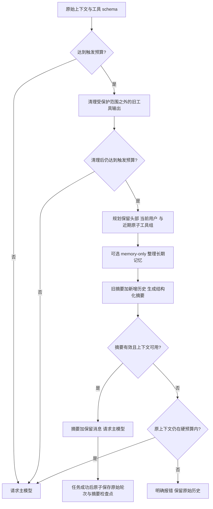

# 高级上下文压缩与长期记忆整理

高级模式借鉴 Hermes 的分层记忆思路：当前任务用结构化摘要维持连续性，跨会话信息保存在有容量上限的 Markdown 记忆中，完整经历仍留在 SQLite。摘要和长期记忆分别管理，不把整段聊天摘要直接写入 `MEMORY.md`。

## 三份数据各自负责什么

| 数据 | 用途 | 生命周期 |
| --- | --- | --- |
| 原始会话消息 | 保存用户输入、模型文本、工具参数、调用 ID、结果和推理协议字段，供恢复和检索 | 成功轮次完整追加到 `sessions.db`，压缩不删除它们 |
| 会话摘要检查点 | 用更短的上下文接续当前任务，记录目标、约束、进度、决策和待办 | 随成功轮次提交，后续压缩增量更新；不作为跨用户共享记忆 |
| `MEMORY.md` / `USER.md` | 保存值得跨会话复用的事实、项目约定和用户偏好 | 按 scope 隔离，工具原子写入；新会话读取冻结快照 |

L2 的同步 `compactHistory` 仍保留为基础练习。高级模式使用独立、异步的 `ContextEngine`，接在模型 Provider 前面；参考 Core 和 learner Core 都可使用这层框架，学习者不需要把模型摘要请求塞进 `runLoop`。

## 一次高级压缩如何发生



每次模型请求前都会检查预算，包括执行工具后再次请求模型的时刻。预算包含消息的序列化长度和工具 schema，不能只看正文长度。当前计量单位是字符，不是供应商返回的真实 token 数；阈值和保留比例也是教学项目自己的配置。

压缩时先处理昂贵的旧工具输出。最新工具组仍完整保留，避免模型刚请求的结果还没看见就被清掉。保留区域包括冻结的 system、预算允许的有限初始交换、当前真实用户消息，以及按预算选择的近期消息。assistant 的工具调用和对应 tool 结果作为原子组处理，不能把调用声明与结果拆开。

其余历史交给摘要模型整理为结构化交接信息，包含“目标、约束与偏好、进展、关键决策、相关文件、后续步骤、关键上下文”七个标题。再次压缩时输入已有摘要和新增的待压缩内容，更新原来的目标、进度与待办，不反复从零总结全部原始记录。超长历史按批次更新，单条超长记录提供带省略标记的头尾摘录；每次最多处理八个摘要批次，超过上限明确失败。模型返回的摘要是派生数据，不能修改系统规则，也不能成为执行插件代码的依据。

摘要有独立长度上限和超时。每轮最多尝试三次压缩；第一次摘要失败后，本轮不再反复请求摘要。失败、空响应、非法响应或取消不会提交新的检查点；摘要失败时，原上下文还能放入硬预算就继续，否则返回明确的预算错误。不能为了让请求成功而静默扔掉中间历史。受保护的用户输入或最新工具组本身过大时，也可能需要缩短输入、降低工具输出量或调大预算。

## 持久检查点与恢复

`context_checkpoints` 表保存当前会话摘要的 `generation`、`coveredCount`、`prefixHash` 和正文。覆盖数针对未裁剪的原始消息，不包含临时 system 或合成摘要消息；SHA256 指纹包含工具元数据和 `reasoningContent`。

每轮运行期间，摘要先保留在内存。只有最终答复完成并通过消息协议校验后，`SessionStore.commitTurn` 才在同一 SQLite 事务中追加原始消息并保存最新摘要。写入时再次核对覆盖范围、前缀指纹和预期代际，拒绝迟到的摘要覆盖更新状态。一轮内即使压缩多次，也只提交最后一个检查点。

进程重启后，读取检查点并核对其原始历史前缀，再决定能否复用。原始历史始终可通过 `history` 或 `history_search` 检索，摘要遗漏的信息仍有恢复来源。字段损坏的检查点会显式报错，原始消息依然可读；不要直接修改检查点内容来掩盖恢复问题。

## 压缩前整理长期记忆

开启 `compressionMemoryFlush` 后，压缩前可以运行一次受限的记忆整理：只开放记忆工具，最多进行两次模型请求，把值得保留的用户偏好、项目事实和稳定约定写入对应 scope。它接收已有摘要与尚未覆盖的原始证据，并在末尾保留当前真实 user 锚点；辅助请求预算不足时，只对证据提供带省略标记的头尾摘录，不截断实时记忆。一些信息可能不在摘录中，模型只能依据可见证据整理，不能猜测缺失事实。一次性的命令输出、临时路径和整段推理记录不应占用长期记忆。

`memory` 工具的 `target` 为 `memory` 或 `user`，分别对应 `MEMORY.md` 和 `USER.md`。一批操作只写一个目标，支持：

- `add`：新增条目；完全重复的条目不重复写入。
- `patch`：用唯一的 `old_text` 定位一段文字，只替换该片段，保留条目其他事实。
- `remove`：用唯一匹配定位并删除整条过时记录。

```json
{
  "target": "user",
  "operations": [
    { "action": "patch", "old_text": "喜欢冗长解释", "content": "喜欢简洁解释" },
    { "action": "add", "content": "用户使用 TypeScript 学习 Agent，希望代码带中文注释。" }
  ]
}
```

每文件默认 4000 字符，条目以 `§` 分隔。操作先在内存里应用，整批结果通过校验后只写一次文件；任一定位失败或最终结果超容量，整个批次不写入。容量错误会提供当前条目与空间信息，模型可以把“缩短旧条目”和“新增事实”放在同一批次重试，不需要先删除事实再赌下一次新增能否成功。超限不会自动丢弃旧条目。

长期记忆写入后，记忆工具可立即读取最新内容；当前会话的 system 快照保持冻结，新会话才注入更新后的快照。记忆工具写入属于已发生的副作用，若后续任务失败或取消，不保证撤销已经落盘的写入；这与 SQLite 检查点只在成功轮次提交的规则不同。

兼容的 `memory_read` / `memory_write` 仍存在；Demo 的 `/remember` 仍演示整篇替换，不代表新工具的条目合并行为。

## 配置与切换

高级模式默认开启。开发时可显式对照：

```sh
npm run dev -- chat --provider demo --mode reference --compression advanced --trace
npm run dev -- chat --provider demo --mode reference --compression basic --trace
```

`basic` 使用同步 L2，进入模型循环前裁剪一次，循环内只做硬预算检查；`advanced` 在每次模型请求前运行异步引擎。Core 的 `--mode` 和压缩模式互相独立；完整 learner 聊天仍需要完成 L4 会话路由。

profile 的 `config.json` 可设置：

```json
{
  "compressionEnabled": true,
  "compressionThreshold": 0.75,
  "compressionTargetRatio": 0.5,
  "compressionSummaryChars": 3000,
  "compressionTailMessages": 8,
  "compressionToolChars": 1200,
  "compressionTimeoutMs": 20000,
  "compressionMemoryFlush": true
}
```

| 字段 | 含义 |
| --- | --- |
| `compressionEnabled` | 是否使用高级引擎；false 对应基础模式 |
| `compressionThreshold` | 达到 `contextChars` 的这个比例时尝试整理；范围 `(0, 1]` |
| `compressionTargetRatio` | 压缩后希望接近的预算比例，必须小于触发比例；保护消息可能使实际长度高于目标 |
| `compressionSummaryChars` | 摘要正文上限，范围 256～16000 字符；小窗口还会进一步收紧实际摘要上限 |
| `compressionTailMessages` | 近期保留消息数量的规划参数，实际边界要对齐工具原子组 |
| `compressionToolChars` | 旧工具输出清理的长度参数，至少 80 字符 |
| `compressionTimeoutMs` | 每个摘要批次或受限记忆整理步骤的超时预算；整个任务仍受 turnTimeoutMs 限制 |
| `compressionMemoryFlush` | 是否启用压缩前的受限长期记忆整理 |

程序调用时可以通过 `AgentOptions.summaryProvider` 注入独立摘要模型；CLI 默认复用主 Provider。真实模型执行压缩和记忆整理会产生额外请求，需将其计入超时与使用成本。Demo 是确定性替身，只验证控制流，不代表模型摘要质量。

## 离线调试与验收

```sh
npm run dev -- check --stage 2 --mode learner --trace --debug
npm run typecheck
npm test
npm run build
```

先在 `src/core/context-engine.ts` 的 `prepare`、`chooseCut`、`summarize` 和 `checkpointDraft` 设置断点，再看 `SessionStore.commitTurn`。重点比较三份内容：传入循环的原始消息、真正发给 Provider 的压缩视图、SQLite 成功保存的完整轨迹。

trace 可观察 `context.pruned`、`context.summary`、`context.compress.start/end/failed` 和 `memory.flush.start/end/failed`。这些事件提供大小、计数和错误类别，不输出摘要正文、用户记忆或原始推理字段。

验收关注长期历史触发摘要、工具循环中再次触发、增量更新与重启恢复、最新工具组完整性、摘要失败/超时/取消，以及记忆批次容量与 scope 隔离。回归使用本机 Provider 替身，不需要真实 API key；真实摘要的事实保留率、误删和长任务表现仍需独立评估。

阶段 2 共 11 个具名 case，本轮 learner 验收已通过 11/11。其中新增高级验收为：

| Case | 观察内容 |
| --- | --- |
| `Context/structured-summary-and-tool-pairs` | 实际摘要请求、七个结构化标题、含 schema 的预算、最近工具组与原始输入 |
| `Context/failure-keeps-original` | 无效摘要无法救回硬超限时明确失败，不生成检查点或修改原历史 |
| `Context/checkpoint-restart` | 原始轮次与摘要成功提交、重启核对指纹、相同历史无需重新摘要 |
| `Memory/atomic-curation-and-scope` | 超容量整批不写、同一批次腾空间后新增、用户与目标文件隔离 |

Hermes 的分层压缩与长期记忆原理见 [Context Compression and Caching](https://hermes-agent.nousresearch.com/docs/developer-guide/context-compression-and-caching) 和 [Persistent Memory](https://hermes-agent.nousresearch.com/docs/user-guide/features/memory)。本实现保留核心思想，没有复制上游多平台会话 hygiene、供应商真实 token usage、缓存策略、全部恢复与插件引擎语义，也不兼容上游配置格式。
