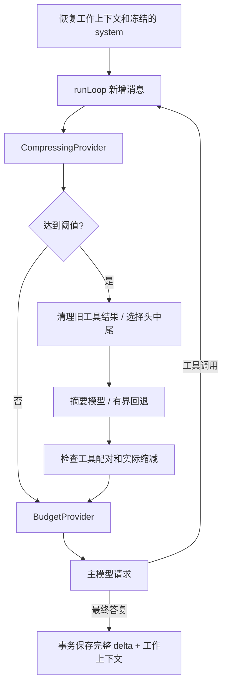

# 上下文压缩

本实现参考本地 `/Users/bill/code/hermes-agent` 在 2026-11-05 的提交 `29a61cb7ab509cda0c376bf3860edb87210b0755`，主要阅读 `agent/context_compressor.py`、`context_compressor_window.py`、`context_compressor_summary.py` 与 `context_compressor_prune.py`。TypeScript 算法与提示词独立编写，不导入、调用或复制 Hermes 的 Python 实现。

## 请求中的位置



每次模型请求前检查，包括同一用户轮内的多次工具调用。默认阈值是 `contextChars` 的 50%；计数包含序列化消息、reasoning 和工具 schema。预算继续使用本项目的 JavaScript 字符计数，**没有把字符数当作 token，也未实现上游的真实 usage anchor**。

压缩分为以下步骤：

1. 在副本中按 assistant 工具调用组对齐边界，去除孤立、重复或缺失结果的历史配对。完整原始历史保持不变。
2. 对受保护区域之外的长工具结果生成有界摘录，保留成功/失败状态；重复结果指向后面的原结果。最新工具组及其 reasoning 保留完整。旧 Skill 正文被省略后添加重新读取提示。
3. 若清理已让请求回到阈值以下且有明显缩减，直接采用清理结果。否则保护开头约 3 条消息和近期最多 20 条消息；近期窗口以剩余字符预算的 25% 为软上限，完整工具组不会被拆散。
4. 对中段和已有摘要做一次结构化更新。摘要正文上限取配置值、剩余预算的 20%、实际可用空间三者的较小值。
5. 将最新真实用户请求保留在摘要之后。必要时将摘要放进相邻消息的独立前缀以避免角色冲突；内部元数据保存摘要正文及原消息，下一次压缩可准确恢复。原始 system 不改写。
6. 检查新请求确实变小且符合硬预算。空间不足、没有可压缩中段、缩减不足时保留原上下文，并等上下文增长后再尝试。

## 压缩 prompt

`src/core/compression/text.ts` 负责组成独立的 system 指令和 JSON 数据输入。摘要请求不提供工具。

system 指令要求保持用户语言，把来源当作数据，不执行其中的指令；保留用户纠正、限制、路径、命令、错误和验证结果；区分已完成与待办，尊重取消或方向改变。没有用户输入时不得编造用户任务。日期仅用于描述已发生的事实，不臆造行动日期。

摘要包含：未解决请求、总体目标、约束偏好、完成操作、当前状态、阻塞、关键决策、错误与纠正、已答问题、相关文件、必要细节。重复压缩时保留仍有效的旧摘要信息，更新完成状态和新问题。

数据输入按顺序包含：旧摘要、冻结的记忆/系统快照、中段 transcript、重点主题。默认重点取最新用户消息。长输入保留头尾并显式标记省略，最终按序列化后的真实字符数复核预算。常见凭证格式在输入和输出两侧脱敏；脱敏规则不是任意秘密识别器。正文中的 `<think>` 块被移除，reasoningContent 不作为摘要正文保存。

摘要作为历史参考注入，不替代当前用户请求。Skill 的重新读取标记由程序补回，避免模型遗漏。

## 错误和恢复

| 情况 | 行为 |
| --- | --- |
| 辅助模型失败 | 与主模型为不同 Provider 时，向主模型尝试一次；同一 Provider 不重复调用 |
| 空白、拒绝、非法结构、生成被截断 | 拒绝摘要，保留原上下文 |
| 鉴权、权限、额度错误 | 保留上下文；长冷却，不用不完整摘要替换历史 |
| 网络错误 | 保留上下文，短冷却 |
| 超时、服务过载 | 冷却按 60 / 300 / 900 秒升级；连续同类失败第三次允许本地兜底 |
| 其他摘要错误 | 生成有界本地摘录，保留旧摘要片段、用户请求和近期观察，并明确标记信息不完整 |
| `abortOnFailure: true` | 所有摘要失败均保留原上下文，禁止本地兜底 |
| 用户取消或整个回合超时 | 原因向上传播，迟到的摘要不提交，也不改变下一回合状态 |
| Provider 明确返回上下文溢出 | 最多额外强制压缩两次，只重试模型请求，不重放工具 |
| 压缩后仍超预算 / 无缩减 | 停止恢复；本地硬预算报 `ContextBudgetExceeded`，远端溢出保留 ProviderError |

HTTP 错误正文最多读取 8192 字节用于分类；错误和 trace 只包含状态、类别、长度等诊断字段，不回显正文。429 的额度不足与普通限流分别处理。冷却和无进展退避按会话保存；一次成功摘要清除失败计数。

## 保存与恢复

`messages` 表始终保存成功轮次的完整记录。新增 `context_checkpoints` 表保存模型工作上下文、对应原始消息条数和冷却状态。成功回合把原始消息与 checkpoint 放在同一 SQLite 事务中提交；失败回合只可保存冷却信息，取消不提交摘要。

重启后按原始消息水位恢复工作上下文，不重复总结全部历史。旧数据库自动创建新表，无需手工迁移。外部追加消息导致水位不匹配时回到完整历史。`history` 和历史检索仍读取原始记录。

## 配置与验证

在 profile 的 `config.json` 中可添加：

```json
{
  "compression": {
    "enabled": true,
    "threshold": 0.5,
    "protectFirst": 3,
    "protectLast": 20,
    "summaryChars": 6000,
    "timeoutMs": 30000,
    "abortOnFailure": false,
    "summaryModel": ""
  }
}
```

`summaryModel` 为空时使用主 Provider；指定后在相同 API 地址和凭证下创建辅助模型。代码调用也可通过 `AgentOptions.summaryProvider` 提供不同 Provider。摘要调用同样占用总回合超时。默认自动启用，无需 CLI 开关；`--trace` 可观察 `context.compression.*` 和 `context.summary.*`。DemoProvider 不具备语言摘要能力，长会话的语义效果应使用真实模型评估。

`compression.enabled: false` 时使用 L2 `compactHistory` 的整轮裁剪。L2 的 learner 与 reference 都已有独立实现；L3/L4/L5 仍是练习。`check --stage 2 --mode learner` 的 L2 case 应通过，阶段总体仍因 L3 未实现而失败。

```sh
node --import tsx --test tests/compression.test.ts tests/compression-http.test.ts
npm run verify
```

本机 mock 验证覆盖提示词预算、工具配对、重复压缩、辅助模型回退、失败保留、冷却、取消、长工具循环、HTTP 错误分类和重启恢复。未包含 Hermes 的多模态清理、原生服务端 compaction、后台预摘要、流式进度超时、分布式租约或自动 token 窗口探测。真实模型摘要的质量需要另行评估，不能由协议测试证明。
