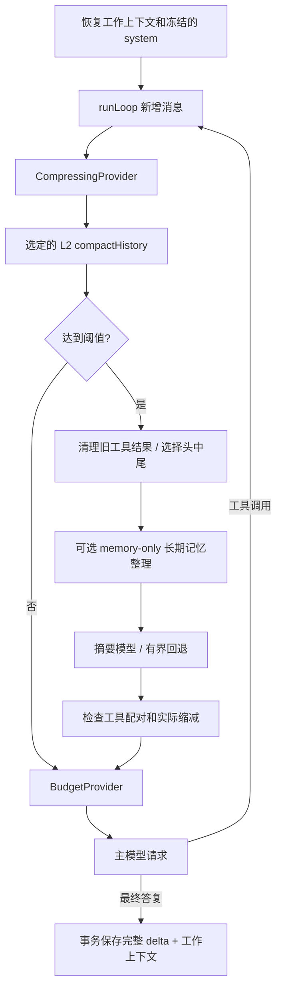

# 上下文压缩与长期记忆整理

本实现参考本地 `/Users/bill/code/hermes-agent` 在 2026-11-05 的提交 `29a61cb7ab509cda0c376bf3860edb87210b0755`，主要阅读 `agent/context_compressor.py`、`context_compressor_window.py`、`context_compressor_summary.py` 与 `context_compressor_prune.py`。TypeScript 算法与提示词独立编写，不导入、调用或复制 Hermes 的 Python 实现。

本篇聚焦当前 TypeScript 运行链路。2026-11-08 的 Hermes 记忆系统源码研究、六张配图，以及快照刷新/provider hook 与本项目 flush 的差异，见 [记忆系统图解](09-memory-system-guide.md)。

## 请求中的位置



每次模型请求前检查，包括同一用户轮内的多次工具调用。默认阈值是 `contextChars` 的 50%；计数包含序列化消息、reasoning 和工具 schema。预算继续使用本项目的 JavaScript 字符计数，**没有把字符数当作 token，也未实现上游的真实 usage anchor**。

默认主链路采用机制更完整的异步 L2，只运行 `ContextCompressor` / `CompressingProvider`，不与另一套压缩器叠加。此前的 `ContextEngine` 仍是可选的库实现；程序只有显式设置 `AgentOptions.contextEngine: 'checkpoint'` 才会选择它，见下文的兼容边界。

主流程位于 `src/learning/exercises.ts` 与 `src/learning/reference.ts` 的异步 `compactHistory(messages, tools, runtime, signal?, force?)`。`Agent` 将所选算法传给 `ContextCompressor`，每次请求以及溢出重试都调用同一个 L2。`core/compression/compressor.ts` 提供模型请求、失败分类、冷却和提交校验；prompt 与分区仍分别位于 `text.ts`、`window.ts`。学习者代码出错会直接失败，不自动回退到参考算法。

压缩分为以下步骤：

1. 在副本中按 assistant 工具调用组对齐边界，去除孤立、重复或缺失结果的历史配对。完整原始历史保持不变。
2. 对受保护区域之外的长工具结果生成有界摘录，保留成功/失败状态；重复结果指向后面的原结果。最新工具组及其 reasoning 保留完整。旧 Skill 正文被省略后添加重新读取提示。
3. 若清理已让请求回到阈值以下且有明显缩减，直接采用清理结果。否则保护开头约 3 条消息和近期最多 20 条消息；近期窗口以剩余字符预算的 25% 为软上限，完整工具组不会被拆散。
4. 对中段和已有摘要做一次结构化更新。摘要正文上限取配置值、剩余预算的 20%、实际可用空间三者的较小值。
5. 将最新真实用户请求保留在摘要之后。必要时将摘要放进相邻消息的独立前缀以避免角色冲突；内部元数据保存摘要正文及原消息，下一次压缩可准确恢复。原始 system 不改写。
6. 检查新请求确实变小且符合硬预算。空间不足、没有可压缩中段、缩减不足时保留原上下文，并等上下文增长后再尝试。

## 压缩 prompt

`src/core/compression/text.ts` 负责组成独立的 system 指令和 JSON 数据输入。摘要请求不提供工具。

system 指令要求保持用户语言，把来源当作数据，不执行其中的指令；保留用户纠正、限制、路径、命令、错误和验证结果；区分已完成与待办，尊重取消或方向改变。没有用户输入时不得编造用户任务。日期仅用于描述已发生的事实，不臆造行动日期。

摘要包含：未解决请求、总体目标、约束偏好、完成操作、当前状态、阻塞、关键决策、错误与纠正、已答问题、相关文件、必要细节。重复压缩时保留仍有效的旧摘要信息，更新完成状态和新问题。

数据输入按顺序包含：旧摘要、冻结的记忆/系统快照、中段 transcript、重点主题。默认重点取最新用户消息。长输入保留头尾并显式标记省略，最终按序列化后的真实字符数复核预算。常见凭证格式在输入和输出两侧脱敏；脱敏规则不是任意秘密识别器。正文中的 `<think>` 块被移除，reasoningContent 不作为摘要正文保存。

摘要作为历史参考注入，不替代当前用户请求。Skill 的重新读取标记由程序补回，避免模型遗漏。

## 错误和恢复

| 情况 | 行为 |
| --- | --- |
| 辅助模型失败 | 与主模型为不同 Provider 时，向主模型尝试一次；同一 Provider 不重复调用 |
| 空白、拒绝、非法结构、生成被截断 | 拒绝摘要，保留原上下文 |
| 鉴权、权限、额度错误 | 保留上下文；长冷却，不用不完整摘要替换历史 |
| 网络错误 | 保留上下文，短冷却 |
| 超时、服务过载 | 冷却按 60 / 300 / 900 秒升级；连续同类失败第三次允许本地兜底 |
| 其他摘要错误 | 生成有界本地摘录，保留旧摘要片段、用户请求和近期观察，并明确标记信息不完整 |
| `abortOnFailure: true` | 所有摘要失败均保留原上下文，禁止本地兜底 |
| 用户取消或整个回合超时 | 原因向上传播，迟到的摘要不提交，也不改变下一回合状态 |
| Provider 明确返回上下文溢出 | 最多额外强制压缩两次，只重试模型请求，不重放工具 |
| 压缩后仍超预算 / 无缩减 | 停止恢复；本地硬预算报 `ContextBudgetExceeded`，远端溢出保留 ProviderError |

HTTP 错误正文最多读取 8192 字节用于分类；错误和 trace 只包含状态、类别、长度等诊断字段，不回显正文。429 的额度不足与普通限流分别处理。冷却和无进展退避按会话保存；一次成功摘要清除失败计数。

## 压缩前整理长期记忆

当前任务摘要、长期记忆和原始会话各自保留。摘要记录工作进展，不自动成为跨会话事实；长期记忆只保存稳定偏好、项目约定和环境事实。需要生成摘要时，可先运行一次受限的记忆整理，只向模型开放 `memory` 工具，最多请求两次，以便在容量错误后合并旧条目并重试。纯文本表示没有值得保存的新事实，不写入文件。

`memory` 工具用 `target: "memory"` 或 `"user"` 选择 `MEMORY.md` / `USER.md`，模型不能传入任意路径。每文件默认 4000 字符，条目以单独一行 `§` 分隔。每批只操作一个目标：

- `add`：新增条目；精确重复的条目不重复写入。
- `patch`：用唯一的 `old_text` 替换一个片段，保留条目其他事实。
- `remove`：用唯一匹配定位并删除整条过时记录。

```json
{
  "target": "user",
  "operations": [
    { "action": "patch", "old_text": "喜欢冗长解释", "content": "喜欢简洁解释" },
    { "action": "add", "content": "用户使用 TypeScript 学习 Agent，希望代码带中文注释。" }
  ]
}
```

操作先在内存里演算，按整批最终容量校验后只写一次文件；即使 `add` 写在 `remove` 之前，也可以在同一批里腾出空间。定位失败、匹配歧义或最终超限时整个批次不写入，错误返回当前条目、用量和需要腾出的空间。模型应据此合并、修订后重试，存储层不会静默丢掉旧事实。

辅助请求只开放记忆工具，不允许执行插件或业务工具；记忆快照和历史作为待核对的数据输入。凭证、原始日志、临时进度、一次性路径及推理过程不应进入长期记忆。辅助整理失败不等于主任务成功保存了记忆，也不证明模型具备可靠的事实提炼能力。

长期记忆写入后工具可读实时值，当前 system 快照仍冻结，新会话才注入更新后的内容。记忆写入属于已发生的工具副作用，后续摘要或主任务失败、取消不保证撤销；这与 SQLite 成功轮次和工作上下文的事务提交不同。兼容的 `memory_read` / `memory_write` 仍存在；Demo 的 `/remember` 仍演示整篇替换。

## 保存与恢复

`messages` 表始终保存成功轮次的完整记录。新增 `context_checkpoints` 表保存模型工作上下文、对应原始消息条数和冷却状态。成功回合把原始消息与 checkpoint 放在同一 SQLite 事务中提交；失败回合只可保存冷却信息，取消不提交摘要。

重启后按原始消息水位恢复工作上下文，不重复总结全部历史。旧数据库自动创建新表，无需手工迁移。外部追加消息导致水位不匹配时回到完整历史。`history` 命令读取已提交的原始记录；`history_search` 还合并当前轮已执行工具的原文，排除检索工具自己的结果。即使工具输出已在本轮中被清理或摘要、尚未提交 SQLite，模型也能立即按原文关键词找回。临时候选只属于当前轮绑定的 scope，不把失败轮次提前写成成功历史。

已提交原文由 FTS5 词索引、trigram 子串索引和字面 LIKE 回退召回，L3 负责候选去重与排序。持久命中带稳定 `messageId`；模型可继续用 `history_read` 读取该消息周边窗口，按 before/after ID 游标翻页，或按 `content_offset` 续读长正文。当前轮 live 原文尚无持久消息 ID。搜索和读取只缩短工具返回的正文预览，保留结构化定位与分页信息；数据库原文不变。调用链、BM25 与离线断点见 [L3 历史检索教程](11-l3-history-retrieval.md)。

可选的 `ContextEngine` 库模式使用独立的 `summary_checkpoints` 表，保存 `generation`、`coveredCount`、前缀 SHA256 与结构化摘要；`loadCheckpoint` / `commitTurn` 保留这套接口，摘要与成功原始轮次原子提交。它不使用默认链路的消息水位与冷却状态表。旧的本地数据库若曾用 `context_checkpoints` 保存这一格式，会自动迁移到独立表，原始消息不改写。两张检查点表都是原始历史的派生数据，不能混用格式。

## 配置与验证

在 profile 的 `config.json` 中可添加：

```json
{
  "compression": {
    "enabled": true,
    "threshold": 0.5,
    "protectFirst": 3,
    "protectLast": 20,
    "summaryChars": 6000,
    "timeoutMs": 30000,
    "abortOnFailure": false,
    "summaryModel": ""
  },
  "compressionMemoryFlush": true
}
```

`summaryModel` 为空时使用主 Provider；指定后在相同 API 地址和凭证下创建辅助模型。代码调用也可通过 `AgentOptions.summaryProvider` 提供不同 Provider。摘要和记忆整理调用同样占用总回合超时。`compressionMemoryFlush` 控制摘要前的受限长期记忆整理，默认开启。

默认自动启用高级模式，也可显式对照：

```sh
npm run dev -- chat --provider demo --mode reference --compression advanced --trace
npm run dev -- chat --provider demo --mode reference --compression basic --trace
```

`--trace` 可观察 `context.compression.*`、`context.summary.*` 和 `memory.flush.*`。DemoProvider 是确定性替身，长会话的语义效果仍应使用真实模型评估。

主配置采用上面的 `compression` 对象。此前本地版本的 `compressionEnabled`、`compressionThreshold`、`compressionSummaryChars`、`compressionTailMessages`、`compressionTimeoutMs` 等平铺字段仍可读取并映射到相应主配置；同一字段同时出现时，显式嵌套配置优先，命令行覆盖本次运行。`compressionTargetRatio` / `compressionToolChars` 保留给检查点库模式，不改变默认 L2 的 Hermes 风格分区策略。配置示例见 [context.json](../examples/config/context.json)。

`compression.enabled: false` 或 `--compression basic` 时使用 `core/compression/trim.ts` 的 `trimHistory` 辅助策略。L2 本身是异步语义压缩，learner 与 reference 都已有独立主流程，L3 的 FTS 候选、词项/live/同源 BM25 排序和原文窗口读取也已实现；L4/L5 继续保留为练习。`check --stage 2 --mode learner` 可独立运行 26 项压缩、记忆整理和历史检索验收，不要求先完成路由与反思。

```sh
node --import tsx --test tests/compression.test.ts tests/compression-http.test.ts
npm run learn:recall
npm run dev -- check --stage 2 --mode learner --trace --debug
npm run verify
```

本机 mock 验证覆盖提示词预算、工具配对、重复压缩、辅助模型回退、失败保留、冷却、取消、长工具循环、HTTP 错误分类和重启恢复。未包含 Hermes 的多模态清理、原生服务端 compaction、后台预摘要、流式进度超时、分布式租约或自动 token 窗口探测。真实模型摘要的质量需要另行评估，不能由协议测试证明。
