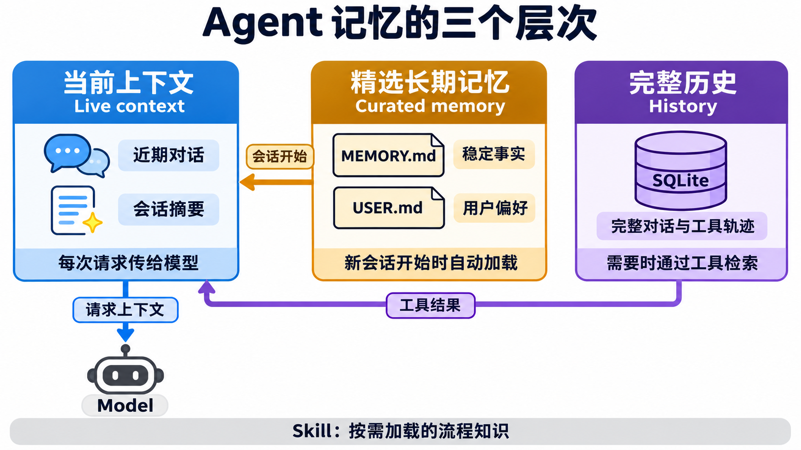
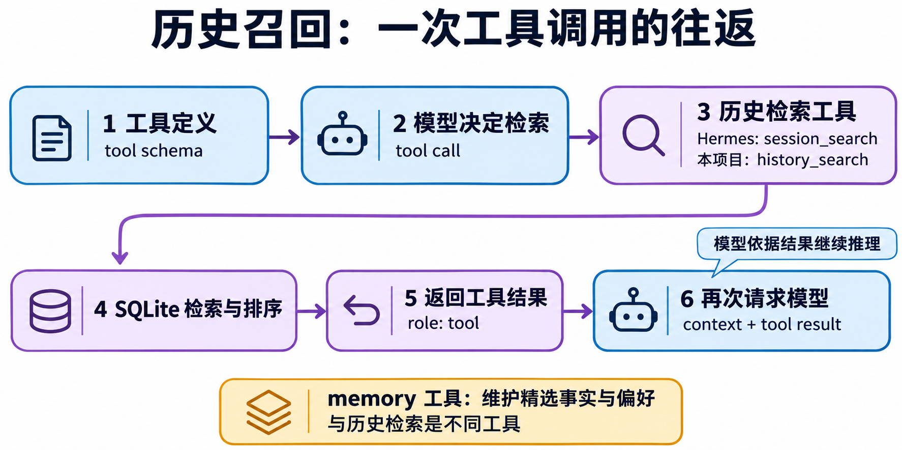
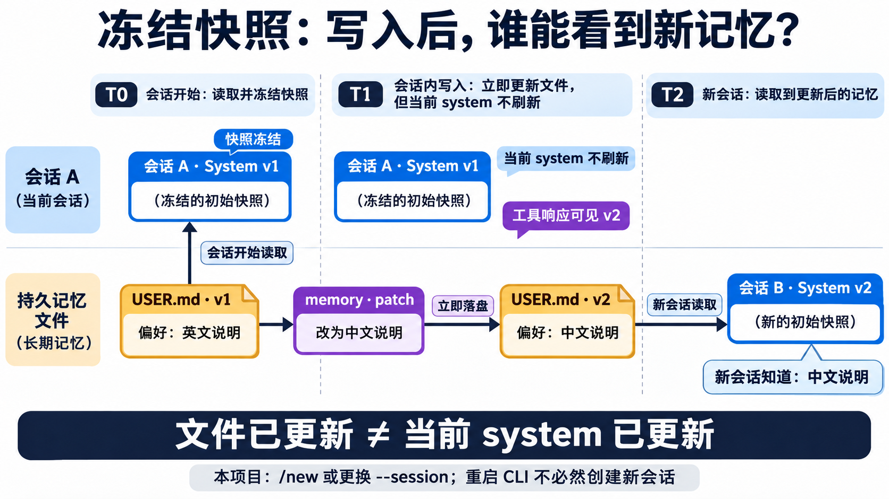
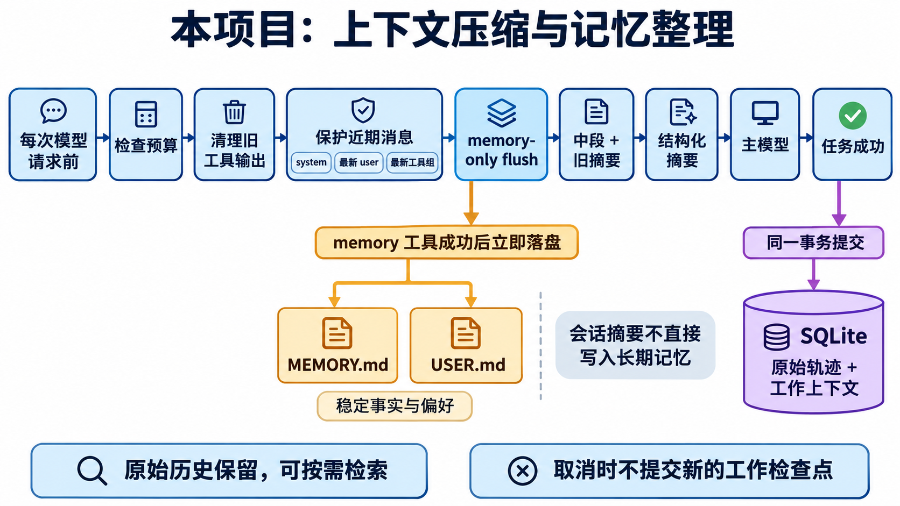
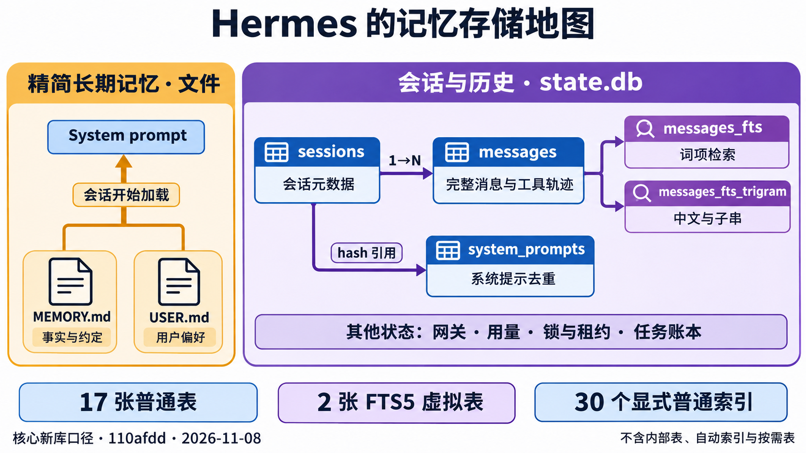
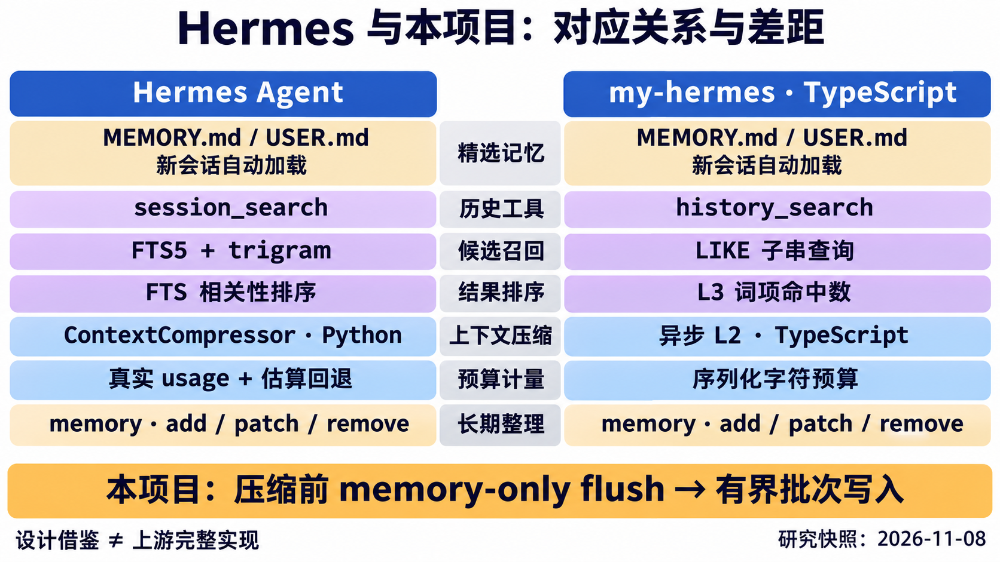

# Hermes Agent 记忆系统与本项目：机制、数据流和源码对照

本篇把“模型当前看到了什么”“哪些信息跨会话保留”“历史如何找回”“上下文满了怎样继续”放到同一条运行链路中解释。阅读顺序建议是：先理解记忆分层，再看工具调用与冻结快照，最后看压缩、存储和代码入口。

研究日期为 **2026-11-08**。Hermes 源码固定到提交 [`110afdd60e3098b86950963b06a792e261bd36a4`](https://github.com/NousResearch/hermes-agent/tree/110afdd60e3098b86950963b06a792e261bd36a4)。本项目最初配图与对照基线为 `6f14e487a6cc5e28ca824dedf36643163555ba2b`；本文的项目实现说明已更新到其后的 L3 进阶实现，包含 FTS5、trigram、BM25 与 `history_read`，详细学习步骤见 [11 L3 历史检索](11-l3-history-retrieval.md)。在线文档可能晚于或落后于源码，下面会明确标出已经核实的差异。本项目借鉴设计，使用 TypeScript 独立实现，不宣称与上游的插件、配置或数据库格式兼容。

表、索引、字段和数据库检查 SQL 单独整理在 [10 记忆存储参考](10-memory-storage-reference.md)。本篇中的六张 PNG 均由内置 imagegen 生成；图用于讲解，精确条件以正文及固定版本源码为准。[配图提示词 A](images/memory/generated-prompts-part-a.md)、[配图提示词 B](images/memory/generated-prompts-part-b.md) 保留生成和检查记录。

## 1. 先区分五种不同的数据



分层图用三种颜色区分当前上下文、精选长期记忆和完整历史。Skill 在这里是按需加载的流程知识，不能与用户事实或原始聊天记录混成一种东西。

| 数据 | 保存什么 | 模型何时看到 | 是否跨会话 |
| --- | --- | --- | --- |
| 当前上下文 | system、近期对话、工具结果、必要摘要 | 本次模型请求携带的消息 | 原消息可持久化，但不会每次全部发送 |
| 精选事实记忆 | `MEMORY.md` 中的稳定事实；`USER.md` 中的用户档案和长期偏好 | 会话启动时加载进系统提示；更新通过记忆工具持久化 | 是 |
| 原始历史 | 会话中的用户、assistant、tool 消息及协议元数据 | 当前窗口直接携带，或之后通过历史工具找回 | 是 |
| 压缩工作视图 | 旧摘要、保留的头尾和当前用户锚点 | 超长会话整理后供后续请求使用 | 可持久恢复，但仍服务于该会话 |
| Skill | 可重复使用的操作流程、适用条件、注意事项 | 索引先披露，正文按需加载 | 是 |

**持久化和注入模型是两个动作。** 一条消息在 SQLite 中存在，不代表它已经进入这次模型请求；一个事实进入系统提示，也不代表模型权重发生了训练。

例如，“长期用中文解释”适合用户档案；“刚才某次测试报错的完整堆栈”适合历史；“当前还剩两个测试未修复”适合工作上下文；“如何可靠排查这类错误”适合经过验证的 Skill。不同容器分别承担稳定事实、经历和流程知识。

Hermes 的内置文件记忆、历史存储和技能是不同子系统。其可选 memory provider 还能提供额外的自动检索与同步能力，因此不能把某个插件的行为当成所有 Hermes 安装的默认行为。参考 [Persistent Memory](https://hermes-agent.nousresearch.com/docs/user-guide/features/memory)、[Skills](https://hermes-agent.nousresearch.com/docs/user-guide/features/skills) 和 [Memory Providers](https://hermes-agent.nousresearch.com/docs/user-guide/features/memory-providers)。

## 2. 谁触发读取，结果什么时候给模型

| 行为 | Hermes 内置机制 | 本项目默认机制 |
| --- | --- | --- |
| 读取精简长期事实 | 会话开始读取文件，构造系统提示快照 | `Agent` 首次创建该会话 system 时调用 `memory.snapshot(scope)` |
| 检索过去的详细对话 | 模型按需调用 `session_search` | 模型按需调用 `history_search` |
| 读取命中前后文或继续翻页 | `session_search` 的窗口与 scroll 形态 | 独立的 `history_read` 工具，按消息 ID 和正文偏移续读 |
| 保存或修订长期事实 | 模型调用 `memory`，可能受写入审核约束 | 模型调用 `memory`，参数与最终容量校验后写入 |
| 缩小过大的模型请求 | 运行时按上下文压力触发压缩 | 每次模型请求前调用所选异步 L2 |
| 压缩前整理精选事实 | provider hook、记忆维护及其他生命周期路径各有职责 | 本项目提供受限的 memory-only flush 策略 |

“模型主动调用”指模型返回 tool call，框架执行它；用户不必输入工具名。用户正常说“找一下上次的部署方案”，模型可以判断当前上下文不足，然后选择历史检索工具。工具是否真的被调用、返回是否成功，应以轨迹为准，不能只根据模型自然语言中的“我记住了”或“我查过了”判断。



调用图展示共同的工具往返结构，未展开两边不同的候选召回和结果格式。`memory` 与历史检索工具是独立工具；FTS5 是检索工具内部的数据库能力，不是模型要额外调用的一种记忆工具。

本项目的实际顺序是：

1. `registry.schemas()` 告诉模型有哪些工具以及参数格式。
2. 模型产生 assistant 消息，声明调用 `history_search({ query: "部署方案" })`。
3. 框架从当前 scope 的数据库历史和本轮工具原文中收集候选，交 L3 排序。数据库候选带 `sessionId`、`messageId`、`source` 和可用的 BM25 `rank`。
4. Registry 把结果包装成与调用 ID 对应的 `role: tool` 消息。
5. `runLoop` 追加该消息，再次请求模型；模型此时看到搜索结果，可以直接回答，也可以调用 `history_read`，读取命中附近的原始消息。
6. `history_read` 的结果同样作为工具消息进入下一次请求。消息窗口用 ID 游标翻页，长正文用字符偏移续读，不再调用另一个模型把历史改写成摘要。

```text
user:      找一下上次的部署方案
assistant: tool_call history_search(query="部署方案", id="call-1")
tool:      tool_call_id="call-1", { ok: true, result: [...] }
assistant: tool_call history_read(session_id="…", around_message_id=42, limit=5, id="call-2")
tool:      tool_call_id="call-2", { ok: true, result: { messages: [...], ... } }
assistant: 根据命中和前后文，说明方案和来源
```

对应代码为 [历史工具](../src/core/history-tools.ts)、[L1 工具循环](../src/learning/exercises.ts) 和 [ToolRegistry](../src/core/tools.ts)。历史工具在输出预算内保留定位字段和分页结构，只缩短正文预览；`contentTruncated` 与 `nextContentOffset` 表明还需继续读取。“有原文存储”和“这次结果完整展开”也要分开理解。库 API 保留原始协议元数据；工具窗口展示 `role/content` 等可引用内容，不回传旧 `reasoningContent`。

## 3. Hermes 的精选长期记忆怎样维护

### 3.1 文件、配额和条目

在本研究快照中，内置文件存储默认使用 `MEMORY.md` 与 `USER.md`，容量分别为 **2200** 和 **1375** 字符。文件位于当前 Hermes home/profile 对应的记忆目录。条目可包含多行，条目之间采用独立的 `§` 分隔。它们不是 `messages` 表里的两条特殊聊天记录。

两份文件进入会话的系统提示，并带用量信息。模型维护条目时使用固定 target，不能通过记忆工具任意指定文件路径。具体容量、读取和快照逻辑见固定版 [memory_tool_store.py](https://github.com/NousResearch/hermes-agent/blob/110afdd60e3098b86950963b06a792e261bd36a4/tools/memory_tool_store.py)。

### 3.2 AI 可以写，用户也可以编辑

模型通过 `memory` 工具提交操作，框架负责校验、锁定目标、读取最新内容和落盘。固定版本的操作包括：

| 操作 | 意义 | 容易误解的边界 |
| --- | --- | --- |
| `add` | 加入一条新事实 | 精确重复可以去重，不等于自动判断语义等价 |
| `patch` | 唯一定位原文片段并替换 | 保留同条中的其他事实，不是随意覆盖整条 |
| `remove` | 定位并删除一条记录 | 匹配不唯一时应要求更明确的定位 |
| `operations` 批次 | 对一个 target 一次提交多步 | 按最终结果检查容量，允许同批先整理再添加 |

容量不足时，工具把当前条目和容量信息交回模型，模型可以合并冗余、修订过时内容后重试。存储层不应为了放入新内容而静默丢掉旧事实。写入审核、无人值守审查和普通交互写入还有不同规则；不能把“AI 有工具”理解为所有写入都会立即无条件生效。见 [memory_tool.py](https://github.com/NousResearch/hermes-agent/blob/110afdd60e3098b86950963b06a792e261bd36a4/tools/memory_tool.py)。

固定版本的写入审核默认关闭。开启 `memory.write_approval` 后，交互 CLI 可以内联确认，其他运行面可以先形成待审核修改。无人值守后台 review 即使在总开关关闭时，也会把 `patch/remove` 放入 staging，避免直接破坏既有事实；新增操作另有允许条件。批准时会重新检查被定位的条目，过期的修改不会盲目覆盖后来内容。**待审核和已经应用是不同状态**，不能只看工具有返回就认定文件已经更新。

用户也可以手动编辑这些 Markdown 文件，但外部编辑和工具校验的行为并不完全相同。固定 Hermes 实现加载超限手工文件时会警告并保留已有条目，后续修改另受容量与漂移保护约束；本项目遇到超限文件则直接报错。这是需要保留的实现差异。

### 3.3 哪些信息值得保存

应把来源明确、稳定、以后仍有用的信息提炼为短条目。原始日志、密钥、临时 TODO 和猜测不适合作为精选事实。流程方法适合进入 Skill，具体经历适合通过历史检索恢复。

固定提交的工具 schema 对 task-specific 内容比在线介绍更严格：它强调跨任务稳定信息，任务特定的流程、教训和进度应分别交给 Skill 或历史，而不是把完成日志持续追加到 `MEMORY.md`。在线页面仍有“completed work”示例，阅读时应注意版本差异。本项目允许稳定的项目约定，但不保存临时进度；两边的默认提示策略不能视为字句一致。

### 3.4 冻结快照有边界，不是永久不变

普通请求会沿用已构造的系统提示快照，以保持稳定前缀。工具写文件后，工具响应能说明实时状态；新会话也会加载新文件。**固定 Hermes 源码在成功压缩的部分提交边界还会使 system 缓存失效、重新加载记忆并重建提示**，而某些 seeded hygiene 路径会保留原提示。

因此，在线记忆文档中“会话内从不变化”的说法不能覆盖所有源码路径。相关入口见 [system_prompt.py](https://github.com/NousResearch/hermes-agent/blob/110afdd60e3098b86950963b06a792e261bd36a4/agent/system_prompt.py) 和 [conversation_compression.py](https://github.com/NousResearch/hermes-agent/blob/110afdd60e3098b86950963b06a792e261bd36a4/agent/conversation_compression.py)。本项目尚未实现这种压缩边界刷新：只在新建会话 system 时读取文件。



时间线展示**本项目**的普通会话行为。旧会话仍可能从当前 user 或工具结果知道更新后的偏好，冻结的是 system 快照，不是模型对所有新信息的感知。图中“更换 --session”指使用尚未创建的新会话名称；切换到已有名称会恢复旧快照。图中没有展示 Hermes 的压缩边界重建路径。

## 4. Hermes 的历史检索怎样工作

### 4.1 `session_search` 提供不止一种查询形态

固定版本返回原始历史记录、命中附近的窗口和分页信息，**不是把每次搜索结果再交给 LLM 写摘要**。不同查询形态有不同的预览上限，不能笼统说“永不截断”。

| 输入形态 | 作用 | 研究快照中的默认或上限 |
| --- | --- | --- |
| 有 `query` | 从历史发现相关会话与命中 | 默认 3 个结果，最多 10 个 |
| `session_id` 加 `around_message_id` | 围绕一条消息读取窗口 | 窗口参数默认 5，范围 1～20，不应理解为返回总共 5 条 |
| 只有 `session_id` | 读取该会话的头尾 | 默认头 20 条、尾 10 条 |
| 没有 query/session | 浏览近期会话 | 默认 10 个 |

Discovery 与 read 路径可以返回带 `content_truncated` 的消息预览；scroll 路径用于继续读取窗口。固定源码中 discovery/read 的内容预览上限分别是 4000/2000 字符，不能把这些数值当成整个历史原文的存储上限。见 [session_search_tool.py](https://github.com/NousResearch/hermes-agent/blob/110afdd60e3098b86950963b06a792e261bd36a4/tools/session_search_tool.py)。

### 4.2 FTS、trigram 和 LIKE 分别解决什么

Hermes 保存原始 `messages`，在其上维护全文索引。基础词索引支持按词搜索与相关性排序；trigram 支持连续字符的子串检索，适合部分中文场景。它不是中文语义理解模型，也不等于 embedding 向量数据库。

固定版本的检索会根据查询、角色过滤和索引可用性选择路径：

```text
查询与过滤条件
  → 词项 FTS / trigram / 有界 LIKE 回退
  → 相关性或时间排序
  → 会话与 lineage 过滤、去重
  → 加载原始命中及附近消息
  → 作为工具结果返回模型
```

普通相关性排序可使用 FTS 的 BM25；也支持按时间方向取结果。较短中文、工具正文查询或某些回退场景会走 LIKE。默认 discovery 会过滤一些后台/子代理来源，并处理压缩会话的 lineage；搜索不是对所有数据库行无条件做一次相同的 MATCH。见 [hermes_state_search.py](https://github.com/NousResearch/hermes-agent/blob/110afdd60e3098b86950963b06a792e261bd36a4/hermes_state_search.py)。

固定版本为了控制索引体积，对工具正文的索引内容和 trigram 来源做了限制：原始工具结果仍在 `messages` 中，词索引只收工具正文的有界前缀；trigram 不包含工具行，并排除部分后台来源。需要完整工具正文时，可走针对原始记录的检索路径。详细表、视图和限制见 [存储附录](10-memory-storage-reference.md)。

### 4.3 本项目当前的 FTS5、排序与原文窗口

`SessionStore.search` 已由整段 LIKE 升级为独立的 [HistorySearch](../src/memory/history-search.ts) 候选层。两个外部内容 FTS5 虚拟表分别维护词索引和 trigram 字符索引，原文仍来自 `messages`。运行时先探测真实 SQLite 能力，缺少 FTS5 或 trigram 时保留 LIKE 回退。

| 查询情况 | 本项目的候选路径 |
| --- | --- |
| 普通非 CJK 词项，如 `TypeScript memory` | 词 FTS5；零命中再尝试可用的 trigram，最后 LIKE |
| 含中日韩文字且每个词项至少 3 个 Unicode 字符 | 可用的 trigram；未命中或不可用时 LIKE |
| 两字中文，如 `记忆` | LIKE 字面子串回退 |
| 路径、标点或 `%_` 等符号 | 按完整字面子串 LIKE，转义 `%`、`_` 和反斜杠 |

普通多词查询先要求词项全部命中（AND），只有零命中才放宽为 OR。词项会被转义，用户文本中的 `OR`、`NOT`、`*` 等不会被直接当成 MATCH 查询语法执行。FTS 路径使用 BM25 升序，数值越小越相关；同 rank 按较新消息 ID 排列。scope 过滤在 SQL 的 LIMIT 之前完成。现在 `memory implementation in TypeScript` 能被 `TypeScript memory` 找到，不再要求整段 query 连续出现；这仍是词项/子串检索，不是向量语义检索。

`history_search` 请求最多 20 条数据库候选，合并本轮 live 工具原文，再由所选 L3 取最多 5 条。L3 按去重词项命中数排序，相同词项分数时优先 live；数据库候选只在同来源、有限 rank 可比时应用 BM25，最后保持稳定输入顺序。它按 `sessionId + messageId` 去重，不按相同正文合并不同记录，也不改写原 `score`。LIKE 与 FTS 的分值、词 FTS 与 trigram 的 BM25 不直接混排比较。

`history_read({ session_id, around_message_id, limit })` 围绕稳定消息 ID 读取原文窗口。`limit` 是返回消息总数，默认 10、范围 1～50；与上游 `session_search` 的窗口参数含义不同。`before_message_id`、`after_message_id` 可使用返回的 `beforeCursor`、`afterCursor` 翻页，三种锚点互斥。页内按消息 ID 升序，不依赖 ID 连续，也不把压缩后的工作视图当作原文。会话与锚点都必须属于固定 scope 内的目标会话。

长消息可用 `around_message_id`、`limit: 1`、`content_offset` 和返回的 `nextContentOffset` 继续读取正文；`content_chars` 默认 2000，范围 1～6000，实际还受整体工具输出预算限制。代码与断点练习见 [L3 历史检索](11-l3-history-retrieval.md)。这次升级采用直接索引 `messages.content` 的教学实现，尚未移植 Hermes 的 source view、工具行索引前缀限制、lineage 和后台来源过滤。

### 4.4 本轮尚未入库的原文也可以找回

压缩发生在工具循环中途时，一些工具原文还没有随最终答复提交到 SQLite。本项目在当前轮保留原始工具轨迹，为 `history_search` 提供临时候选；已清理或摘要的工具输出仍可按原文关键词找回。

临时候选绑定当前 scope，仍按完整 query 的字面子串匹配，较新的 live 候选放在数据库候选之前；排除历史检索工具自己的结果，避免检索结果递归嵌套。live 记录尚无持久 `messageId`，不能把它伪装成可供 `history_read` 定位的数据库锚点。它不会因此把失败回合提前记录成成功历史。入口见 [Agent](../src/core/agent.ts) 与 [历史工具](../src/core/history-tools.ts)，端到端验证见 [merge-memory.test.ts](../tests/merge-memory.test.ts)。

### 4.5 为什么不能说所有长期记忆都要主动调工具

上面的按需调用描述的是内置 `session_search` 路径。精选 Markdown 内容已经自动进入 system；若另外启用 memory provider，还可以由框架自动执行生命周期操作：

| provider 生命周期 | 可以承担的职责 |
| --- | --- |
| `build_system_prompt` | 提供系统提示中的记忆部分 |
| `prefetch_all` / `queue_prefetch_all` | 按当前输入提前检索相关内容 |
| `sync_all` | 把回合中的消息同步到 provider |
| `on_session_end` | 会话结束时提取或整理可持久信息 |
| `on_pre_compress` | 压缩前保存或补充必要上下文 |
| `on_memory_write` | 在内置记忆变化时通知 provider |

这些是扩展协议提供的机会，各 provider 支持程度不同，不代表每次必然写入或检索成功。本项目目前没有移植这套完整的 provider 生命周期。源码入口是 [memory_provider.py](https://github.com/NousResearch/hermes-agent/blob/110afdd60e3098b86950963b06a792e261bd36a4/agent/memory_provider.py) 与 [memory_manager.py](https://github.com/NousResearch/hermes-agent/blob/110afdd60e3098b86950963b06a792e261bd36a4/agent/memory_manager.py)。

## 5. 短期压缩与长期记忆整理不是同一件事

上下文压缩回答“怎样把当前任务继续所需的信息放进模型窗口”；长期记忆整理回答“哪些事实值得带到以后的其他会话”。一份完成当前任务所需的摘要，可以包含临时进度和错误；这些内容不应因此全部进入长期记忆。

### 5.1 Hermes 的压缩主线

Hermes 的上下文引擎在模型请求与会话生命周期中管理压力，常见步骤包括清理旧工具内容、保护头尾和工具组、生成或更新中段摘要、整理协议配对、保留可恢复来源。实际触发涉及模型窗口、输出预留、真实 usage 与估算回退，不能简单换算成本项目的字符阈值。部分 Provider 路径还支持原生 compaction，memory provider 可以参与压缩生命周期。

成功压缩可以更新活动工作视图并保留已归档的历史原文；失败、超时、无进展和溢出恢复各有有界策略。本文不把某个配置下的比例当成所有 Provider 通用常数。详见 [Context Compression and Caching](https://hermes-agent.nousresearch.com/docs/developer-guide/context-compression-and-caching) 与固定版 [conversation_compression.py](https://github.com/NousResearch/hermes-agent/blob/110afdd60e3098b86950963b06a792e261bd36a4/agent/conversation_compression.py)。

### 5.2 本项目的默认异步 L2



压缩图展示实际进入摘要分支后的主路径。预算未触发时直接请求主模型；旧工具清理已经足够时可以跳过模型摘要与 memory flush；没有可压缩中段、模型失败和取消时按下面的策略处理，并非每个请求都会完整走一遍图中所有步骤。

默认运行链路是：

```text
Agent 恢复工作上下文和冻结 system
  → runLoop
  → CompressingProvider
  → 所选 learner/reference 异步 compactHistory
  → BudgetProvider
  → 主 Provider
```

L2 负责触发判断、旧结果清理、头中尾分区、摘要选择和重组；`ContextCompressor` 提供辅助请求、失败分类、冷却和缩减校验。`runLoop` 始终保留原始 delta，压缩器只改变发给模型的视图。

默认配置为阈值 `0.5`、保护头部 `3` 条、近期规划 `20` 条、摘要上限 `6000` 字符、辅助请求超时 `30000ms`。这些参数还受工具原子组和实际可用预算约束。预算包含消息序列化、reasoning 协议字段和工具 schema，**计量单位仍是 JavaScript 字符串的 `.length`，不是真实 token usage**；它与 Python 的字符计数也不完全等价，例如部分 emoji 会占两个 UTF-16 计数单位。

### 5.3 压缩前 memory-only flush 是本项目的一项策略

真正进入摘要生成时，本项目可先发起一次受限的记忆整理，一轮最多触发一次：

1. 向辅助模型提供实时记忆快照与当前轨迹证据，末尾保留最新真实用户消息。
2. 只开放 `memory` 工具，不允许 calculator、插件或其他业务工具。
3. 最多请求模型两次；第一轮工具返回容量错误时，第二轮可以合并条目重试。
4. 没有工具调用就结束，不把自然语言的“无需更新”当成文件写入。
5. 实时记忆快照不截断；超长证据采用有标记的头尾摘录。连完整快照和 schema 都放不下时明确失败。

这是本项目为教学而采用的受限工具流程。**不能直接把它说成 Hermes 所有压缩路径都必然执行的同一套实现。** 固定 Hermes 的 `MemoryManager.on_pre_compress` 属于 provider 生命周期，可补充摘要上下文；其后台 self-improvement review、会话边界维护和写入审核是另外的机制。详见 [memory_manager.py](https://github.com/NousResearch/hermes-agent/blob/110afdd60e3098b86950963b06a792e261bd36a4/agent/memory_manager.py)。

Hermes 的后台 review 可以在适当的触发范围内维护记忆与 Skill，也有自己的工具白名单和写入边界；它不是每轮都无条件把对话塞入长期文件。固定实现见 [background_review.py](https://github.com/NousResearch/hermes-agent/blob/110afdd60e3098b86950963b06a792e261bd36a4/agent/background_review.py)。本项目的 L5 则是成功工具轨迹生成待审核 Skill 候选的练习接口，不等于上游完整后台维护系统。

本项目实现见 [memory-flush.ts](../src/core/memory-flush.ts)。提示词要求不保存凭证、原始日志、临时进度和推理过程，但这些指令与常见格式脱敏都不能证明模型提炼的事实一定正确。

### 5.4 本项目的失败策略

| 情况 | 默认行为 |
| --- | --- |
| 辅助摘要 Provider 失败 | 如果它与主 Provider 不同，最多向主 Provider 回退一次 |
| 空白、拒绝、工具调用、非法摘要结构 | 拒绝该摘要，不将它当作有效压缩结果 |
| 网络、空、非法响应 | 保留上下文，并设置相应冷却 |
| 鉴权或权限错误 | 保留上下文，使用较长冷却 |
| 超时、截断、过载 | 冷却按 60/300/900 秒升级；只有 timeout/overload 的同类连续第三次可允许本地兜底 |
| `abortOnFailure: true` | 禁止本地兜底；摘要失败保留历史 |
| 无有效缩减 | 保留工作上下文，等待增长后再尝试 |
| Provider 确认 `context_length` | 最多额外强制压缩两次，只重试模型，不重放工具 |
| 用户取消或总回合超时 | 原因继续传播，迟到结果不发布新检查点 |
| memory flush 失败 | 通常不阻断摘要；已写入的文件不假装自动回滚 |

具体分类与退避以 [compressor.ts](../src/core/compression/compressor.ts)、[provider.ts](../src/core/compression/provider.ts) 和 [provider-error.ts](../src/core/provider-error.ts) 为准。`truncated` 会升级冷却，但不会因为第三次就自动获得 timeout/overload 的兜底资格。

## 6. 两个项目怎样存储和恢复



存储图对应固定 Hermes 提交的核心初始化 schema：**17 张普通表、2 张 FTS5 虚拟表、30 个显式普通索引**。它不计 SQLite 自动主键/唯一索引、FTS shadow tables 和惰性创建的其他表；不能把任何运行实例的总表数都说成固定的 19 张。完整清单及统计方法见 [存储附录](10-memory-storage-reference.md)。

本项目的 SessionStore 有五张普通表，Gateway 另建一张事件表；全文索引另外统计：

| 表 | 作用 |
| --- | --- |
| `sessions` | 会话键、scope、冻结 system 和创建时间 |
| `messages` | 成功轮次原始消息、正文和协议元数据 |
| `context_checkpoints` | 默认异步 L2 的工作消息视图、水位和压缩冷却状态 |
| `summary_checkpoints` | 显式 checkpoint 库模式的摘要、代际、覆盖数与前缀哈希 |
| `history_search_meta` | 派生全文索引的版本和 dirty 标记，控制旧库回填与能力恢复后的重建 |
| `gateway_events` | Gateway 成功事件的去重和回复缓存 |

此外有 `messages_fts`、`messages_fts_trigram` 两个 FTS5 虚拟表，及插入、更新、删除三个同步触发器。普通显式 B-tree 索引仍是两个；FTS 虚拟表、内部 shadow tables 和 `sqlite_autoindex_*` 不能混算成同一类索引。初始化时会为旧消息回填派生全文索引，后续随原文事务同步；查询或读取窗口不会改写原文。实际分类计数见 [存储附录第 6 节](10-memory-storage-reference.md#6-我们项目的数据库结构)。

**本项目只在回合成功并通过校验后保存本轮 user/delta**，不能描述成所有输入一到达就已经持久化。默认工作视图和成功原始轨迹在同一 SQLite 事务中提交；非取消失败可以单独保存冷却，但不发布半成品工作视图。记忆工具已经成功写入的 Markdown 是另一种副作用，不在该 SQLite 事务里。

重启后，默认工作检查点只有在原始消息数量水位匹配时才复用。外部追加使水位失效，就退回完整历史。`messages` 仍可供检索，摘要不是唯一恢复来源。

此前的 `ContextEngine` 作为显式 `contextEngine: 'checkpoint'` 库模式保留，使用独立的 `summary_checkpoints`、SHA256 前缀指纹、代际和工具边界校验。它不与默认异步 L2 叠加。旧库如果曾把这种格式存在同名 `context_checkpoints`，初始化会识别并迁移到独立表；不能把两种格式混写。

## 7. Hermes 与本项目的对应关系



**上图是项目基线 `6f14e487a6cc5e28ca824dedf36643163555ba2b` 的历史对照图。图中的 LIKE 描述属于升级前实现，不能用作当前功能清单。** 当前项目已支持 FTS5、trigram、BM25 和 `history_read`，以本文下表及 [L3 历史检索](11-l3-history-retrieval.md) 为准。上游的真实 usage、检索回退、provider 生命周期与权限语义更复杂，不能用某一行概括其所有运行路径。

| 能力 | Hermes 固定研究版本 | 本项目当前实现 |
| --- | --- | --- |
| 精选文件记忆 | 有界 Markdown 条目与工具维护 | 同一思路；每文件默认 4000 字符 |
| 快照刷新 | 普通请求稳定；新会话及部分成功压缩边界刷新 | 新建会话 system 时读取；压缩不重建 system |
| 写入管理 | 条目批次、锁、容量和可选审核；后台 review 有额外约束 | 原子批次与容量错误重试；没有上游完整审核队列 |
| 历史检索工具 | `session_search` 的发现、窗口、头尾、浏览 | `history_search` 发现锚点；`history_read` 读取窗口、按 ID 翻页和按正文偏移续读 |
| 候选与排序 | FTS、trigram、LIKE 回退、BM25/时间与 lineage 策略 | FTS5/trigram/字面 LIKE 候选；L3 词项排序、消息身份去重、同来源 BM25 |
| 预算 | 真实 usage anchor 与多种估算、Provider 路径 | 序列化字符计数和配置硬预算 |
| 摘要 | 多种压缩策略、生命周期和 Provider 能力 | 独立 TypeScript 异步 L2，保留主要回退与恢复控制流 |
| 压缩前事实整理 | provider hook、后台维护与特定路径各有职责 | 显式 memory-only flush，最多两次工具模型请求 |
| 数据隔离 | Hermes home/profile；历史工具还可选择其他 profile | Gateway scope 为 `[channel, userId]`，固定到工具闭包 |
| 程序性知识 | `skill_view` / `skill_manage`、使用维护与可选后台整理 | `skill_read` 渐进读取；反思候选与人工提升框架，L5 仍是练习 |

本项目相同渠道、相同用户在不同 conversation 下共享长期文件；不同渠道即使 userId 字符串相同也会隔离。sessionKey 则还包含 conversation。Hermes 的 profile 与本项目的 scope 不是同一个概念，不能用“都按用户完全隔离”替代实际规则。

## 8. 用一个例子串起来

假设用户说：“我希望以后都用中文解释 TypeScript。”

1. **当前轮**：这句话已在上下文中，模型可以立刻按要求回答。
2. **保存偏好**：模型可调用 `memory`，将稳定偏好写入 `USER.md`；工具成功才算完成持久化。
3. **本会话后续**：近期对话和工具观察仍能提供该信息；本项目原 system 快照不会因此改写。
4. **历史变长**：L2 清理旧结果、生成任务摘要；必要时受限 flush 整理仍值得保存的事实。
5. **新会话**：自动读取 `USER.md`，第一次模型请求就包含该偏好。
6. **追问具体经历**：用户问“当时那个报错是哪一条”，模型先调用 `history_search` 找锚点，再按需 `history_read` 读取前后文或续读堆栈；无需把整个堆栈塞入 `USER.md`。
7. **形成方法**：如果总结出可复用的排错流程，应该整理为 Skill，并通过相应验证与提升流程，而不是把流程文本当用户档案。

本项目 CLI 默认使用固定的 `default` conversation。**重新启动 CLI 不必然创建新会话**；在交互中使用 `/new`，或指定尚未使用的 `--session` 值，才会创建新的会话并加载新的文件快照。切回已有会话名称会恢复其原来的 system，不会仅因重新运行 CLI 而刷新记忆快照。

## 9. 配置、调试与验收入口

默认链路的配置示例：

```json
{
  "compression": {
    "enabled": true,
    "threshold": 0.5,
    "protectFirst": 3,
    "protectLast": 20,
    "summaryChars": 6000,
    "timeoutMs": 30000,
    "abortOnFailure": false,
    "summaryModel": ""
  },
  "compressionMemoryFlush": true
}
```

`summaryModel` 为空时复用主 Provider；指定时 CLI 在同一服务配置下创建辅助模型。代码也可通过 `AgentOptions.summaryProvider` 注入独立 Provider。真实模型的摘要和记忆整理会产生额外请求；离线 stub 只证明控制流，不证明事实提炼和摘要质量。

```sh
# 独立离线验收，不需要真实模型凭证
npm run dev -- check --stage 2 --mode learner --trace --debug

# 离线演示：搜索锚点、原文窗口、正文续读
npm run learn:recall

# 对照默认异步压缩与基础整轮裁剪
npm run dev -- chat --provider demo --mode reference --compression advanced --trace
npm run dev -- chat --provider demo --mode reference --compression basic --trace
```

完整 learner 聊天已可运行；L3 历史检索、L4 路由和 L5 模型反思均已实现。基础 `trimHistory` 是同步裁剪辅助策略，不能把它再称为当前异步 L2 的全部实现。

建议按这个顺序设置断点：

| 想看什么 | 入口 |
| --- | --- |
| 会话第一次加载文件、scope、冻结 system | [Agent](../src/core/agent.ts) |
| 模型什么时候获得检索结果 | [runLoop](../src/learning/exercises.ts) 的工具执行与下一轮 complete |
| 词 FTS、中文回退与 BM25 | [HistorySearch](../src/memory/history-search.ts) |
| 原文窗口、ID 翻页与正文偏移 | [SessionStore.readHistory](../src/memory/store.ts)、[历史工具](../src/core/history-tools.ts) |
| memory 批次如何处理容量和匹配错误 | [LongTermMemory.manage](../src/memory/long-term.ts) |
| flush 怎样限制工具、重试与证据大小 | [memory-flush.ts](../src/core/memory-flush.ts) |
| 压缩分区和摘要选择 | [L2](../src/learning/exercises.ts)、[window.ts](../src/core/compression/window.ts) |
| 摘要失败、冷却和溢出恢复 | [compressor.ts](../src/core/compression/compressor.ts)、[provider.ts](../src/core/compression/provider.ts) |
| 原文、工作视图和迁移 | [SessionStore](../src/memory/store.ts) |

重要回归场景见 [历史搜索索引](../tests/history-search.test.ts)、[L3 进阶集成](../tests/recall-upgrade.test.ts)、[merge-memory.test.ts](../tests/merge-memory.test.ts)、[recall.test.ts](../tests/recall.test.ts)、[memory-flush.test.ts](../tests/memory-flush.test.ts)、[store-merge.test.ts](../tests/store-merge.test.ts)。观察 `context.compression.*`、`context.summary.*` 和 `memory.flush.*`，分别比较原始轨迹、模型请求视图、工作检查点与 Markdown 文件，不能只看最终回答。

## 10. 下一步如何继续接近 Hermes

候选全文召回、旧库回填、稳定锚点、窗口翻页与正文续读已有独立离线验收。剩余差距可以继续按下面的顺序推进：

1. **完善检索评测与查询形态**：准备更多中文、标识符、错误日志和跨会话样本，比较 BM25 与时间策略；按实际需要增加会话浏览、头尾读取、角色/来源筛选和 lineage 规则。
2. **控制索引规模**：评估工具大正文、后台会话和增量重建成本，再决定是否引入类似 Hermes 的 source view 与索引前缀策略。
3. **真实 token 与窗口管理**：扩展 Provider usage 数据，处理 usage anchor、输出预留、模型切换和无 usage 回退。
4. **审查记忆质量**：评测错误事实、冲突事实、重复偏好和危险内容，决定是否增加写入审核或保留变更历史。
5. **明确快照边界**：若实现压缩提交后重新加载记忆，需要连同缓存稳定性、会话恢复和并发写入一起验证。

向量检索、外部 memory provider、后台 self-improvement 和分布式生命周期可以作为后续独立模块。它们并不是使用 SQLite 或 FTS5 后自然具备的能力。

## 来源与版本差异索引

| 主题 | 主要依据 |
| --- | --- |
| 文件记忆、批次、容量与快照 | [memory_tool.py](https://github.com/NousResearch/hermes-agent/blob/110afdd60e3098b86950963b06a792e261bd36a4/tools/memory_tool.py)、[memory_tool_store.py](https://github.com/NousResearch/hermes-agent/blob/110afdd60e3098b86950963b06a792e261bd36a4/tools/memory_tool_store.py) |
| 历史工具查询形态与预览 | [session_search_tool.py](https://github.com/NousResearch/hermes-agent/blob/110afdd60e3098b86950963b06a792e261bd36a4/tools/session_search_tool.py) |
| FTS、trigram、LIKE 与排序 | [hermes_state_search.py](https://github.com/NousResearch/hermes-agent/blob/110afdd60e3098b86950963b06a792e261bd36a4/hermes_state_search.py) |
| 表、索引和迁移 | [hermes_state_common.py](https://github.com/NousResearch/hermes-agent/blob/110afdd60e3098b86950963b06a792e261bd36a4/hermes_state_common.py)、[hermes_state_schema.py](https://github.com/NousResearch/hermes-agent/blob/110afdd60e3098b86950963b06a792e261bd36a4/hermes_state_schema.py) |
| 压缩提交、重建 system 与 memory 刷新 | [conversation_compression.py](https://github.com/NousResearch/hermes-agent/blob/110afdd60e3098b86950963b06a792e261bd36a4/agent/conversation_compression.py)、[system_prompt.py](https://github.com/NousResearch/hermes-agent/blob/110afdd60e3098b86950963b06a792e261bd36a4/agent/system_prompt.py) |
| 外部 provider 的生命周期 | [memory_manager.py](https://github.com/NousResearch/hermes-agent/blob/110afdd60e3098b86950963b06a792e261bd36a4/agent/memory_manager.py) |

在线 [记忆文档](https://hermes-agent.nousresearch.com/docs/user-guide/features/memory) 对冻结快照、保存内容和检索形态的介绍与固定源码存在简化或漂移。本篇保留了这些差异，精确结论绑定上面的提交；后续升级应重新核对，而不是只更新日期。
