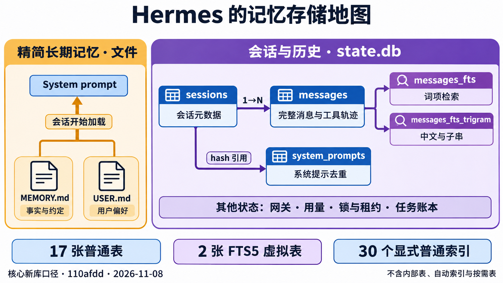

# Hermes 与本项目的记忆存储参考

本文是 [记忆系统详解](09-memory-system-guide.md) 的存储附录，回答“哪些内容放文件、哪些内容放数据库、到底有多少表和索引”。概念与执行时机先读主文；默认上下文压缩的实现细节见 [上下文压缩与长期记忆整理](08-context-compression.md)。本项目部分已更新为 L3 进阶实现，操作和断点教程见 [11 L3 历史检索](11-l3-history-retrieval.md)。Hermes 部分仍绑定下面的固定上游提交。



## 1. 版本和统计口径

Hermes 的数量以官方提交 [`110afdd60e3098b86950963b06a792e261bd36a4`](https://github.com/NousResearch/hermes-agent/commit/110afdd60e3098b86950963b06a792e261bd36a4) 为准，核对日期为 2026-11-08。该提交的 `SCHEMA_VERSION` 是 32。在线说明可能落后或只展示节选，因此不能仅根据文档中的架构树统计完整 Schema。

这里统计的是：**支持 FTS5 与 trigram 的 SQLite 环境中，核心新库正常初始化后的对象**。不把某个运行很久、启用了不同插件和 Gateway 功能的数据库当作唯一标准。

| 对象 | Hermes 核心新库 | 是否计入普通表或普通显式索引 |
| --- | ---: | --- |
| 普通表 | 17 | 普通表计数的主体 |
| FTS5 虚拟表 | 2 | 单列；不与 17 张普通表混算 |
| 全文索引读取的 source view | 2 | 视图；不计入普通表 |
| 显式普通索引，含显式唯一索引 | 30 | 普通索引计数的主体 |
| 主键／UNIQUE 约束生成的自动索引 | 15 | 另算；不是 30 中的一部分 |
| FTS5 管理的 shadow table | 内部实现对象 | 不作为业务表计数 |
| `sqlite_sequence` 等 SQLite 内部对象 | 内部实现对象 | 不作为业务表计数 |
| `delivery_obligations` 等按需创建的表 | 随实际功能而变化 | 不计入核心初始化的 17 张 |

其中 30 个显式普通索引来自：`SCHEMA_SQL` 的 15 个、`DEFERRED_INDEX_SQL` 的 13 个，以及初始化流程补建的 2 个。**30 不是全文索引的数量；本版本的全文索引是 2 个 FTS5 虚拟表。**

固定源码依据：[核心 Schema](https://github.com/NousResearch/hermes-agent/blob/110afdd60e3098b86950963b06a792e261bd36a4/hermes_state_common.py#L456)、[延后创建的索引](https://github.com/NousResearch/hermes-agent/blob/110afdd60e3098b86950963b06a792e261bd36a4/hermes_state_common.py#L783)、[初始化流程](https://github.com/NousResearch/hermes-agent/blob/110afdd60e3098b86950963b06a792e261bd36a4/hermes_state_schema.py#L899)。

## 2. 先区分文件和数据库

Hermes 内置的精选长期记忆仍是 Markdown 文件：`MEMORY.md` 保存环境、项目和工作约定等事实；`USER.md` 保存用户偏好和档案。它们在会话开始时形成系统提示快照，修改通过 `memory` 工具完成。数据库里的完整历史负责保存经历，`session_search` 再按需找回细节。**精选事实、历史原文和压缩摘要不是同一份数据。**

默认 profile 的状态数据库位于 Hermes home 下的 `state.db`；命名 profile 有各自的 home 和数据库。下文的表、索引都属于这种状态数据库，而不是把 Markdown 文件转换成一张 `memory` 表。文件和 profile 的规则见 [Hermes Persistent Memory](https://hermes-agent.nousresearch.com/docs/user-guide/features/memory) 与 [Session Storage](https://hermes-agent.nousresearch.com/docs/developer-guide/session-storage)。

## 3. Hermes 的 17 张普通表

下面列的是该固定版本的完整核心普通表清单。关键字段是为理解用途选取的摘要，并非每张表的全部列。

| 分组 | 表 | 关键字段或键 | 主要职责 |
| --- | --- | --- | --- |
| 会话与内容 | `sessions` | `id`、`parent_session_id`、`system_prompt_hash`、`source`、`session_key` | 会话身份、来源、路由线索、模型配置、活动状态、压缩失败状态、用量和展示信息；会话父子关系也在这里表达 |
| 会话与内容 | `messages` | `id`、`session_id`、`role`、`content`、`tool_calls`、`tool_call_id` | 用户输入、模型输出、工具声明和结果，以及推理协议、展示、活动／归档状态和逻辑消息身份 |
| 会话与内容 | `system_prompts` | `hash` 主键、`prompt` | 按哈希保存系统提示正文，供会话引用 |
| 用量 | `session_model_usage` | 会话、模型、计费路由与 `task` 组成复合主键 | 分会话、模型、路由和任务类别记录调用量、token 与费用 |
| 元数据 | `schema_version` | `version` | 数据迁移版本；不能仅凭版本相同就假定所有运行实例的实际对象完全一致 |
| 元数据 | `state_meta` | `key` 主键、`value` | 存储布局标记、FTS 重建进度等状态键值 |
| Gateway | `gateway_routing` | `(scope, session_key)` 复合主键、`entry_json` | 路由键到会话相关路由状态的持久映射 |
| Gateway | `gateway_hygiene_state` | `session_key` 主键、`failure_streak` | 会话卫生检查的连续失败状态 |
| Gateway | `conversation_generations` | `(source, session_key)` 复合主键、`generation` | 路由 peer 的单调会话代际，避免历史清理后重用已经退休的会话身份 |
| Gateway | `gateway_heartbeats` | `backend_id` 主键、`pid`、`last_heartbeat` | 后端存活心跳，为失去 owner 的运行状态判断提供依据 |
| 锁与租约 | `compression_locks` | `session_id` 主键、`holder`、`expires_at` | 跨进程压缩协调和过期控制 |
| 锁与租约 | `session_turn_leases` | `conversation_id` 主键、`holder`、`expires_at` | 会话回合的租约占用状态 |
| 运行账本 | `runtime_epoch` | 固定 singleton 整数主键、`epoch`、`instance_id` | 当前运行 owner 的代际身份 |
| 运行账本 | `session_admissions` | `seq`、唯一 `admission_id`、`target_session_id`、请求唯一键 | 用户输入的排队、开始、未知和终止状态，以及输入 payload、摘要和 owner 绑定 |
| 运行账本 | `worker_executions` | `execution_id` 主键、`session_id`、`owner_epoch`、`generation` | Cron、子任务、计算任务和 Kanban 等 worker 的执行身份与接管状态 |
| 运行账本 | `worker_receipts` | `(execution_id, sequence)` 复合主键、`payload_digest` | worker 有序结果回执及其内容指纹 |
| 异步委托 | `async_delegations` | `delegation_id` 主键、来源会话、任务与投递状态字段 | 异步委托任务、完成结果、owner 和结果投递重试状态 |

清单来自 [固定版本 `SCHEMA_SQL`](https://github.com/NousResearch/hermes-agent/blob/110afdd60e3098b86950963b06a792e261bd36a4/hermes_state_common.py#L456)。其中 Gateway、锁和 worker 表主要承担运行可靠性，不应全部解释为“记忆检索表”。

### 3.1 关键关系

以下关系有 SQL 外键约束：

| 从表字段 | 指向 | 含义 |
| --- | --- | --- |
| `sessions.parent_session_id` | `sessions.id` | 会话谱系，例如分支或压缩延续 |
| `sessions.system_prompt_hash` | `system_prompts.hash` | 系统提示正文引用 |
| `messages.session_id` | `sessions.id` | 消息归属会话 |
| `session_model_usage.session_id` | `sessions.id` | 用量归属会话，删除规则为 `CASCADE` |
| `session_admissions.target_session_id` | `sessions.id` | 输入进入的会话，删除规则为 `RESTRICT` |
| `worker_executions.session_id` | `sessions.id` | worker 关联的会话，删除规则为 `RESTRICT` |
| `worker_receipts.execution_id` | `worker_executions.execution_id` | 回执归属执行，删除规则为 `RESTRICT` |

字段名里有 `session_id` 不代表一定声明了外键。例如锁、租约、异步委托的一些会话字段属于逻辑关联。数据流图应区分这两种关系；不能看到同名字段就画成具有级联删除保证的数据库外键。

### 3.2 原始消息、活动消息与压缩代际

Hermes 的 `messages` 除正文外，还包括工具调用 JSON、调用结果 ID、推理字段、`active`／`compacted` 状态、展示身份和 `message_uid` 等字段。压缩后的可见上下文和可检索原始经历因此可以在同一张消息表中区分。

不要把“当前请求没有带这条消息”理解成“数据库已经删除原文”；也不要把压缩前后内容相同的行直接当成错误重复。物理行 `id`、逻辑消息身份和压缩代际是不同概念。具体运行语义仍应以该版本的压缩与会话实现为准，本文不建议手工清理这些行。

## 4. 两个全文索引和两个 source view

| 对象 | 类型 | 索引或投影内容 | 为什么存在 |
| --- | --- | --- | --- |
| `messages_fts_src` | 普通 view | 从 `messages` 投影 `id`、正文、工具名和工具调用；工具结果正文只取前 8192 字符 | 让首次构建、重建和同步触发器使用相同的可索引内容 |
| `messages_fts` | FTS5 虚拟表 | `content`、`tool_name`、`tool_calls`；外部内容来自 `messages_fts_src` | 按词进行全文搜索，找到消息原文或工具相关记录 |
| `messages_fts_trigram_src` | 普通 view | 消息与会话连接后投影 `id`、`role`、`content`、`tool_name`，并应用排除规则 | 为字符子串索引提供更小、边界一致的数据集 |
| `messages_fts_trigram` | FTS5 虚拟表 | `content`、`tool_name`；使用 `trigram` tokenizer，外部内容来自对应 view | 为中文等不依赖空格的子串查询提供索引支持 |

这两个 FTS 表采用外部内容模式：全文索引的 rowid 与源消息 id 对应，FTS 表负责检索结构，消息原文仍由源数据承载。FTS 的 `content_rowid` 对应关系不等于 SQL 外键约束。

插入、删除、更新消息时，同步触发器维护两种索引；重建过程还使用 `state_meta` 中的进度标记控制同步范围。因此不能只复制一份 FTS 表 DDL，就认为已实现了完整同步和恢复机制。源码见 [词索引及 source view](https://github.com/NousResearch/hermes-agent/blob/110afdd60e3098b86950963b06a792e261bd36a4/hermes_state_common.py#L955)、[trigram 及 source view](https://github.com/NousResearch/hermes-agent/blob/110afdd60e3098b86950963b06a792e261bd36a4/hermes_state_common.py#L1080)。

### 4.1 本版本 trigram 的边界

`messages_fts_trigram` 不是对全部消息无差别建立索引。本版本 source view 与触发器共同排除：

- `role = 'tool'` 的消息。
- `sessions.source = 'cron'` 的会话。
- `sessions.source = 'subagent'` 的会话。
- `model_config` 带有非空 `_delegate_from` 标记的委托子会话。

这些记录仍可保留在 `messages` 中，标准词索引也没有因为这套 trigram 排除规则而一并排除它们。压缩或分支延续仅有 `parent_session_id`、没有上述委托标记，并不因此被当成子代理会话排除。边界来自 [统一的 trigram 会话谓词](https://github.com/NousResearch/hermes-agent/blob/110afdd60e3098b86950963b06a792e261bd36a4/hermes_state_common.py#L1062)。

trigram 是字符片段索引，不等于中文语义分词、向量相似度或模型理解。具体查询策略仍需考虑短查询、符号和回退路径。

## 5. 30 个显式普通索引完整清单

以下是索引名称、键与筛选条件的整理，不是要求复制的迁移脚本。`DESC` 表示倒序；“部分索引”只覆盖满足条件的行。

### 5.1 `sessions`：12 个

| 索引名 | 键与条件 | 主要服务的查询 |
| --- | --- | --- |
| `idx_sessions_source` | `source` | 按会话来源筛选 |
| `idx_sessions_source_id` | `(source, id)` | 来源与会话身份联合查找 |
| `idx_sessions_parent` | `parent_session_id` | 会话谱系查询 |
| `idx_sessions_started` | `started_at DESC` | 按创建时间浏览 |
| `idx_sessions_session_key` | `(session_key, started_at DESC)` | 路由键下的近期会话 |
| `idx_sessions_gateway_peer` | `(source, user_id, chat_id, chat_type, thread_id, started_at DESC)` | 按平台用户、会话和线程定位 |
| `idx_sessions_handoff_state` | `(handoff_state, started_at)` | 按移交状态筛选 |
| `idx_sessions_system_prompt_hash` | `system_prompt_hash` | 系统提示引用查询 |
| `idx_sessions_tool_names` | `tool_names` | 工具能力相关筛选 |
| `idx_sessions_effective_activity` | `(COALESCE(last_activity_at, started_at) DESC, started_at DESC)` | 直接按持久活动时间预选近期会话，避免扫描消息计算活跃度 |
| `idx_sessions_local_created_started` | `(created_source, started_at DESC)`；部分条件 `source = 'local'` | 区分本地 CLI、TUI 等创建来源 |
| `idx_sessions_title_unique` | 唯一键 `title`；部分条件 `title IS NOT NULL` | 非空会话标题唯一性 |

### 5.2 `messages`：10 个

| 索引名 | 键与条件 | 主要服务的查询 |
| --- | --- | --- |
| `idx_messages_session` | `(session_id, timestamp)` | 会话内时间顺序读取 |
| `idx_messages_session_id` | `(session_id, id)` | 会话内按物理消息 id 读取 |
| `idx_messages_assistant_calls_by_session` | `session_id`；部分条件为 assistant 且 `tool_calls` 非空 | 工具使用统计等查询 |
| `idx_messages_session_active` | `(session_id, active, timestamp)` | 活动轨迹读取 |
| `idx_messages_display_page` | `(session_id, display_order, active DESC, id DESC)`；部分条件为活动或压缩归档行 | 展示分页 |
| `idx_messages_display_backfill` | `session_id`；部分条件为缺展示顺序或身份，且为活动或压缩归档行 | 展示元数据回填 |
| `idx_messages_display_identity` | `(session_id, display_identity, display_order)`；部分条件为展示身份非空，且为活动或压缩归档行 | 按逻辑展示身份读取 |
| `idx_messages_active_null` | `active`；部分条件 `active IS NULL` | 修复旧库中活动状态缺失的记录 |
| `idx_messages_session_uid` | `(session_id, message_uid)`；部分条件 `active = 1` | 活动消息的逻辑身份恢复 |
| `idx_messages_platform_msg_id` | `(session_id, platform_message_id)`；部分条件 `platform_message_id IS NOT NULL` | 平台输入身份相关查询 |

### 5.3 其他表：8 个

| 表 | 索引名 | 键与条件 |
| --- | --- | --- |
| `session_model_usage` | `idx_session_model_usage_session` | `session_id` |
| `session_model_usage` | `idx_session_model_usage_model` | `model` |
| `session_admissions` | `session_admissions_pending` | `(target_session_id, status, seq)` |
| `session_admissions` | `idx_session_admissions_cron_request` | `(principal_id, request_id, target_session_id)`；仅调度器的 `CRON_PRINCIPAL_ID` |
| `worker_executions` | `idx_worker_executions_session_status` | `(session_id, status)` |
| `compression_locks` | `idx_compression_locks_expires` | `expires_at` |
| `session_turn_leases` | `idx_session_turn_leases_expires` | `expires_at` |
| `async_delegations` | `idx_async_delegations_delivery` | `(delivery_state, completed_at)` |

核对合计：`12 + 10 + 8 = 30`。

其中标题唯一索引由 [初始化后的标题约束修复](https://github.com/NousResearch/hermes-agent/blob/110afdd60e3098b86950963b06a792e261bd36a4/hermes_state_schema.py#L1173) 保证；平台消息 ID 索引在 [初始化流程](https://github.com/NousResearch/hermes-agent/blob/110afdd60e3098b86950963b06a792e261bd36a4/hermes_state_schema.py#L943) 补建。其余 28 个声明见 [基础索引](https://github.com/NousResearch/hermes-agent/blob/110afdd60e3098b86950963b06a792e261bd36a4/hermes_state_common.py#L613) 和 [延后索引](https://github.com/NousResearch/hermes-agent/blob/110afdd60e3098b86950963b06a792e261bd36a4/hermes_state_common.py#L783)。

### 5.4 为什么数据库查看器可能显示更多

SQLite 会为适用的主键和唯一约束建立自动索引，通常显示为 `sqlite_autoindex_<表名>_<序号>`。本核心 Schema 的这类自动索引共有 15 个，独立于上面的 30 个。`INTEGER PRIMARY KEY` 通常直接使用 rowid，不能简单按“主键个数”推算自动索引数量。

FTS5 还管理自己的 shadow tables，例如 `<fts名>_data`、`_idx`、`_docsize`、`_config`。不同 FTS 配置、SQLite 版本与存储布局的内部对象可能不同，不能把它们视为新的 Hermes 业务表。SQLite 的 `sqlite_schema.type = 'table'` 也同时用于普通表和虚拟表，仅统计这个字段会把多个类别混起来。参见 [SQLite Schema Table](https://www.sqlite.org/schematab.html) 与 [FTS5 外部内容表](https://www.sqlite.org/fts5.html#external_content_and_contentless_tables)。

Gateway 的 [delivery ledger](https://github.com/NousResearch/hermes-agent/blob/110afdd60e3098b86950963b06a792e261bd36a4/gateway/delivery_ledger.py) 还可按需创建 `delivery_obligations`，记录待完成的投递义务。迁移历史、启用功能和扩展都可能使运行实例增加对象，所以“核心新库的表数”不等于“所有 Hermes 实例固定只有这些表”。

## 6. 我们项目的数据库结构

**当前项目已接入 FTS5 词索引、trigram、BM25、稳定消息锚点和原文窗口读取。** LIKE 负责短中文、符号字面查询及能力缺失/零命中回退；没有向量检索。候选来自 [SessionStore](../src/memory/store.ts) 与 [HistorySearch](../src/memory/history-search.ts)，经 [L3](../src/learning/exercises.ts) 排序选取，再由 [历史工具](../src/core/history-tools.ts) 整理输出。

2026-11-08 用临时新库实测，SQLite 为 3.53.0，FTS5 与 trigram 均可用。以下普通表和索引统计排除 `sqlite_sequence` 与 FTS shadow 对象：

| 初始化范围 | 普通表 | 显式普通 B-tree 索引 | 普通表主键／UNIQUE 自动索引 | FTS5 虚拟表 | 同步触发器 |
| --- | ---: | ---: | ---: | ---: | ---: |
| 只有 `SessionStore` | 5 | 2 | 5 | 2 | 3 |
| `SessionStore` 加 `Gateway` | 6 | 2 | 6 | 2 | 3 |

上述运行时另外产生 **8 张 FTS shadow table**，每个虚拟表各有 `_data`、`_idx`、`_docsize`、`_config`。它们是 SQLite 维护倒排索引的内部存储，不是 8 张项目业务表。`pragma_table_list` 分别将普通表、虚拟表与 shadow 表报告为 `table`、`virtual`、`shadow`；只统计 `sqlite_schema.type = 'table'` 会把三种对象相加。这里的 2 个显式 B-tree 索引也不包含 2 个全文虚拟表，更不包含 shadow 表内部的索引。

这些数量绑定支持两种 FTS 能力的新库。缺少模块或分词器的 SQLite 构建可用 LIKE 回退；曾经启用 FTS 的库也可能保留现有派生对象。应同时查看实际对象与 `store.searchCapabilities()`，不能只用表名判断当前启用的查询路径。本项目直接以 `messages` 为外部内容来源，没有 Hermes 的两个 source view。

`SessionStore` 即使使用默认压缩链路，也会创建两种检查点表；表存在不代表两种引擎同时运行。默认只使用 Hermes 式异步 L2。程序显式设置 `AgentOptions.contextEngine: 'checkpoint'` 才选择兼容库模式。CLI 的 `--compression advanced` 默认仍是异步 L2，不会开启两层叠加压缩。

### 6.1 表、关键列与职责

| 表 | 核心列 | 含义 |
| --- | --- | --- |
| `sessions` | `id` 文本主键、唯一 `session_key`、`scope`、`system_prompt`、`created_at` | 会话身份、用户范围及冻结的系统提示 |
| `messages` | 自增整数 `id`、`session_id`、`payload`、`content`、`created_at` | 成功回合的原始轨迹；`payload` 保留结构化协议字段，`content` 作为全文索引来源和字面回退搜索正文 |
| `context_checkpoints` | `session_id` 主键、`payload`、`message_count`、`compression_state` | 默认异步 L2 的工作消息列表、水位与冷却状态 |
| `summary_checkpoints` | `session_id` 主键、`generation`、`covered_count`、`prefix_hash`、`summary`、`updated_at` | 可选 `ContextEngine` 的前缀摘要、代际和 SHA256 校验信息 |
| `history_search_meta` | `key` 文本主键、`value` | 全文索引版本与 dirty 标记，决定首次回填和能力恢复后的重建；不保存原文和模型事实 |
| `gateway_events` | `event_key` 文本主键、`payload_hash`、`session_key`、`response`、`completed_at` | Gateway 成功事件缓存与同事件不同内容的冲突检测 |

`messages.session_id` 和两张检查点表的 `session_id` 都引用 `sessions.id`。`gateway_events.session_key` 是逻辑路由键，没有声明到 `sessions` 的数据库外键。不要据此假设删除会话会自动删除事件缓存。

前五张由 SessionStore 初始化，`gateway_events` 由 Gateway 按需初始化。表定义：[会话存储](../src/memory/store.ts)、[检索元数据](../src/memory/history-search.ts)、[Gateway 事件存储](../src/gateway/router.ts)。

### 6.2 两个显式 B-tree 索引、两个全文虚拟表与三个触发器

| 索引名 | 所属表与键 | 作用 |
| --- | --- | --- |
| `messages_session` | `messages(session_id, id)` | 按会话顺序恢复原始消息，并支持按 ID 读取窗口与 keyset 翻页 |
| `sessions_scope` | `sessions(scope)` | 支持按用户范围筛选和历史搜索连接 |

`sessions.id` 与唯一 `session_key` 分别生成一个自动索引，两张检查点表的 `session_id` 主键各生成一个，`history_search_meta.key` 再生成一个，合计 5 个；Gateway 事件主键使其变为 6 个。这些 `sqlite_autoindex_*` 不算上表两个显式索引。`messages.id INTEGER PRIMARY KEY` 使用 rowid 身份，不另生成同类自动索引。

| 全文对象 | 定义要点 | 职责 |
| --- | --- | --- |
| `messages_fts` | `fts5(content, content='messages', content_rowid='id')` | 普通词项全文召回与 BM25 排序 |
| `messages_fts_trigram` | 同一外部内容来源，加 `tokenize='trigram'` | 三字符片段子串召回与本来源 BM25 |

两种索引的 `rowid` 都对应 `messages.id`。外部内容模式让原文仍以 `messages` 为准，但不会自动同步写入，必须由下面三个触发器维护。当前直接索引全部 `messages.content`，包括工具正文，没有照搬上游的工具前缀上限、trigram 工具排除和后台来源过滤。BM25 从所用 FTS 表计算，不是 `messages_session` 这个 B-tree 索引提供的分数。

| 同步触发器 | 事件 | 对每个可用全文索引执行的操作 |
| --- | --- | --- |
| `messages_search_insert` | `AFTER INSERT ON messages` | 写入 `new.id` 与 `new.content` |
| `messages_search_delete` | `AFTER DELETE ON messages` | 用 `old.id`、`old.content` 写入 FTS 的 delete 命令 |
| `messages_search_update` | `AFTER UPDATE OF id, content ON messages` | 删除旧索引项，再写入新索引项 |

这三个触发器在同一原文写入事务内运行，因此原文事务回滚时不会留下本轮的索引项。即使测试选用 `forceLike`，底层实际可用的全文索引仍同步，恢复 FTS 查询后不漏掉期间写入的消息。

### 6.3 默认工作 checkpoint 与事务

默认模式将工作上下文保存为 `context_checkpoints.payload`。`message_count` 记录生成这份视图时对应的原始消息数量。下次恢复时：

1. 如果存在 payload 且水位与当前原始消息数量相同，读取保存的工作视图。
2. 没有 checkpoint，或外部追加使水位失配，退回完整原始历史。
3. `compression_state` 独立保存 `cooldownUntil`、`failures`、`lastFailure` 和 `nextAttemptChars`，供下一回合继续执行失败冷却及无进展退避。

**数量水位不是内容指纹。** 本模式能发现新增消息造成的数量变化，不应写成能够检测任何数据库原地改写；后者与可选库模式的前缀 SHA256 不是同一种保证。

成功回合先由 Agent 校验完整 assistant/tool 结构，再通过 `appendMessages`／`commitTurn` 在同一 SQLite 事务中追加 `[user, ...delta]` 和工作视图。摘要请求不在数据库事务内运行，不持有写锁等待网络。非取消失败可以单独保存冷却信息，但不能发布未完成回合的用户消息、delta 或工作视图。取消同样不提交这些派生结果。

因此，本项目的 `messages` 是**成功回合的完整历史**，不是所有失败输入的审计账本。长期记忆工具已经写入的文件属于另外的副作用，后续回合失败不保证撤销。实现见 [Agent](../src/core/agent.ts)、[默认压缩 Provider](../src/core/compression/provider.ts)、[SessionStore](../src/memory/store.ts)。

### 6.4 可选摘要 checkpoint 与旧库迁移

可选库模式用 `summary_checkpoints` 表，不使用默认工作视图格式。提交前同时验证：

- `covered_count` 是合法的正整数，不能超过历史范围或回退到已提交覆盖范围之前。
- 原始前缀的 SHA256 等于 `prefix_hash`；指纹包含协议元数据。
- 覆盖边界没有拆开工具声明和结果，合法指纹本身不能证明边界合法。
- `expectedGeneration` 与当前代际一致；成功保存才递增代际。

原始消息与摘要同事务提交，任一校验或写入失败全部回滚。一次回合中间产生的候选摘要只保留在内存，最终答复成功后才发布。

两条历史开发线曾把不同格式都命名为 `context_checkpoints`。当前初始化通过列集合识别旧格式：具有 `generation` 且没有 `compression_state` 的旧表，会在事务中改名为 `summary_checkpoints`，随后建立默认工作上下文表；原始 `messages` 不改写。若旧摘要表与目标摘要表异常同时存在，明确拒绝覆盖；不能把“自动迁移”理解为会猜测两份数据该保留哪份。

实现：[SessionStore](../src/memory/store.ts)、[可选 ContextEngine](../src/core/context-engine.ts)；回归：[旧库迁移与统一事务](../tests/store-merge.test.ts)、[摘要提交边界](../tests/context-checkpoint.test.ts)。

### 6.5 全文索引升级、重建与原文读取

`HistorySearch` 用 SAVEPOINT 在一次初始化中创建元数据、全文虚拟表和同步触发器。首次接入的旧库不会自动包含历史词项，因此在安装触发器后，对已有 `messages` 执行 FTS `rebuild`，再记录每种索引的 `:version` 与 `:dirty`。当前索引版本是 `1`，它位于 `history_search_meta`，不占用项目其他模块的 `PRAGMA user_version`。已完成初始化的正常重启不反复回填；不能识别的较新索引版本或不兼容表定义会明确报错。

运行时真实缺少 FTS5 模块或 trigram 分词器时，移除不可用索引的同步依赖并标记 dirty；以后能力恢复，再从原文重建缺失期间的索引项。显式选择 LIKE 或禁用 trigram 查询与真正缺少扩展不同：如果本地底层扩展仍存在，派生索引继续保持同步。SQL 错误、数据库损坏和锁错误不会被一律当成“没有 FTS”吞掉。实现与回归见 [HistorySearch](../src/memory/history-search.ts)、[history-search.test.ts](../tests/history-search.test.ts)。

原文返回分为两个步骤：

```text
history_search(query)
  → 当前 scope 内的 FTS/trigram/LIKE 候选
  → L3 排序、身份去重，最多 5 个命中
  → sessionId + messageId + 正文预览 + source/rank
history_read(session_id, around_message_id, limit)
  → 从 messages.payload 读取原始消息窗口
  → beforeCursor/afterCursor 继续按 ID 翻页
  → 长正文使用 content_offset/nextContentOffset 续读
```

`readHistory` 库 API 的页内消息按 ID 升序，返回 `{ id, sessionId, message, createdAt }`，并保留存储的协议元数据。窗口默认 10 条、最多 50 条；around/before/after 三种锚点互斥，锚点必须属于目标会话。分页基于 `(session_id, id)`，不使用随新增记录移动的 OFFSET，也不要求全库 ID 在某个会话内连续。跨 scope 与不存在的会话使用相同拒绝信息。

`history_read` 工具在此基础上移除旧 `reasoningContent`、将历史工具调用概括为工具名，并在总体输出预算内限制正文预览。它保留消息 ID、分页字段、`originalContentChars`、`contentOffset`、`contentTruncated` 与可用的 `nextContentOffset`。正文续读需固定 `around_message_id` 和单条消息；`content_chars` 默认 2000、范围 1～6000。字符偏移采用 JavaScript UTF-16 `.length`，不是 token。原文仍在数据库中，不因预览缩短而改写。使用示例、调试断点与离线演示见 [L3 历史检索](11-l3-history-retrieval.md)。

## 7. 只读检查一个实际数据库

检查运行实例时，应报告数据库版本、对象类别和过滤规则，而不是只给一个 `COUNT(*)`。下面的查询**只读取元数据**，不创建索引、不重建 FTS、不迁移数据库。

建议使用已经准备好的、一致的离线副本；不要在数据库正在使用 WAL 时仅复制主 `.db` 文件就假定拿到了完整快照。以下命令是占位路径示例，需自行替换为离线副本路径，`-readonly` 防止误建或写入数据库：

```sh
sqlite3 -readonly /absolute/path/to/offline-copy/state.db
```

### 7.1 先确认 SQLite 版本和对象类别

`PRAGMA table_list` 以及下面使用的 `pragma_table_list` 需要 SQLite 3.37.0 或更新版本；它能区分普通表、虚拟表、shadow table 与 view。旧版可先列出 `sqlite_schema` 逐项核对，不能使用缺少分类能力的计数冒充相同口径。规则见 [SQLite PRAGMA table_list](https://www.sqlite.org/pragma.html#pragma_table_list)。

```sql
SELECT sqlite_version();

-- 同时查看普通表、虚拟表、FTS 内部表和视图。
SELECT name, type, ncol, wr
FROM pragma_table_list
WHERE schema = 'main'
  AND name NOT GLOB 'sqlite_*'
ORDER BY type, name;

-- 分类统计。这里的 table 才是本文使用的“普通表”口径。
SELECT type, COUNT(*) AS object_count
FROM pragma_table_list
WHERE schema = 'main'
  AND name NOT GLOB 'sqlite_*'
GROUP BY type
ORDER BY type;
```

如需确认某个虚拟表是否真是 FTS5，读取其创建 SQL，检查使用的模块和外部内容配置。虚拟表这个类别本身并不专属于 FTS5：

```sql
SELECT s.name, s.sql
FROM main.sqlite_schema AS s
JOIN pragma_table_list AS t
  ON t.schema = 'main' AND t.name = s.name
WHERE s.type = 'table' AND t.type = 'virtual'
ORDER BY s.name;
```

### 7.2 分开列出显式索引和自动索引

SQLite 的 Schema 中，自动主键／唯一索引的 `sql` 为 NULL；显式创建的索引有创建 SQL。下面连接普通表清单，避免把虚拟表实现拥有的内部对象算作业务索引。

```sql
-- 普通表上的显式索引：当前所核对的 Hermes 核心新库为 30 个。
SELECT s.tbl_name, s.name, s.sql
FROM main.sqlite_schema AS s
JOIN pragma_table_list AS t
  ON t.schema = 'main' AND t.name = s.tbl_name
WHERE s.type = 'index'
  AND s.sql IS NOT NULL
  AND t.type = 'table'
  AND t.name NOT GLOB 'sqlite_*'
ORDER BY s.tbl_name, s.name;

-- 普通表上的自动索引：独立于上面的显式索引统计。
SELECT s.tbl_name, s.name
FROM main.sqlite_schema AS s
JOIN pragma_table_list AS t
  ON t.schema = 'main' AND t.name = s.tbl_name
WHERE s.type = 'index'
  AND s.sql IS NULL
  AND t.type = 'table'
  AND t.name NOT GLOB 'sqlite_*'
ORDER BY s.tbl_name, s.name;

-- 按普通表汇总两类索引数量。
SELECT s.tbl_name,
       SUM(s.sql IS NOT NULL) AS explicit_indexes,
       SUM(s.sql IS NULL) AS automatic_indexes
FROM main.sqlite_schema AS s
JOIN pragma_table_list AS t
  ON t.schema = 'main' AND t.name = s.tbl_name
WHERE s.type = 'index'
  AND t.type = 'table'
  AND t.name NOT GLOB 'sqlite_*'
GROUP BY s.tbl_name
ORDER BY s.tbl_name;
```

进一步查看某个索引的键和部分索引标志，也只需要读取元数据：

```sql
PRAGMA main.index_list('messages');
PRAGMA main.index_xinfo('idx_messages_session');
```

项目自身的消息索引名为 `messages_session`，上面的 `idx_messages_session` 属于 Hermes 固定版本。还可单独检查触发器，避免把它们误计为表或索引：

```sql
SELECT name, tbl_name, sql
FROM main.sqlite_schema
WHERE type = 'trigger'
ORDER BY tbl_name, name;
```

不要执行 `UPDATE sqlite_schema`、`DROP`、FTS `rebuild` 或 `VACUUM` 来“检查”数量；这些是写入或维护操作，和只读 inspection 的目的不同。若实际数量与本文不同，先核对固定提交、SQLite 能力、迁移状态和按需表，再解释差异。

## 8. 阅读与源码入口

- 概念、调用时机和对照图：[记忆系统详解](09-memory-system-guide.md)。
- 本项目默认请求链路：[Agent](../src/core/agent.ts)、[L2/L3](../src/learning/exercises.ts)、[压缩运行时](../src/core/compression/compressor.ts)。
- 本项目文件记忆：[LongTermMemory](../src/memory/long-term.ts)、[memory-only flush](../src/core/memory-flush.ts)。
- 本项目历史与恢复：[SessionStore](../src/memory/store.ts)、[候选全文搜索](../src/memory/history-search.ts)、[搜索/窗口工具](../src/core/history-tools.ts)、[Gateway](../src/gateway/router.ts)。
- L3 实现与离线验收：[L3 历史检索](11-l3-history-retrieval.md)、[进阶集成测试](../tests/recall-upgrade.test.ts)。
- Hermes 固定版本：[核心声明](https://github.com/NousResearch/hermes-agent/blob/110afdd60e3098b86950963b06a792e261bd36a4/hermes_state_common.py)、[初始化与补充索引](https://github.com/NousResearch/hermes-agent/blob/110afdd60e3098b86950963b06a792e261bd36a4/hermes_state_schema.py)、[FTS 维护](https://github.com/NousResearch/hermes-agent/blob/110afdd60e3098b86950963b06a792e261bd36a4/hermes_state_fts.py)。

本文的表和索引清单服务于理解存储边界，不代表要把 Hermes 的全部运行账本直接搬入教学项目。当前 FTS 升级已覆盖首次回填、同步、重建、查询边界、scope 隔离和离线回归；Hermes 的 source view、lineage、后台来源筛选与更丰富的会话浏览仍是后续差异。
