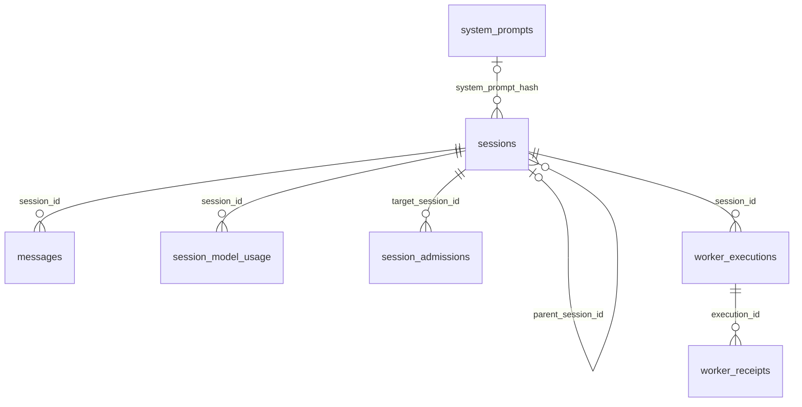
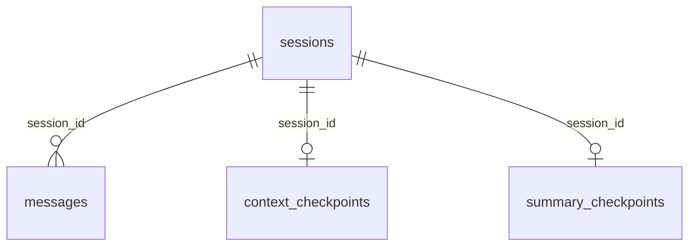

# Hermes 与本项目的 SQLite 表和索引设计

本文是 [记忆系统详解](09-memory-system-guide.md) 的存储附录，按“表与关系 → 查询 SQL → 索引 → 事务与执行计划”解释两边的设计。Hermes 将历史、压缩状态、路由与运行账本放进 SQLite；我们保留成功回合原文，用独立 checkpoint 保存工作上下文。两边的长期精选记忆仍是 Markdown 文件。

快速阅读：[统计口径](#1-版本和统计口径) → [Hermes 表清单](#3-hermes-的-17-张普通表) → [Hermes 索引清单](#5-30-个显式普通索引完整清单) → [我们项目的结构](#6-我们项目的数据库结构) → [关键 SQL 和执行计划](#8-关键-sql-与索引如何配合) → [设计取舍](#9-两边的设计取舍)。模型何时调用搜索、如何续读原文，见 [L3 历史检索教程](11-l3-history-retrieval.md)。


## 1. 版本和统计口径

本次核对日期为 **2026-11-09**。Hermes 以本机 `/Users/bill/code/hermes-agent` 的干净源码提交 [`29a61cb7ab509cda0c376bf3860edb87210b0755`](https://github.com/NousResearch/hermes-agent/commit/29a61cb7ab509cda0c376bf3860edb87210b0755) 为准，`SCHEMA_VERSION = 32`；本项目实现基线为 `eddd1a356bf013d26465b7ada2eee59eabba085a`。本页原先引用 `110afdd`，此次更新为本机可核对的版本；不能根据提交哈希大小或文档日期推断代码新旧。

下面统计的是 **FTS5 和 trigram 可用、未加载额外 `cjk_unicode61` 扩展的核心 DDL 基线**。在 Node 内置 SQLite **3.50.4** 的临时库中执行 Hermes 的 `SCHEMA_SQL`、`DEFERRED_INDEX_SQL`、两条补充索引 DDL、`FTS_SQL` 和 `FTS_TRIGRAM_SQL`，核对实际对象；不启动 Hermes 服务或迁移个人数据库。我们的数量通过真实 `SessionStore` 和 `Gateway` 初始化测得。这不是所有运行实例的固定上限。

| 对象 | Hermes 核心 DDL 基线 | 是否计入普通表或普通显式索引 |
| --- | ---: | --- |
| 普通表 | 17 | 普通表计数的主体 |
| FTS5 虚拟表 | 2 | 单列；不与 17 张普通表混算 |
| 全文索引读取的 source view | 2 | 视图；不计入普通表 |
| 显式普通索引，含显式唯一索引 | 30 | 普通索引计数的主体 |
| 主键／UNIQUE 约束生成的自动索引 | 15 | 另算；不是 30 中的一部分 |
| FTS5 管理的 shadow table | 8 | 不作为业务表计数 |
| 触发器 | 13 | 7 个消息／运行状态触发器，6 个全文同步触发器；不算表或索引 |
| `sqlite_sequence` 等 SQLite 内部对象 | 内部实现对象 | 不作为业务表计数 |
| `delivery_obligations` 等按需创建的表 | 随实际功能而变化 | 不计入核心初始化的 17 张 |

其中 30 个显式普通索引来自：`SCHEMA_SQL` 的 15 个、`DEFERRED_INDEX_SQL` 的 13 个，以及初始化流程补建的 2 个。**30 是普通显式索引数，2 是此基线的 FTS5 虚拟表数。**

Hermes 还会按原生扩展能力创建第三个全文索引 `messages_fts_cjk`，以及 `messages_fts_cjk_src` 视图和对应触发器，见 [CJK 初始化](https://github.com/NousResearch/hermes-agent/blob/29a61cb7ab509cda0c376bf3860edb87210b0755/hermes_state_fts.py#L352)。因此看到 3 个 FTS 表不表示统计错误；应先确认扩展是否加载、索引是否就绪，再看本页基线数量。

| 同口径比较 | Hermes 基线 | 我们的 SessionStore | 再启用我们的 Gateway |
| --- | ---: | ---: | ---: |
| 普通表 | 17 | 5 | 6 |
| 显式普通索引 | 30 | 2 | 2 |
| 普通表自动索引 | 15 | 5 | 6 |
| FTS 虚拟表 | 2 | 2 | 2 |
| source view | 2 | 0 | 0 |
| FTS shadow table | 8 | 8 | 8 |
| 触发器 | 13 | 3 | 3 |

固定源码依据：[核心 Schema](https://github.com/NousResearch/hermes-agent/blob/29a61cb7ab509cda0c376bf3860edb87210b0755/hermes_state_common.py#L451)、[延后创建的索引](https://github.com/NousResearch/hermes-agent/blob/29a61cb7ab509cda0c376bf3860edb87210b0755/hermes_state_common.py#L778)、[初始化流程](https://github.com/NousResearch/hermes-agent/blob/29a61cb7ab509cda0c376bf3860edb87210b0755/hermes_state_schema.py#L940)。

## 2. 先区分文件和数据库

Hermes 内置的精选长期记忆仍是 Markdown 文件：`MEMORY.md` 保存环境、项目和工作约定等事实；`USER.md` 保存用户偏好和档案。它们在会话开始时形成系统提示快照，修改通过 `memory` 工具完成。数据库里的完整历史负责保存经历，`session_search` 再按需找回细节。**精选事实、历史原文和压缩摘要不是同一份数据。**

默认 profile 的状态数据库位于 Hermes home 下的 `state.db`；命名 profile 有各自的 home 和数据库。下文的表、索引都属于这种状态数据库，而不是把 Markdown 文件转换成一张 `memory` 表。文件和 profile 的规则见 [Hermes Persistent Memory](https://hermes-agent.nousresearch.com/docs/user-guide/features/memory) 与 [Session Storage](https://hermes-agent.nousresearch.com/docs/developer-guide/session-storage)。

## 3. Hermes 的 17 张普通表

下面列的是该固定版本的完整核心普通表清单。关键字段是为理解用途选取的摘要，并非每张表的全部列。

| 分组 | 表 | 关键字段或键 | 主要职责 |
| --- | --- | --- | --- |
| 会话与内容 | `sessions` | `id`、`parent_session_id`、`system_prompt_hash`、`source`、`session_key` | 会话身份、来源、路由线索、模型配置、活动状态、压缩失败状态、用量和展示信息；会话父子关系也在这里表达 |
| 会话与内容 | `messages` | `id`、`session_id`、`role`、`content`、`tool_calls`、`tool_call_id` | 用户输入、模型输出、工具声明和结果，以及推理协议、展示、活动／归档状态和逻辑消息身份 |
| 会话与内容 | `system_prompts` | `hash` 主键、`prompt` | 按哈希保存系统提示正文，供会话引用 |
| 用量 | `session_model_usage` | 会话、模型、计费路由与 `task` 组成复合主键 | 分会话、模型、路由和任务类别记录调用量、token 与费用 |
| 元数据 | `schema_version` | `version` | 数据迁移版本；不能仅凭版本相同就假定所有运行实例的实际对象完全一致 |
| 元数据 | `state_meta` | `key` 主键、`value` | 存储布局标记、FTS 重建进度等状态键值 |
| Gateway | `gateway_routing` | `(scope, session_key)` 复合主键、`entry_json` | 路由键到会话相关路由状态的持久映射 |
| Gateway | `gateway_hygiene_state` | `session_key` 主键、`failure_streak` | 会话卫生检查的连续失败状态 |
| Gateway | `conversation_generations` | `(source, session_key)` 复合主键、`generation` | 路由 peer 的单调会话代际，避免历史清理后重用已经退休的会话身份 |
| Gateway | `gateway_heartbeats` | `backend_id` 主键、`pid`、`last_heartbeat` | 后端存活心跳，为失去 owner 的运行状态判断提供依据 |
| 锁与租约 | `compression_locks` | `session_id` 主键、`holder`、`expires_at` | 跨进程压缩协调和过期控制 |
| 锁与租约 | `session_turn_leases` | `conversation_id` 主键、`holder`、`expires_at` | 会话回合的租约占用状态 |
| 运行账本 | `runtime_epoch` | 固定 singleton 整数主键、`epoch`、`instance_id` | 当前运行 owner 的代际身份 |
| 运行账本 | `session_admissions` | `seq`、唯一 `admission_id`、`target_session_id`、请求唯一键 | 用户输入的排队、开始、未知和终止状态，以及输入 payload、摘要和 owner 绑定 |
| 运行账本 | `worker_executions` | `execution_id` 主键、`session_id`、`owner_epoch`、`generation` | Cron、子任务、计算任务和 Kanban 等 worker 的执行身份与接管状态 |
| 运行账本 | `worker_receipts` | `(execution_id, sequence)` 复合主键、`payload_digest` | worker 有序结果回执及其内容指纹 |
| 异步委托 | `async_delegations` | `delegation_id` 主键、来源会话、任务与投递状态字段 | 异步委托任务、完成结果、owner 和结果投递重试状态 |

清单来自 [固定版本 `SCHEMA_SQL`](https://github.com/NousResearch/hermes-agent/blob/29a61cb7ab509cda0c376bf3860edb87210b0755/hermes_state_common.py#L451)。其中 Gateway、锁和 worker 表主要承担运行可靠性，不应全部解释为“记忆检索表”。

### 3.1 关键关系

以下关系有 SQL 外键约束：

| 从表字段 | 指向 | 含义 |
| --- | --- | --- |
| `sessions.parent_session_id` | `sessions.id` | 会话谱系，例如分支或压缩延续 |
| `sessions.system_prompt_hash` | `system_prompts.hash` | 系统提示正文引用 |
| `messages.session_id` | `sessions.id` | 消息归属会话 |
| `session_model_usage.session_id` | `sessions.id` | 用量归属会话，删除规则为 `CASCADE` |
| `session_admissions.target_session_id` | `sessions.id` | 输入进入的会话，删除规则为 `RESTRICT` |
| `worker_executions.session_id` | `sessions.id` | worker 关联的会话，删除规则为 `RESTRICT` |
| `worker_receipts.execution_id` | `worker_executions.execution_id` | 回执归属执行，删除规则为 `RESTRICT` |

字段名里有 `session_id` 不代表一定声明了外键。例如锁、租约、异步委托的一些会话字段属于逻辑关联。数据流图应区分这两种关系；不能看到同名字段就画成具有级联删除保证的数据库外键。

### 3.2 原始消息、活动消息与压缩代际

Hermes 的 `messages` 除正文外，还包括工具调用 JSON、调用结果 ID、推理字段、`active`／`compacted` 状态、展示身份和 `message_uid` 等字段。压缩后的可见上下文和可检索原始经历因此可以在同一张消息表中区分。

不要把“当前请求没有带这条消息”理解成“数据库已经删除原文”；也不要把压缩前后内容相同的行直接当成错误重复。物理行 `id`、逻辑消息身份和压缩代际是不同概念。具体运行语义仍应以该版本的压缩与会话实现为准，本文不建议手工清理这些行。

下面只画与阅读历史直接相关的数据库外键；其余运行账本关系见上一张表。



`system_prompts` 用 SHA256 内容哈希做主键。同一提示正文可被多个会话引用；会话保存 `system_prompt_hash`，旧的内联 `system_prompt` 字段仍用于兼容。这样大段系统提示不必在每个会话行重复保存。写入入口见 [`_store_system_prompt`](https://github.com/NousResearch/hermes-agent/blob/29a61cb7ab509cda0c376bf3860edb87210b0755/hermes_state.py#L516)。

## 4. 两个全文索引和两个 source view

| 对象 | 类型 | 索引或投影内容 | 为什么存在 |
| --- | --- | --- | --- |
| `messages_fts_src` | 普通 view | 从 `messages` 投影 `id`、正文、工具名和工具调用；工具结果正文只取前 8192 字符 | 让首次构建、重建和同步触发器使用相同的可索引内容 |
| `messages_fts` | FTS5 虚拟表 | `content`、`tool_name`、`tool_calls`；外部内容来自 `messages_fts_src` | 按词进行全文搜索，找到消息原文或工具相关记录 |
| `messages_fts_trigram_src` | 普通 view | 消息与会话连接后投影 `id`、`role`、`content`、`tool_name`，并应用排除规则 | 为字符子串索引提供更小、边界一致的数据集 |
| `messages_fts_trigram` | FTS5 虚拟表 | `content`、`tool_name`；使用 `trigram` tokenizer，外部内容来自对应 view | 为中文等不依赖空格的子串查询提供索引支持 |

这两个 FTS 表采用外部内容模式：全文索引的 rowid 与源消息 id 对应，FTS 表负责检索结构，消息原文仍由源数据承载。FTS 的 `content_rowid` 对应关系不等于 SQL 外键约束。

插入、删除、更新消息时，同步触发器维护两种索引；重建过程还使用 `state_meta` 中的进度标记控制同步范围。因此不能只复制一份 FTS 表 DDL，就认为已实现了完整同步和恢复机制。源码见 [词索引及 source view](https://github.com/NousResearch/hermes-agent/blob/29a61cb7ab509cda0c376bf3860edb87210b0755/hermes_state_common.py#L945)、[trigram 及 source view](https://github.com/NousResearch/hermes-agent/blob/29a61cb7ab509cda0c376bf3860edb87210b0755/hermes_state_common.py#L1067)。

### 4.1 本版本 trigram 的边界

`messages_fts_trigram` 不是对全部消息无差别建立索引。本版本 source view 与触发器共同排除：

- `role = 'tool'` 的消息。
- `sessions.source = 'cron'` 的会话。
- `sessions.source = 'subagent'` 的会话。
- `model_config` 带有非空 `_delegate_from` 标记的委托子会话。

这些记录仍可保留在 `messages` 中，标准词索引也没有因为这套 trigram 排除规则而一并排除它们。压缩或分支延续仅有 `parent_session_id`、没有上述委托标记，并不因此被当成子代理会话排除。边界来自 [统一的 trigram 会话谓词](https://github.com/NousResearch/hermes-agent/blob/29a61cb7ab509cda0c376bf3860edb87210b0755/hermes_state_common.py#L1050)。

trigram 是字符片段索引，不等于中文语义分词、向量相似度或模型理解。具体查询策略仍需考虑短查询、符号和回退路径。

### 4.2 可选的 CJK 双字符索引

本机源码还定义 `messages_fts_cjk`，使用需要单独加载的 `cjk_unicode61` 分词器，将连续 CJK 文字拆成重叠双字符片段，补充短中文等检索能力。它的 source view 排除工具行，并索引 `content`、`tool_name`、`tool_calls`；**该视图没有 trigram 的 cron/subagent 排除谓词**，不能把两者的覆盖范围混为一谈。

扩展不可加载时不启用这个查询路径；现存表可能保留，但同步触发器会停用并记录 stale 状态。索引在回填完成前也不能作为完整索引使用。定义与就绪检查见 [hermes_state_fts.py](https://github.com/NousResearch/hermes-agent/blob/29a61cb7ab509cda0c376bf3860edb87210b0755/hermes_state_fts.py#L40)。我们的项目只用 SQLite 内置词索引与 trigram，短中文回退 LIKE。

## 5. 30 个显式普通索引完整清单

以下是索引名称、键与筛选条件的整理，不是要求复制的迁移脚本。`DESC` 表示倒序；“部分索引”只覆盖满足条件的行。

### 5.1 `sessions`：12 个

| 索引名 | 键与条件 | 主要服务的查询 |
| --- | --- | --- |
| `idx_sessions_source` | `source` | 按会话来源筛选 |
| `idx_sessions_source_id` | `(source, id)` | 来源与会话身份联合查找 |
| `idx_sessions_parent` | `parent_session_id` | 会话谱系查询 |
| `idx_sessions_started` | `started_at DESC` | 按创建时间浏览 |
| `idx_sessions_session_key` | `(session_key, started_at DESC)` | 路由键下的近期会话 |
| `idx_sessions_gateway_peer` | `(source, user_id, chat_id, chat_type, thread_id, started_at DESC)` | 按平台用户、会话和线程定位 |
| `idx_sessions_handoff_state` | `(handoff_state, started_at)` | 按移交状态筛选 |
| `idx_sessions_system_prompt_hash` | `system_prompt_hash` | 系统提示引用查询 |
| `idx_sessions_tool_names` | `tool_names` | 工具能力相关筛选 |
| `idx_sessions_effective_activity` | `(COALESCE(last_activity_at, started_at) DESC, started_at DESC)` | 直接按持久活动时间预选近期会话，避免扫描消息计算活跃度 |
| `idx_sessions_local_created_started` | `(created_source, started_at DESC)`；部分条件 `source = 'local'` | 区分本地 CLI、TUI 等创建来源 |
| `idx_sessions_title_unique` | 唯一键 `title`；部分条件 `title IS NOT NULL` | 非空会话标题唯一性 |

### 5.2 `messages`：10 个

| 索引名 | 键与条件 | 主要服务的查询 |
| --- | --- | --- |
| `idx_messages_session` | `(session_id, timestamp)` | 会话内时间顺序读取 |
| `idx_messages_session_id` | `(session_id, id)` | 会话内按物理消息 id 读取 |
| `idx_messages_assistant_calls_by_session` | `session_id`；部分条件为 assistant 且 `tool_calls` 非空 | 工具使用统计等查询 |
| `idx_messages_session_active` | `(session_id, active, timestamp)` | 活动轨迹读取 |
| `idx_messages_display_page` | `(session_id, display_order, active DESC, id DESC)`；部分条件为活动或压缩归档行 | 展示分页 |
| `idx_messages_display_backfill` | `session_id`；部分条件为缺展示顺序或身份，且为活动或压缩归档行 | 展示元数据回填 |
| `idx_messages_display_identity` | `(session_id, display_identity, display_order)`；部分条件为展示身份非空，且为活动或压缩归档行 | 按逻辑展示身份读取 |
| `idx_messages_active_null` | `active`；部分条件 `active IS NULL` | 修复旧库中活动状态缺失的记录 |
| `idx_messages_session_uid` | `(session_id, message_uid)`；部分条件 `active = 1` | 活动消息的逻辑身份恢复 |
| `idx_messages_platform_msg_id` | `(session_id, platform_message_id)`；部分条件 `platform_message_id IS NOT NULL` | 平台输入身份相关查询 |

### 5.3 其他表：8 个

| 表 | 索引名 | 键与条件 |
| --- | --- | --- |
| `session_model_usage` | `idx_session_model_usage_session` | `session_id` |
| `session_model_usage` | `idx_session_model_usage_model` | `model` |
| `session_admissions` | `session_admissions_pending` | `(target_session_id, status, seq)` |
| `session_admissions` | `idx_session_admissions_cron_request` | `(principal_id, request_id, target_session_id)`；仅调度器的 `CRON_PRINCIPAL_ID` |
| `worker_executions` | `idx_worker_executions_session_status` | `(session_id, status)` |
| `compression_locks` | `idx_compression_locks_expires` | `expires_at` |
| `session_turn_leases` | `idx_session_turn_leases_expires` | `expires_at` |
| `async_delegations` | `idx_async_delegations_delivery` | `(delivery_state, completed_at)` |

核对合计：`12 + 10 + 8 = 30`。

其中标题唯一索引由 [初始化后的标题约束修复](https://github.com/NousResearch/hermes-agent/blob/29a61cb7ab509cda0c376bf3860edb87210b0755/hermes_state_schema.py#L136) 保证；平台消息 ID 索引在 [初始化流程](https://github.com/NousResearch/hermes-agent/blob/29a61cb7ab509cda0c376bf3860edb87210b0755/hermes_state_schema.py#L975) 补建。其余 28 个声明见 [基础索引](https://github.com/NousResearch/hermes-agent/blob/29a61cb7ab509cda0c376bf3860edb87210b0755/hermes_state_common.py#L608) 和 [延后索引](https://github.com/NousResearch/hermes-agent/blob/29a61cb7ab509cda0c376bf3860edb87210b0755/hermes_state_common.py#L778)。

### 5.4 为什么数据库查看器可能显示更多

SQLite 会为适用的主键和唯一约束建立自动索引，通常显示为 `sqlite_autoindex_<表名>_<序号>`。本核心 DDL 基线的这类自动索引共有 15 个，独立于上面的 30 个。`INTEGER PRIMARY KEY` 通常直接使用 rowid，不能简单按“主键个数”推算自动索引数量。

FTS5 还管理自己的 shadow tables，例如 `<fts名>_data`、`_idx`、`_docsize`、`_config`。不同 FTS 配置、SQLite 版本与存储布局的内部对象可能不同，不能把它们视为新的 Hermes 业务表。SQLite 的 `sqlite_schema.type = 'table'` 也同时用于普通表和虚拟表，仅统计这个字段会把多个类别混起来。参见 [SQLite Schema Table](https://www.sqlite.org/schematab.html) 与 [FTS5 外部内容表](https://www.sqlite.org/fts5.html#external_content_and_contentless_tables)。

Gateway 的 [delivery ledger](https://github.com/NousResearch/hermes-agent/blob/29a61cb7ab509cda0c376bf3860edb87210b0755/gateway/delivery_ledger.py) 还可按需创建 `delivery_obligations`，记录待完成的投递义务。迁移历史、启用功能和扩展都可能使运行实例增加对象，所以“核心新库的表数”不等于“所有 Hermes 实例固定只有这些表”。

## 6. 我们项目的数据库结构

**当前项目已接入 FTS5 词索引、trigram、BM25、稳定消息锚点和原文窗口读取。** LIKE 负责短中文、符号字面查询及能力缺失/零命中回退；没有向量检索。候选来自 [SessionStore](../src/memory/store.ts) 与 [HistorySearch](../src/memory/history-search.ts)，经 [L3](../src/learning/exercises.ts) 排序选取，再由 [历史工具](../src/core/history-tools.ts) 整理输出。

2026-11-11 接入 Goals 后用临时新库复测，Node 内置 SQLite 为 3.50.4，FTS5 与 trigram 均可用。以下普通表和索引统计排除 `sqlite_sequence` 与 FTS shadow 对象：

| 初始化范围 | 普通表 | 显式普通 B-tree 索引 | 普通表主键／UNIQUE 自动索引 | FTS5 虚拟表 | 同步触发器 |
| --- | ---: | ---: | ---: | ---: | ---: |
| 只有 `SessionStore` | 6 | 2 | 6 | 2 | 3 |
| `SessionStore` 加 `Gateway` | 7 | 2 | 7 | 2 | 3 |

上述运行时另外产生 **8 张 FTS shadow table**，每个虚拟表各有 `_data`、`_idx`、`_docsize`、`_config`。它们是 SQLite 维护倒排索引的内部存储，不是 8 张项目业务表。`pragma_table_list` 分别将普通表、虚拟表与 shadow 表报告为 `table`、`virtual`、`shadow`；只统计 `sqlite_schema.type = 'table'` 会把三种对象相加。这里的 2 个显式 B-tree 索引也不包含 2 个全文虚拟表，更不包含 shadow 表内部的索引。

这些数量绑定支持两种 FTS 能力的新库。缺少模块或分词器的 SQLite 构建可用 LIKE 回退；曾经启用 FTS 的库也可能保留现有派生对象。应同时查看实际对象与 `store.searchCapabilities()`，不能只用表名判断当前启用的查询路径。本项目直接以 `messages` 为外部内容来源，没有 Hermes 的两个 source view。

`SessionStore` 即使使用默认压缩链路，也会创建两种检查点表；表存在不代表两种引擎同时运行。默认只使用 Hermes 式异步 L2。程序显式设置 `AgentOptions.contextEngine: 'checkpoint'` 才选择兼容库模式。CLI 的 `--compression advanced` 默认仍是异步 L2，不会开启两层叠加压缩。

### 6.1 表、关键列与职责

| 表 | 核心列 | 含义 |
| --- | --- | --- |
| `sessions` | `id` 文本主键、唯一 `session_key`、`scope`、`system_prompt`、`created_at` | 会话身份、用户范围及冻结的系统提示 |
| `messages` | 自增整数 `id`、`session_id`、`payload`、`content`、`created_at` | 成功回合的原始轨迹；`payload` 保留结构化协议字段，`content` 作为全文索引来源和字面回退搜索正文 |
| `context_checkpoints` | `session_id` 主键、`payload`、`message_count`、`compression_state` | 默认异步 L2 的工作消息列表、水位与冷却状态 |
| `summary_checkpoints` | `session_id` 主键、`generation`、`covered_count`、`prefix_hash`、`summary`、`updated_at` | 可选 `ContextEngine` 的前缀摘要、代际和 SHA256 校验信息 |
| `history_search_meta` | `key` 文本主键、`value` | 全文索引版本与 dirty 标记，决定首次回填和能力恢复后的重建；不保存原文和模型事实 |
| `state_meta` | `key` 文本主键、`value` | 通用状态 JSON；Goals 使用 `goal:<sessionId>` 保存目标、预算、验收条件和恢复游标 |
| `gateway_events` | `event_key` 文本主键、`payload_hash`、`session_key`、`response`、`completed_at` | Gateway 成功事件缓存与同事件不同内容的冲突检测 |

`messages.session_id` 和两张检查点表的 `session_id` 都引用 `sessions.id`。`gateway_events.session_key` 是逻辑路由键，没有声明到 `sessions` 的数据库外键。不要据此假设删除会话会自动删除事件缓存。

前六张由 SessionStore 初始化，`gateway_events` 由 Gateway 按需初始化。表定义：[会话存储](../src/memory/store.ts)、[检索元数据](../src/memory/history-search.ts)、[Gateway 事件存储](../src/gateway/router.ts)。



`history_search_meta` 是独立索引状态表。`state_meta` 和 `gateway_events` 不在这张外键图中：前者把会话 ID 编入业务键，后者通过应用层会话键关联，均不能据图推断级联清理。

`messages.payload` 保存完整 Message JSON，便于恢复 `toolCalls`、`toolCallId`、`reasoningContent` 等协议字段；`content` 另存同一条消息的正文，供全文索引与 LIKE 读取。这是同一消息在一行中的两种表示，会增加磁盘占用，但避免每次全文维护都先解析 JSON。两列由同一次序列化和 INSERT 产生，不能独立编辑其中一列后期待另一列自动同步。当前 role 从 `payload` 的 JSON 中读取，没有独立 role 列或 role 索引。

### 6.2 两个显式 B-tree 索引、两个全文虚拟表与三个触发器

| 索引名 | 所属表与键 | 作用 |
| --- | --- | --- |
| `messages_session` | `messages(session_id, id)` | 按会话顺序恢复原始消息，并支持按 ID 读取窗口与 keyset 翻页 |
| `sessions_scope` | `sessions(scope)` | 支持按用户范围筛选和历史搜索连接 |

`sessions.id` 与唯一 `session_key` 分别生成一个自动索引，两张检查点表的 `session_id` 主键各生成一个，`history_search_meta.key` 和 `state_meta.key` 各生成一个，合计 6 个；Gateway 事件主键使其变为 7 个。这些 `sqlite_autoindex_*` 不算上表两个显式索引。`messages.id INTEGER PRIMARY KEY` 使用 rowid 身份，不另生成同类自动索引。

| 全文对象 | 定义要点 | 职责 |
| --- | --- | --- |
| `messages_fts` | `fts5(content, content='messages', content_rowid='id')` | 普通词项全文召回与 BM25 排序 |
| `messages_fts_trigram` | 同一外部内容来源，加 `tokenize='trigram'` | 三字符片段子串召回与本来源 BM25 |

两种索引的 `rowid` 都对应 `messages.id`。外部内容模式让原文仍以 `messages` 为准，但不会自动同步写入，必须由下面三个触发器维护。当前直接索引全部 `messages.content`，包括工具正文，没有照搬上游的工具前缀上限、trigram 工具排除和后台来源过滤。BM25 从所用 FTS 表计算，不是 `messages_session` 这个 B-tree 索引提供的分数。

| 同步触发器 | 事件 | 对每个可用全文索引执行的操作 |
| --- | --- | --- |
| `messages_search_insert` | `AFTER INSERT ON messages` | 写入 `new.id` 与 `new.content` |
| `messages_search_delete` | `AFTER DELETE ON messages` | 用 `old.id`、`old.content` 写入 FTS 的 delete 命令 |
| `messages_search_update` | `AFTER UPDATE OF id, content ON messages` | 删除旧索引项，再写入新索引项 |

这三个触发器在同一原文写入事务内运行，因此原文事务回滚时不会留下本轮的索引项。即使测试选用 `forceLike`，底层实际可用的全文索引仍同步，恢复 FTS 查询后不漏掉期间写入的消息。

### 6.3 默认工作 checkpoint 与事务

默认模式将工作上下文保存为 `context_checkpoints.payload`。`message_count` 记录生成这份视图时对应的原始消息数量。下次恢复时：

1. 如果存在 payload 且水位与当前原始消息数量相同，读取保存的工作视图。
2. 没有 checkpoint，或外部追加使水位失配，退回完整原始历史。
3. `compression_state` 独立保存 `cooldownUntil`、`failures`、`lastFailure` 和 `nextAttemptChars`，供下一回合继续执行失败冷却及无进展退避。

**数量水位不是内容指纹。** 本模式能发现新增消息造成的数量变化，不应写成能够检测任何数据库原地改写；后者与可选库模式的前缀 SHA256 不是同一种保证。

成功回合先由 Agent 校验完整 assistant/tool 结构，再通过 `appendMessages`／`commitTurn` 在同一 SQLite 事务中追加 `[user, ...delta]` 和工作视图。摘要请求不在数据库事务内运行，不持有写锁等待网络。非取消失败可以单独保存冷却信息，但不能发布未完成回合的用户消息、delta 或工作视图。取消同样不提交这些派生结果。

因此，本项目的 `messages` 是**成功回合的完整历史**，不是所有失败输入的审计账本。长期记忆工具已经写入的文件属于另外的副作用，后续回合失败不保证撤销。实现见 [Agent](../src/core/agent.ts)、[默认压缩 Provider](../src/core/compression/provider.ts)、[SessionStore](../src/memory/store.ts)。

### 6.4 可选摘要 checkpoint 与旧库迁移

可选库模式用 `summary_checkpoints` 表，不使用默认工作视图格式。提交前同时验证：

- `covered_count` 是合法的正整数，不能超过历史范围或回退到已提交覆盖范围之前。
- 原始前缀的 SHA256 等于 `prefix_hash`；指纹包含协议元数据。
- 覆盖边界没有拆开工具声明和结果，合法指纹本身不能证明边界合法。
- `expectedGeneration` 与当前代际一致；成功保存才递增代际。

原始消息与摘要同事务提交，任一校验或写入失败全部回滚。一次回合中间产生的候选摘要只保留在内存，最终答复成功后才发布。

两条历史开发线曾把不同格式都命名为 `context_checkpoints`。当前初始化通过列集合识别旧格式：具有 `generation` 且没有 `compression_state` 的旧表，会在事务中改名为 `summary_checkpoints`，随后建立默认工作上下文表；原始 `messages` 不改写。若旧摘要表与目标摘要表异常同时存在，明确拒绝覆盖；不能把“自动迁移”理解为会猜测两份数据该保留哪份。

实现：[SessionStore](../src/memory/store.ts)、[可选 ContextEngine](../src/core/context-engine.ts)；回归：[旧库迁移与统一事务](../tests/store-merge.test.ts)、[摘要提交边界](../tests/context-checkpoint.test.ts)。

### 6.5 全文索引升级、重建与原文读取

`HistorySearch` 用 SAVEPOINT 在一次初始化中创建元数据、全文虚拟表和同步触发器。首次接入的旧库不会自动包含历史词项，因此在安装触发器后，对已有 `messages` 执行 FTS `rebuild`，再记录每种索引的 `:version` 与 `:dirty`。当前索引版本是 `1`，它位于 `history_search_meta`，不占用项目其他模块的 `PRAGMA user_version`。已完成初始化的正常重启不反复回填；不能识别的较新索引版本或不兼容表定义会明确报错。

运行时真实缺少 FTS5 模块或 trigram 分词器时，移除不可用索引的同步依赖并标记 dirty；以后能力恢复，再从原文重建缺失期间的索引项。显式选择 LIKE 或禁用 trigram 查询与真正缺少扩展不同：如果本地底层扩展仍存在，派生索引继续保持同步。SQL 错误、数据库损坏和锁错误不会被一律当成“没有 FTS”吞掉。实现与回归见 [HistorySearch](../src/memory/history-search.ts)、[history-search.test.ts](../tests/history-search.test.ts)。

原文返回分为两个步骤：

```text
history_search(query)
  → 当前 scope 内的 FTS/trigram/LIKE 候选
  → L3 排序、身份去重，最多 5 个命中
  → sessionId + messageId + 正文预览 + source/rank
history_read(session_id, around_message_id, limit)
  → 从 messages.payload 读取原始消息窗口
  → beforeCursor/afterCursor 继续按 ID 翻页
  → 长正文使用 content_offset/nextContentOffset 续读
```

`readHistory` 库 API 的页内消息按 ID 升序，返回 `{ id, sessionId, message, createdAt }`，并保留存储的协议元数据。窗口默认 10 条、最多 50 条；around/before/after 三种锚点互斥，锚点必须属于目标会话。分页基于 `(session_id, id)`，不使用随新增记录移动的 OFFSET，也不要求全库 ID 在某个会话内连续。跨 scope 与不存在的会话使用相同拒绝信息。

`history_read` 工具在此基础上移除旧 `reasoningContent`、将历史工具调用概括为工具名，并在总体输出预算内限制正文预览。它保留消息 ID、分页字段、`originalContentChars`、`contentOffset`、`contentTruncated` 与可用的 `nextContentOffset`。正文续读需固定 `around_message_id` 和单条消息；`content_chars` 默认 2000、范围 1～6000。字符偏移采用 JavaScript UTF-16 `.length`，不是 token。原文仍在数据库中，不因预览缩短而改写。使用示例、调试断点与离线演示见 [L3 历史检索](11-l3-history-retrieval.md)。

### 6.6 目标状态的键值表与条件更新

和 Hermes 的 `goal:<session_id>` 元数据设计对应，Goals 使用 `state_meta` 存一份目标 JSON，消息原文仍由 `messages` 保存。没有每次轮询新增一行，也没有独立 Goals JSONL：

```sql
CREATE TABLE IF NOT EXISTS state_meta (
  key TEXT PRIMARY KEY,
  value TEXT NOT NULL
);

-- 已知 sessionId 时按主键读取；主键自动索引足够，不需要另建 key 索引。
SELECT value FROM state_meta WHERE key = ?;

-- 首次创建；并发创建时只有一个成功。
INSERT OR IGNORE INTO state_meta(key, value) VALUES (?, ?);

-- 修改已有目标：value 参数分别是新 JSON、业务键、读取时的旧 JSON。
UPDATE state_meta SET value = ? WHERE key = ? AND value = ?;

-- 用 messages_session(session_id, id) 倒序取最新消息，恢复完成回合的水位。
SELECT id, payload, created_at
FROM messages WHERE session_id = ? ORDER BY id DESC LIMIT 1;
```

最后一个 UPDATE 是 compare-and-set（CAS）：只有当前值仍等于读取时的值才写入，影响行数必须为 1。JSON 内的 `revision` 每次递增；旧裁判不能把用户刚暂停的目标写回 active。`key` 的主键索引先定位唯一行，再比较 value，不需要对整段 JSON 建索引。

`GoalManager` 将 `status`、`phase`、`turns_used/max_turns`、contract、subgoals、gates、waiting、故障计数和消息水位一起存入 JSON。`phase` 和 `execution_id` 是本项目的恢复增强：完整回答已经落盘则补验收，半轮未提交则暂停避免重放副作用。消息提交与目标更新不是同一个事务，恢复逻辑明确处理二者之间退出的窗口。

运行时启动先列出可恢复且已授权的会话，再逐个读取目标；当前没有跨全库按 JSON status 扫描的需求，因此没有 status 表达式索引。规模增大后再基于真实查询增加索引或独立列。完整控制流程见 [Goals](04-memory-and-extensions.md#persistent-goals跨回合推进目标)。

## 7. 只读检查一个实际数据库

检查运行实例时，应报告数据库版本、对象类别和过滤规则，而不是只给一个 `COUNT(*)`。下面的查询**只读取元数据**，不创建索引、不重建 FTS、不迁移数据库。

建议使用已经准备好的、一致的离线副本；不要在数据库正在使用 WAL 时仅复制主 `.db` 文件就假定拿到了完整快照。以下命令是占位路径示例，需自行替换为离线副本路径，`-readonly` 防止误建或写入数据库：

```sh
sqlite3 -readonly /absolute/path/to/offline-copy/state.db
```

### 7.1 先确认 SQLite 版本和对象类别

`PRAGMA table_list` 以及下面使用的 `pragma_table_list` 需要 SQLite 3.37.0 或更新版本；它能区分普通表、虚拟表、shadow table 与 view。旧版可先列出 `sqlite_schema` 逐项核对，不能使用缺少分类能力的计数冒充相同口径。规则见 [SQLite PRAGMA table_list](https://www.sqlite.org/pragma.html#pragma_table_list)。

```sql
SELECT sqlite_version();

-- 同时查看普通表、虚拟表、FTS 内部表和视图。
SELECT name, type, ncol, wr
FROM pragma_table_list
WHERE schema = 'main'
  AND name NOT GLOB 'sqlite_*'
ORDER BY type, name;

-- 分类统计。这里的 table 才是本文使用的“普通表”口径。
SELECT type, COUNT(*) AS object_count
FROM pragma_table_list
WHERE schema = 'main'
  AND name NOT GLOB 'sqlite_*'
GROUP BY type
ORDER BY type;
```

如需确认某个虚拟表是否真是 FTS5，读取其创建 SQL，检查使用的模块和外部内容配置。虚拟表这个类别本身并不专属于 FTS5：

```sql
SELECT s.name, s.sql
FROM main.sqlite_schema AS s
JOIN pragma_table_list AS t
  ON t.schema = 'main' AND t.name = s.name
WHERE s.type = 'table' AND t.type = 'virtual'
ORDER BY s.name;
```

### 7.2 分开列出显式索引和自动索引

SQLite 的 Schema 中，自动主键／唯一索引的 `sql` 为 NULL；显式创建的索引有创建 SQL。下面连接普通表清单，避免把虚拟表实现拥有的内部对象算作业务索引。

```sql
-- 普通表上的显式索引：当前所核对的 Hermes 核心 DDL 基线为 30 个。
SELECT s.tbl_name, s.name, s.sql
FROM main.sqlite_schema AS s
JOIN pragma_table_list AS t
  ON t.schema = 'main' AND t.name = s.tbl_name
WHERE s.type = 'index'
  AND s.sql IS NOT NULL
  AND t.type = 'table'
  AND t.name NOT GLOB 'sqlite_*'
ORDER BY s.tbl_name, s.name;

-- 普通表上的自动索引：独立于上面的显式索引统计。
SELECT s.tbl_name, s.name
FROM main.sqlite_schema AS s
JOIN pragma_table_list AS t
  ON t.schema = 'main' AND t.name = s.tbl_name
WHERE s.type = 'index'
  AND s.sql IS NULL
  AND t.type = 'table'
  AND t.name NOT GLOB 'sqlite_*'
ORDER BY s.tbl_name, s.name;

-- 按普通表汇总两类索引数量。
SELECT s.tbl_name,
       SUM(s.sql IS NOT NULL) AS explicit_indexes,
       SUM(s.sql IS NULL) AS automatic_indexes
FROM main.sqlite_schema AS s
JOIN pragma_table_list AS t
  ON t.schema = 'main' AND t.name = s.tbl_name
WHERE s.type = 'index'
  AND t.type = 'table'
  AND t.name NOT GLOB 'sqlite_*'
GROUP BY s.tbl_name
ORDER BY s.tbl_name;
```

进一步查看某个索引的键和部分索引标志，也只需要读取元数据：

```sql
PRAGMA main.index_list('messages');
PRAGMA main.index_xinfo('idx_messages_session');
```

项目自身的消息索引名为 `messages_session`，上面的 `idx_messages_session` 属于 Hermes 固定版本。还可单独检查触发器，避免把它们误计为表或索引：

```sql
SELECT name, tbl_name, sql
FROM main.sqlite_schema
WHERE type = 'trigger'
ORDER BY tbl_name, name;
```

不要执行 `UPDATE sqlite_schema`、`DROP`、FTS `rebuild` 或 `VACUUM` 来“检查”数量；这些是写入或维护操作，和只读 inspection 的目的不同。若实际数量与本文不同，先核对固定提交、SQLite 能力、迁移状态和按需表，再解释差异。

## 8. 关键 SQL 与索引如何配合

下面的 SELECT 保留对应查询的连接、过滤和排序条件，省略部分返回列。写事务片段用于说明结构；完整校验、取消和错误处理仍以源码为准。所有 `?` 都是绑定参数，不是字符串拼接位置。

### 8.1 我们怎样按会话恢复和翻页

两个显式索引的完整定义是：

```sql
CREATE INDEX messages_session ON messages(session_id, id);
CREATE INDEX sessions_scope ON sessions(scope);
```

`messages_session` 先按会话排列，再按消息 ID 排列。这与下面的恢复和窗口查询吻合：

```sql
-- loadMessages：一个会话的完整原始历史。
SELECT payload FROM messages
WHERE session_id = ? ORDER BY id;

-- readHistory 的后页：参数依次为 sessionId、afterCursor、limit。
SELECT id, session_id, payload, created_at FROM messages
WHERE session_id = ? AND id > ?
ORDER BY id LIMIT ?;

-- 前页反向找最近的若干条，程序再 reverse 为时间正序。
SELECT id, session_id, payload, created_at FROM messages
WHERE session_id = ? AND id < ?
ORDER BY id DESC LIMIT ?;
```

固定左侧 `session_id` 后，数据库可在这个会话的索引区间内按 `id` 定位和顺序读取。它不需要先取出其他会话再过滤，也不用为了跳过前面几万条记录使用大 OFFSET。`messages.id` 是全库自增身份，某一会话的 ID 不必连续；游标比较不依赖连续性。

`SELECT COUNT(*) FROM messages WHERE session_id = ?` 也能读同一索引完成计数。执行计划中的 `COVERING INDEX` 表示这次计数所需信息全在索引里；**仍然需要遍历匹配的索引项，不是常数时间读取一个预存计数**。读取 `payload` 时则需要取原表正文。复合索引和覆盖索引的概念见 [SQLite Query Planning](https://www.sqlite.org/queryplanner.html#multicolumn_indices)。

来源：[loadMessages 与 readHistory](../src/memory/store.ts)。

### 8.2 我们怎样按关键词查询原文

普通词项的 FTS 查询形状如下；trigram 分支只换成固定的另一个 FTS 表名。

```sql
SELECT m.id, m.session_id, m.content, m.created_at,
       json_extract(m.payload, '$.role') AS role,
       bm25(messages_fts) AS rank
FROM messages_fts
JOIN messages m ON m.id = messages_fts.rowid
JOIN sessions s ON s.id = m.session_id
WHERE messages_fts MATCH ? AND s.scope = ?
ORDER BY rank ASC, m.id DESC
LIMIT ?;
```

例如查询 `TypeScript memory`，参数由程序构造成 `"typescript" AND "memory"`。AND 零命中才试 OR；不是不足 20 条就填入弱匹配。SQL 返回最多 20 条持久候选，随后与本轮 live 原文合并，L3 去重重排后最多返回 5 条。

这里有两套不同的索引：FTS 倒排索引按词项找到消息 rowid；普通主键和 B-tree 索引支持消息及会话的定位。`messages_session` 不负责理解关键词，也不产生 BM25 分数。BM25 升序和 `m.id DESC` 分别表达相关度优先、同分时较新消息优先；L3 不直接比较不同 FTS 来源的原始 rank。

`scope` 必须在 SQL 的 LIMIT 之前参与过滤，不能先截取全库前 20 条再在 JS 排除其他用户。但这描述的是**查询结果的语义**，不等于执行器必然先遍历 `sessions_scope`。本次实测计划是从 FTS 命中出发，按消息和会话主键查回原文，并检查 scope；见 8.7。

来源：[HistorySearch.fullText](../src/memory/history-search.ts)、[history_search 处理函数](../src/core/history-tools.ts)。

### 8.3 LIKE 回退怎样使用现有索引

对于短中文和带符号的字面查询，SQL 形状为：

```sql
SELECT m.id, m.session_id, m.content
FROM messages m
JOIN sessions s ON s.id = m.session_id
WHERE s.scope = ? AND m.content LIKE ? ESCAPE '\'
ORDER BY m.id DESC LIMIT ?;
```

查询“编号”的参数是 `%编号%`；查询字面 `%_` 时，程序将参数构造成 `%\%\_%`。SQL 参数绑定与 LIKE 通配符转义分别处理不同问题。

本次计划先用 `sessions_scope` 找到本用户的会话，再用 `messages_session` 读取各会话消息，逐条判断正文是否包含子串。末尾按跨会话的全局消息 ID 排序，出现临时 B-tree。

因此“LIKE 没走全文索引”不等于“整条 SQL 没用任何索引”：会话范围仍可得到索引帮助，**正文包含判断仍要检查候选文本**。给 `content` 盲目加普通索引不能直接解决任意 `%子串%` 搜索，规模增长时应先分析短查询和 LIKE 回退占比。

### 8.4 Hermes 为什么需要更多消息索引

Hermes 的活动上下文和历史展示有不同的过滤、排序需求。

```sql
-- 活动上下文读取形状。
SELECT id, role, content FROM messages
WHERE session_id = ? AND active = 1
ORDER BY timestamp, id;

-- 历史展示页的定位形状。
SELECT id, content FROM messages
WHERE session_id = ? AND (active = 1 OR compacted = 1)
  AND display_order > ?
ORDER BY display_order, active DESC, id DESC
LIMIT ?;
```

第一条与 `(session_id, active, timestamp)` 配合；第二条与下列部分索引配合：

```sql
CREATE INDEX idx_messages_display_page
ON messages(session_id, display_order, active DESC, id DESC)
WHERE active = 1 OR compacted = 1;
```

这个索引只收录当前活动或已压缩归档的行，跳过被撤回的行；键顺序又符合会话过滤和展示排序。`display_order` 负责展示位置，`message_uid` 负责逻辑消息身份，`id` 是物理行身份。压缩保留尾部时可能复制行并获得新 id，因而 Hermes 不能只靠物理 id 解决所有展示、去重和恢复问题。我们没有行级压缩归档与撤回状态，所以不需要照搬这组索引。

Hermes 的默认搜索保留 `(active = 1 OR compacted = 1)` 并排除 `display_kind='hidden'`。原文状态可按下面理解：

| `active` | `compacted` | 常见含义 | 默认历史搜索 |
| ---: | ---: | --- | --- |
| 1 | 0 | 当前活动消息 | 可检索，另受隐藏／来源等条件约束 |
| 0 | 1 | 被摘要替代但保留的原文 | 可检索，另受隐藏／来源等条件约束 |
| 0 | 0 | 撤回或被其他物理行取代的记录 | 默认排除 |

这张表解释常见状态，不是对所有标志组合的 CHECK 约束。压缩事务会归档覆盖范围、写入新工作消息，并处理摘要期间到达的尾部及旧行身份。`watermark` 限定摘要开始时的边界，不能把摘要期间追加的消息一并当成已总结。来源：[archive_and_compact](https://github.com/NousResearch/hermes-agent/blob/29a61cb7ab509cda0c376bf3860edb87210b0755/hermes_state_messages.py#L907)、[统一搜索过滤](https://github.com/NousResearch/hermes-agent/blob/29a61cb7ab509cda0c376bf3860edb87210b0755/hermes_state_search.py#L257)。

### 8.5 Hermes 的全文查询与来源过滤

Hermes 普通 FTS 分支的核心结构为：

```sql
SELECT m.id, m.session_id, m.content,
       snippet(messages_fts, -1, '>>>', '<<<', '...', 40) AS snippet
FROM messages_fts
JOIN messages m ON m.id = messages_fts.rowid
JOIN sessions s ON s.id = m.session_id
WHERE messages_fts MATCH ?
  AND (m.active = 1 OR m.compacted = 1)
  AND COALESCE(m.display_kind, '') <> 'hidden'
ORDER BY rank
LIMIT ? OFFSET ?;
```

实际构造器还可加入来源、角色和会话开始时间条件。`sort=newest/oldest` 则按消息时间再按 rank 排序。上面的 MATCH 搜索确实有 OFFSET 参数，不要把我们 `history_read` 使用 ID 游标的做法概括成 Hermes 所有查询也完全不用 OFFSET。来源：[FTS 查询构造器和 search_messages](https://github.com/NousResearch/hermes-agent/blob/29a61cb7ab509cda0c376bf3860edb87210b0755/hermes_state_search.py#L1125)。

Hermes 的 `source_filter`、profile 与上层调用授权也不能直接等同于本项目的 `(channel,userId)` scope：这是两套入口和隔离设计。上面的通用查询构造器没有我们的 `s.scope = ?` 字段。

Hermes 使用 FTS 的隐藏 `rank` 列，默认对应 BM25。当前项目显式调用 `bm25(...)` 并增加消息 ID 的同分排序。本次相同 fixture 上，Hermes 的 rank-only 查询可以由 FTS 提供排序，我们的查询出现额外临时排序；两者的排序语义并不完全相同。SQLite 说明 rank 列排序在部分场景比直接调用评分函数更高效，但不能据此未经测试删除稳定排序或直接声称某版快多少。见 [FTS5 排序说明](https://www.sqlite.org/fts5.html#sorting_by_auxiliary_function_results)。

### 8.6 写入一致性与查询性能的关系

我们提交成功回合的事务结构是：

```sql
BEGIN IMMEDIATE;

-- 每条新消息都由同一次序列化产生 payload 和 content。
INSERT INTO messages(session_id, payload, content) VALUES (?, ?, ?);
-- INSERT 触发器在同一事务中维护两个可用的 FTS 索引。

-- 默认 L2 保存当前工作视图；水位取追加后的原始消息数量。
INSERT INTO context_checkpoints(session_id, payload, message_count, compression_state)
VALUES (?, ?, ?, ?)
ON CONFLICT(session_id) DO UPDATE SET
  payload = excluded.payload,
  message_count = excluded.message_count,
  compression_state = excluded.compression_state;

COMMIT;
-- 任一步失败由 catch 执行 ROLLBACK。
```

`ON CONFLICT` 使用 `context_checkpoints.session_id` 主键对应的自动索引定位旧行，不需要再人为添加同字段索引。候选摘要在事务外生成；只有最终回合成功才发布原文和 checkpoint，避免等待模型时一直持有写锁。可选摘要引擎的代际／前缀指纹检查也在提交事务内完成，见 6.4。

Hermes 将写事务集中在 `_execute_write`，使用 `BEGIN IMMEDIATE`、有限等待和带抖动的锁重试；写入转录的等待策略与一般状态写入不同。不能把其整体事务回调的重试机制扩展成“任意工具副作用都可以重试”。我们的实现使用同步 SQLite、`busy_timeout=5000` 和 profile 进程锁，没有同等规模的跨进程租约账本。来源：[Hermes 写事务入口](https://github.com/NousResearch/hermes-agent/blob/29a61cb7ab509cda0c376bf3860edb87210b0755/hermes_state.py#L1012)、[我们的 commitTurn](../src/memory/store.ts)。

WAL 允许读者与写者并行，但同一时刻仍只有一个写者；每个额外索引和触发器都会增加写入维护工作。两边都使用 WAL，Hermes 还处理 WAL 检查点、平台同步选项和修复流程。SQLite 自身的 **WAL checkpoint** 是把 WAL 内容并回数据库文件，与本项目用于保存模型上下文的 **context checkpoint** 是不同概念。见 [SQLite WAL](https://www.sqlite.org/wal.html#concurrency)。

还有一个事务边界：我们的 `gateway_events` 在 `agent.run` 成功后通过 Gateway 自己的连接写入，和 `commitTurn` 不是同一个事务。如果前者已完成但事件缓存未写成，重试可能再次进入 Agent。这张表提供已完成事件去重，不保证工具副作用 exactly-once。来源：[Gateway.handle](../src/gateway/router.ts)。

### 8.7 临时库执行计划实测

实测日期 2026-11-09，SQLite 3.50.4；两边各生成 50 个会话、每会话 20 条消息，共 1000 条，正文包含同样的搜索词。我们的 10 个会话属于 alice，其余属于 bob。没有运行 ANALYZE。下面是对应 SELECT 的 `EXPLAIN QUERY PLAN` 要点，说明访问路径，**不是吞吐量或大库性能基准**。

| 对象和查询 | 实际计划要点 | 说明 |
| --- | --- | --- |
| 我们按 `session_key` 找会话 | `sqlite_autoindex_sessions_2 (session_key=?)` | UNIQUE 约束已经提供定位索引 |
| 我们恢复历史 | `messages_session (session_id=?)` | 在目标会话内顺序读取 |
| 我们读取后页 | `messages_session (session_id=? AND id>?)` | 直接从消息游标开始 |
| 我们按会话计数 | `COVERING INDEX messages_session` | 计数无需读正文页 |
| 我们 FTS 查询 | FTS 虚拟索引 → 消息 rowid → 会话主键 → 临时排序 | 本次没使用 `sessions_scope` 作为起点 |
| 我们 LIKE 回退 | `sessions_scope` → `messages_session` → 临时排序 | 范围过滤受益，正文仍需判断 |
| Hermes 活动消息 | `idx_messages_session_active (session_id=? AND active=?)` | 状态过滤与时间顺序匹配 |
| Hermes 展示页 | `idx_messages_display_page (session_id=? AND display_order>?)` | 部分索引支持展示游标 |
| Hermes 近期会话 | `SCAN sessions USING INDEX idx_sessions_effective_activity` | 按持久活动时间表达式顺序读取 |
| Hermes rank-only FTS | FTS 虚拟索引 → 消息 rowid → 会话主键 | 本次无需额外临时排序 |

以我们的 FTS 查询为例，完整计划要点是：

```text
SCAN messages_fts VIRTUAL TABLE INDEX 0:M1
SEARCH m USING INTEGER PRIMARY KEY (rowid=?)
SEARCH s USING INDEX sqlite_autoindex_sessions_1 (id=?)
USE TEMP B-TREE FOR ORDER BY
```

这里的 `SCAN ... VIRTUAL TABLE INDEX` 表示把 MATCH 交给 FTS 虚拟表执行，不能直接解读为普通 `messages` 全表扫描。`USE TEMP B-TREE FOR ORDER BY` 表示查询需要额外整理结果顺序，也不等于一定写出了磁盘临时文件。

可在只读离线副本中将第 8 节 SELECT 前加 `EXPLAIN QUERY PLAN` 重看访问路径。例如本项目查询：

```sql
EXPLAIN QUERY PLAN
SELECT id, payload FROM messages
WHERE session_id = '替换为自己的会话ID' AND id > 100
ORDER BY id LIMIT 10;
```

数据量、词频、SQLite 版本和统计信息会改变计划。不要把一次计划文本写成永远不变的测试断言，也不要因为 SQL 写成先 JOIN sessions 就认定执行器会先扫描 sessions。`SCAN`、`SEARCH`、覆盖索引和临时排序的解释见 [SQLite EXPLAIN QUERY PLAN](https://www.sqlite.org/eqp.html)。

## 9. 两边的设计取舍

| 问题 | Hermes | 本项目 |
| --- | --- | --- |
| 对话如何保存 | `messages` 多列保存角色、工具、推理和展示信息 | `payload` 保留协议对象，`content` 用于检索 |
| 压缩如何发布 | 消息行活动／归档标志、稳定逻辑身份、压缩协调 | 完整原文保持，工作上下文另存 checkpoint |
| 系统提示如何存 | 哈希去重的 `system_prompts`，兼容旧内联列 | 每会话内联 `sessions.system_prompt`，便于学习和恢复 |
| 全文索引覆盖什么 | source view 限制工具前缀、trigram 后台来源；可选 CJK 扩展 | 两个索引直接覆盖全部消息正文，包括工具输出 |
| 没有完整 FTS 时 | 能力／损坏／重建状态下有不同处理，不能概括为一律 LIKE | 明确能力缺失和零命中走 LIKE；数据库错误继续上报 |
| 同步和重建 | 触发器、重建水位、分块回填和缺口补查 | 触发器、版本／dirty 标记、初始化事务内 rebuild |
| 会话列表与展示 | 活动时间、来源、平台线程、展示身份等专用索引 | 两个显式索引，列表较简单，历史按 id 读取 |
| 用户范围 | profile、路由与调用方过滤共同决定 | 入口固定 `(channel,userId)` scope，SQL 内过滤 |
| 并发与恢复 | 压缩锁、回合租约、运行代际、入队与 worker 回执 | 单 profile 进程锁、会话队列和完成事件缓存 |

对当前项目，已有索引能够支持会话恢复、关键词召回和原文窗口。后续调整应绑定具体查询与数据量：

- 若历史工具输出占据大部分磁盘，先测全文索引体积与写入耗时，再决定是否限制工具索引范围；限制后要明确全文工具正文如何继续查找。
- 若短中文查询频繁落到 LIKE 并变慢，再评估中文分词器或双字符索引，不把 trigram 当作所有短词的解决办法。
- 若 FTS 大量命中造成排序开销，可以比较 rank-only 和当前稳定排序的语义、计划与延迟；不能只为消除临时排序而改变结果契约。
- 若会话列表变大，再按实际的过滤和排序设计索引；`created_at` 索引不自动解决带 `COUNT(messages)` 的所有列表查询。
- 不因 Hermes 有 30 个索引就补齐同样数量。我们没有的字段、撤回状态、平台路由和租约工作负载，不需要对应索引。

## 10. 阅读与源码入口

- 概念、调用时机和对照图：[记忆系统详解](09-memory-system-guide.md)。
- 本项目默认请求链路：[Agent](../src/core/agent.ts)、[L2/L3](../src/learning/exercises.ts)、[压缩运行时](../src/core/compression/compressor.ts)。
- 本项目文件记忆：[LongTermMemory](../src/memory/long-term.ts)、[memory-only flush](../src/core/memory-flush.ts)。
- 本项目历史与恢复：[SessionStore](../src/memory/store.ts)、[候选全文搜索](../src/memory/history-search.ts)、[搜索/窗口工具](../src/core/history-tools.ts)、[Gateway](../src/gateway/router.ts)。
- L3 实现与离线验收：[L3 历史检索](11-l3-history-retrieval.md)、[进阶集成测试](../tests/recall-upgrade.test.ts)。
- Hermes 固定版本：[核心声明](https://github.com/NousResearch/hermes-agent/blob/29a61cb7ab509cda0c376bf3860edb87210b0755/hermes_state_common.py)、[初始化与补充索引](https://github.com/NousResearch/hermes-agent/blob/29a61cb7ab509cda0c376bf3860edb87210b0755/hermes_state_schema.py)、[FTS 维护](https://github.com/NousResearch/hermes-agent/blob/29a61cb7ab509cda0c376bf3860edb87210b0755/hermes_state_fts.py)。

本文的表和索引清单服务于理解存储边界，不代表要把 Hermes 的全部运行账本直接搬入教学项目。当前 FTS 升级已覆盖首次回填、同步、重建、查询边界、scope 隔离和离线回归；Hermes 的 source view、lineage、后台来源筛选与更丰富的会话浏览仍是后续差异。
