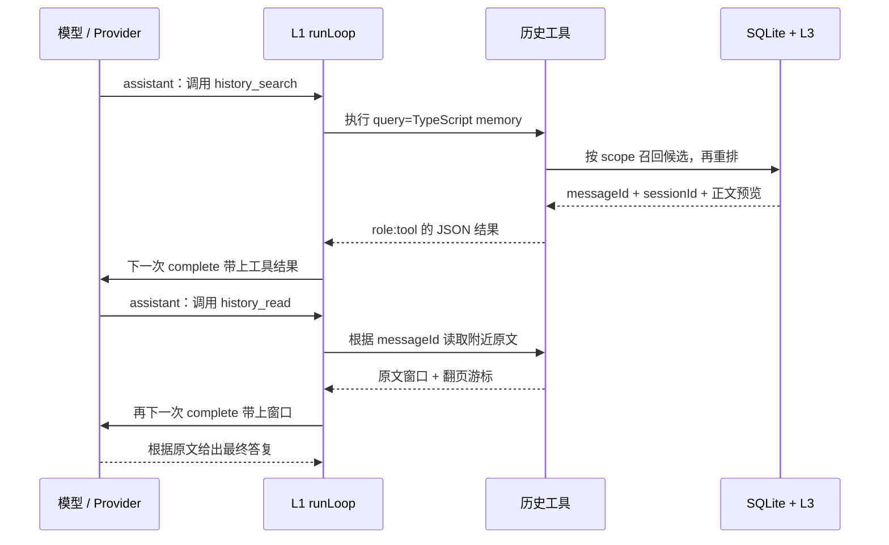

# L3 进阶历史检索：从搜索到原文，再回到模型

这次升级完成的是**历史检索链路**：FTS5 / trigram 找候选，L3 去重和重排，`history_read` 根据稳定消息 ID 读取原文。它与 L2 压缩配合：工作上下文可以变短，SQLite 原文仍然可以找回。

先运行下面的离线演示，再读代码。演示不加载 `.env`，不请求 Kimi，不写日常 profile：SQLite 使用内存库，模型由可预测的脚本 Provider 代替。

```bash
npm run learn:recall
```

入口是 [examples/recall-walkthrough.ts](../examples/recall-walkthrough.ts)。它实际执行 learner 的 `runLoop`、工具注册表、SQLite 检索和 L3，不会切换到 reference 来掩盖问题。

## 1. 先弄清：模型什么时候看到查询结果？

以查询 `TypeScript memory` 为例，旧消息写的是：

```text
user: 前提：这是本地部署，先保留日志。
assistant: memory implementation uses TypeScript，验证编号 B-42。
user: 下一步：检查日志，确认 B-42 后再发布。
```

两个词顺序不同，中间也有其他词。旧的 `LIKE '%TypeScript memory%'` 查不到；现在普通词索引可以同时匹配两个词。



**查库本身不会自动更新模型。** `runLoop` 把结果追加成 `role: 'tool'` 消息，下一次 `provider.complete(context, schemas)` 才将结果送给模型。演示会显示三次模型请求和最终消息序列：

```text
assistant → tool → assistant → tool → assistant
```

搜索预览足够时，模型可以直接答复；需要核对上下文、读长内容时，再调用 `history_read`。是否调用工具由模型决定，工具不会在每次聊天前自动全库检索。

`MEMORY.md` / `USER.md` 是另一条链路：会话初始的系统提示会注入它们的快照。历史搜索既不自动写长期记忆，也不把所有旧会话都塞入系统提示。整体分层见 [09 记忆系统指南](09-memory-system-guide.md)。

## 2. 各个文件负责什么？

| 文件 | 主要问题 | 建议断点 |
| --- | --- | --- |
| [learning/exercises.ts](../src/learning/exercises.ts) | 模型怎样循环？候选怎样重排？ | `runLoop` 的 `provider.complete`、`registry.execute`；`selectMemories` |
| [core/history-tools.ts](../src/core/history-tools.ts) | 工具怎样组合存储和 L3？怎样限制输出？ | 两个 `handler`、`withinToolBudget` |
| [memory/history-search.ts](../src/memory/history-search.ts) | 搜哪些词、走哪种索引、怎样隔离用户？ | `search`、`fullText`、`like` |
| [memory/store.ts](../src/memory/store.ts) | 原文怎样写入？怎样按 ID 读窗口？ | `commitTurn`、`readHistory` |
| [core/agent.ts](../src/core/agent.ts) | 本轮没入库的工具原文从哪里来？ | `buildRegistry` 的 `liveHistory` 回调 |

注意学习边界：**L3 是候选重排函数，FTS 是存储层的候选召回能力。** L3 不直接打开数据库，也不调用模型。候选在进入 L3 前，已经按当前用户的 `scope` 隔离。

## 3. SQLite 为什么要加两张 FTS 表？

`messages` 保留完整原始消息和协议字段，是事实来源。新增的两张表是倒排索引：

| 对象 | 用途 |
| --- | --- |
| `messages_fts` | FTS5 默认 `unicode61` 分词，适合普通英文等词项查询 |
| `messages_fts_trigram` | 按连续三个 Unicode 字符形成片段，补充中文及词内子串查询 |
| `history_search_meta` | 保存各索引的版本和 dirty 标记，决定什么时候回填 |
| `messages_search_insert/update/delete` | 三个触发器，在原文变化的同一事务里同步两个可用索引 |

两个 FTS 表都使用 external-content 模式，`content='messages'`，`content_rowid='id'`。可以把它们理解成“词项 → 原始消息 ID”的可重建目录；它们不会生成新的记忆事实。

**external-content 并不意味着自动同步。** 写入 `messages` 后，触发器插入索引项；更新正文时，先删除旧索引项，再插入新项；删除原文时删除旧项。事务回滚会同时撤销原文和索引变化。

旧库首次升级时，在事务中建索引、装触发器、执行 `rebuild` 回填已有消息并记录版本。正常重开不会全量重建。索引缺失，或运行时暂时缺少模块后恢复能力，会从原文重建。只把明确的模块/分词器缺失当降级，锁、损坏、未知表结构等错误会继续上报。

没有 FTS 能力时仍可用 LIKE 查原文；`searchCapabilities()` 返回实际启用的查询能力。`forceLike` / `disableTrigram` 是可复现降级路径的测试开关，可用的底层索引仍随写入同步。

FTS 虚拟表还会产生 SQLite 内部 shadow 表。统计业务表时应与普通表、显式 B-tree 索引、自动索引分开，完整清单见 [10 存储参考](10-memory-storage-reference.md)。

## 4. 一次查询怎样选择路径？

`HistorySearch.search` 先校验查询、scope 和条数，再按以下规则选择候选来源：

| 查询例子 | 主要路径 | 原因 |
| --- | --- | --- |
| `TypeScript memory` | `messages_fts`，先 AND，零命中才 OR | 找到同时包含两个词、顺序不限的消息 |
| `验证编号` | trigram，必要时 LIKE | 长中文片段可以组成三字符片段 |
| `编号` | LIKE | 两个字不够组成 trigram |
| `TypeScript 记忆` | 多词 LIKE 的 AND / 零命中 OR | 其中短中文不能走当前 trigram 路由 |
| `%_`、`archive-key`、路径 | 完整字面 LIKE | 保留符号和标识符本来的意义 |

普通英文 FTS 零命中时，还会尝试足够长的 trigram，最后保留 LIKE 回退。当前实现每次选择一个有效来源返回，不混合多个索引的原生 BM25 数值。

有两种不同的查询语法需要处理：

1. SQL 值通过 `?` 绑定，避免用户文本拼进 SQL。
2. `MATCH` 参数内部仍是一门查询语言，因此每个普通词还要用 FTS 双引号引用；`LIKE` 参数中的 `%`、`_`、反斜杠则单独转义。

例如查询 `%_` 只找含有这两个字面符号的内容，不等于匹配全库。工具不开放用户自由编写 MATCH 操作符的接口。

SQL 先用 JOIN 过滤 `sessions.scope`，再排序和 LIMIT。不能先取全库最相关的 20 条再到 JavaScript 里删掉其他用户，否则别人的记录会占掉你的候选名额。模型也不能给工具传另一个 scope：scope 来自 Agent 的闭包。

## 5. BM25 与 L3 分别怎么排？

SQLite 候选先按 `bm25(index)` 升序排列，同分按较新的消息 ID 稳定排列。**数值越小越相关，负数也按升序比较**，例如 `-0.8` 应排在 `-0.2` 前。

L3 接到候选后再执行教学用的可解释规则：

1. 查询去重、忽略大小写；命中的不同词项越多越靠前。一个词重复 20 次仍只贡献一个覆盖项。
2. 词项覆盖相同，优先保留 `source: 'live'` 的本轮工具原文。
3. 在同一个来源、同一覆盖层中，使用有限的 BM25 `rank` 升序。词索引和 trigram 的 rank 不直接比较。
4. 其他情况保持候选原来的稳定顺序，不修改调用方数组或分数。
5. 按 `(sessionId, messageId)` 去重，再限制条数。两条正文相同但 ID 不同，仍是不同经历；没有持久 ID 的 live 消息也不会被猜测合并。

字段 `score` 为兼容旧练习保留，不能把它当成所有来源都能比较的统一相关度。详细中文注释在 `selectMemories` 内，learner 和 reference 各自实现，运行时不会自动兜底到参考答案。

这些规则改进的是关键词检索。它们没有向量索引，也不能保证“意思相近但没有共同词”的内容一定被找回。

## 6. 搜索结果怎样定位到原文？

持久历史的命中包含以下字段，实际时间和 rank 由数据库产生：

```json
{
  "sessionId": "某个会话ID",
  "messageId": 2,
  "role": "assistant",
  "content": "memory implementation uses TypeScript，验证编号 B-42。",
  "score": 1,
  "source": "fts5",
  "rank": -0.0000017
}
```

`messageId` 是数据库 `messages.id`，不是当前上下文数组下标。别的会话也会写消息，所以某会话的 ID 可以是 `1, 3, 5`。L2 删除工作视图中的旧正文时，不会改变持久消息 ID。

模型接着可以调用：

```json
{
  "session_id": "某个会话ID",
  "around_message_id": 2,
  "limit": 3
}
```

返回 `messages` 按时间正序排列，尽量包含锚点前后的消息。靠近头尾时会向另一侧补齐。会话必须属于当前 scope，锚点还必须属于这个会话；另一个自己会话的锚点也不能混用。

库 API `readHistory` 返回完整 `Message`，保留 `reasoningContent` 等协议字段。模型工具预览只暴露角色、正文、可选 toolCallId 和工具名，不回放旧推理字段或旧工具调用参数。历史文字作为工具返回的数据，不具有系统指令权限。

## 7. 两种“续读”不要混淆

| 需求 | 参数/返回值 | 单位 |
| --- | --- | --- |
| 读取后面的消息 | `after_message_id: afterCursor` | 数据库消息 ID |
| 读取前面的消息 | `before_message_id: beforeCursor` | 数据库消息 ID |
| 读某条消息没展示完的正文 | `content_offset: nextContentOffset` | 同一正文的 UTF-16 索引 |

一次只能提供 `around_message_id`、`before_message_id`、`after_message_id` 中的一种。消息窗口默认 10 条，允许 1～50 条。

**消息分页**用 ID 游标，不用 OFFSET。看到 `hasAfter: true`，把 `afterCursor` 传入下一次请求；看到 `hasBefore: true`，用 `beforeCursor` 读前页。flags 表达当前非空页附近是否还有记录；空会话或越界空页没有游标，两个 flags 都是 false。

**正文续读**始终定位同一条消息：

```json
{
  "session_id": "某个会话ID",
  "around_message_id": 2,
  "limit": 1,
  "content_offset": 2000,
  "content_chars": 2000
}
```

`content_chars` 默认 2000，上限 6000；实际还会受整个工具 JSON 预算限制。返回的每条预览有 `originalContentChars`、`contentOffset`、`contentTruncated`；仍有后文时有 `nextContentOffset`。直接使用返回的 offset，不能用 UTF-8 字节数或自己猜下一个位置。

工具按真实 JSON 序列化长度调整正文：换行、引号、反斜杠也占预算。它保留 ID、分页字段和结果对象形状，不会把整个结果截成无法解析的半截 JSON。截断不会切开 emoji 的代理对；无法前进的预览会返回明确错误，可减少消息数或增加正文上限重试。若导入的单条历史元数据本身已经超预算，也会报错，不丢掉定位字段冒充成功。

当前轮尚未提交 SQLite 的普通工具结果来自 `liveHistory`。它没有持久 `messageId`，因此不能伪装成可供 `history_read` 定位的持久消息。Agent 排除 `history_search` 和 `history_read` 自己的结果，避免包装 JSON 递归进入候选。

## 8. 你可以怎样打断点学习？

第一轮只跟多词搜索的主流程：

1. 在 `runLoop` 的第一次 `provider.complete` 暂停，确认 context 只有 system/user。
2. 在 `HistorySearch.search` 看查询词，进入 `fullText` 看 AND、scope 和 LIMIT。
3. 在 `selectMemories` 看候选 `source` / `rank` / `messageId`，确认它没有查询数据库。
4. 回到 `runLoop` 的 `context.push(result)`，观察 `role:tool` 如何进入下一次请求。
5. 在 `readHistory` 看同会话锚点验证，以及锚点前后的 SQL。
6. 到第三次 `complete`，观察模型已经看到了前提、编号和后续要求。

在 VS Code/Cursor 的调试列表选择 **L3：历史检索教学（离线）**，直接按 F5。也可以用 Node Inspector 运行演示：

```bash
node --inspect-brk --import tsx examples/recall-walkthrough.ts
```

演示末尾还会打印 `验证编号`、`编号`、`%_` 的实际查询来源，以及两页消息 ID。这样可以对照路由表，而不用猜测自己走的是 FTS 还是回退。

接着独立验收阶段 2：

```bash
npm run check -- --stage 2 --mode learner --trace
npm run check -- --stage 2 --mode learner --trace --debug
```

阶段 2 共 26 项，新增的 6 项在 [stages/recall.ts](../src/stages/recall.ts)。`--debug` 关闭 case 异步超时，便于断点暂停；配合编辑器的 Node 调试入口使用。这些验收不需要你先完成 L4/L5。

```bash
node --import tsx --test tests/history-search.test.ts tests/l3-ranking.test.ts tests/history-tools.test.ts tests/recall-upgrade.test.ts
npm run verify
```

专项测试分别验证索引同步与回填、BM25/去重、长正文无损续读，以及模型真实收到 search/read 结果。完整 verify 还跑原有测试、reference 全阶段和构建；它不会替你完成 learner 的其他练习。

## 9. 与 Hermes 对齐到哪里了？

本项目沿用“原始会话落盘 + 派生全文索引 + 模型按需检索 + 读取命中周边原文”的设计方向，并保留了本轮工具轨迹召回。L2 摘要与长期记忆文件继续按既有实现工作。

它仍是教学实现：工具命名与 schema、数据库完整结构、会话谱系与浏览能力没有逐项复制 Hermes；FTS 仅索引 `messages.content`，不索引旧工具参数或推理字段。没有加入向量检索和自动知识图谱。上游固定版本的事实、表和索引清单以 [10 存储参考](10-memory-storage-reference.md) 为准，避免把相似设计说成完全相同。

建议你下一步先自己改演示数据和查询，观察路径与排序；再尝试把 `limit` 改成 1，沿着游标读下一页。这样能先掌握“召回 → 重排 → 读取 → 模型观察”的边界，再继续 L4。
