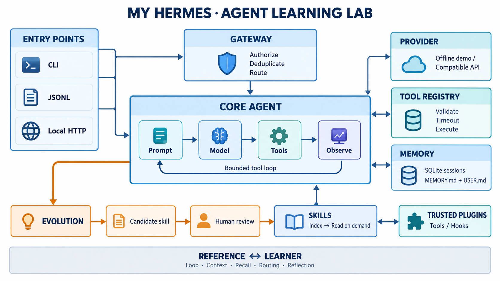

# 文档导航

项目使用 TypeScript、Node.js 24+ 与内置 node:sqlite。先读架构和参考映射，再按 0～5 六个阶段实现；每阶段都能离线验收和附加调试器。

| 文档 | 内容 |
| --- | --- |
| [01 架构](01-architecture.md) | 模块、依赖、消息契约、预算与故障边界 |
| [02 Hermes 参考](02-hermes-reference.md) | 固定上游提交、模块映射与教学取舍 |
| [03 学习路径](03-learning-path.md) | L0～L5、验收、TypeScript 断点与毕业检查 |
| [04 记忆与扩展](04-memory-and-extensions.md) | SQLite、Markdown、Skills、可信 Plugin、自进化 |
| [05 Gateway](05-gateway.md) | 事件协议、连接器、授权、重试和锁恢复 |
| [06 调试](06-debugging.md) | npm 命令、配置、Node Inspector、模型接入与排查 |
| [07 Kimi Provider](07-kimi-provider.md) | L0 模型连接练习、官方协议、离线验收与真实调用 |
| [08 上下文压缩](08-context-compression.md) | 异步 L2、摘要回退、冷却、溢出恢复、持久化与长期记忆整理 |
| [09 记忆系统图解](09-memory-system-guide.md) | 六张生成配图：Hermes 与本项目的文件记忆、检索工具、冻结快照、压缩和差距 |
| [10 记忆存储参考](10-memory-storage-reference.md) | Hermes 的 17 张普通表、2 张 FTS 虚拟表、30 个显式索引，以及本项目的数据库和迁移 |

图像由内置 imagegen 生成；它不绑定实现语言，保留作模块导航。精确依赖以 [架构文档](01-architecture.md) 中的 Mermaid 与源码为准；[生成提示词](images/architecture-prompt.txt) 随仓库保存。
